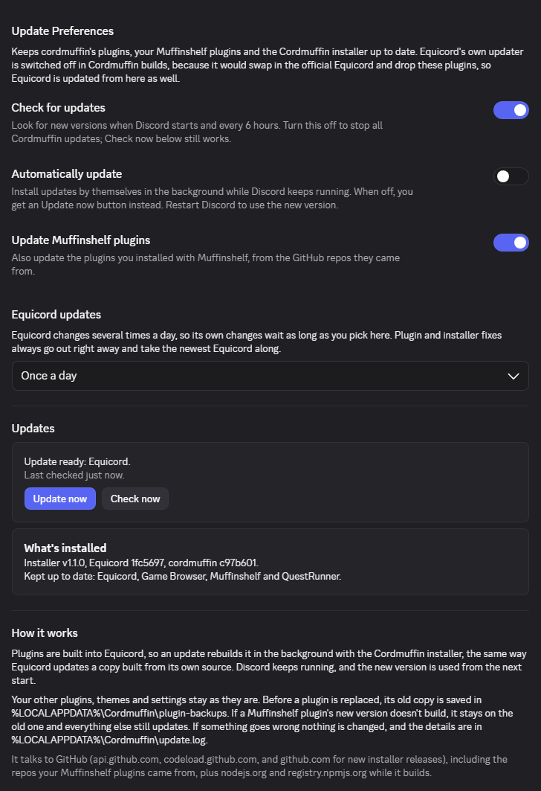
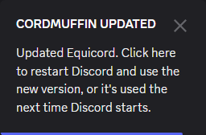
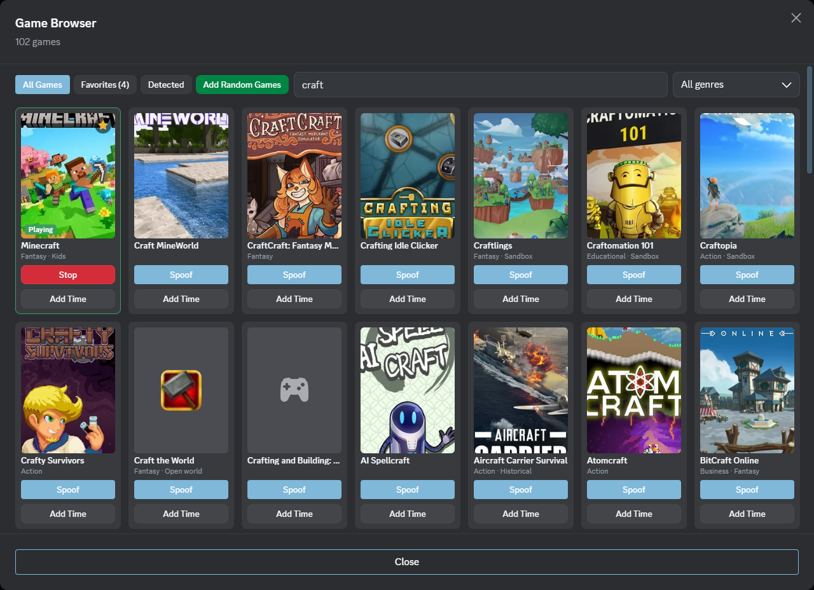
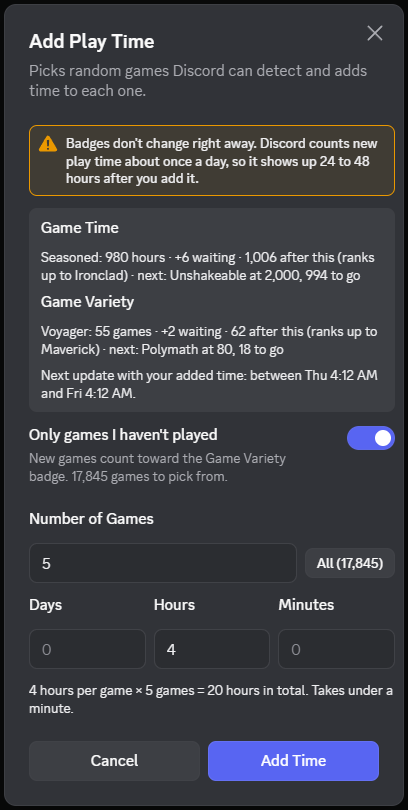
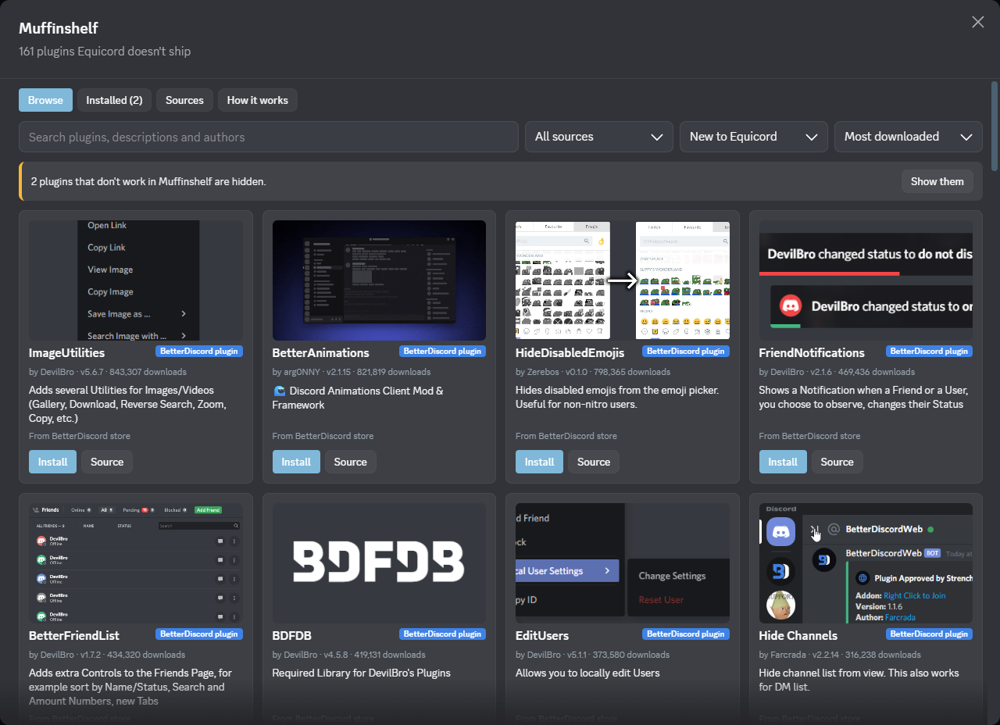
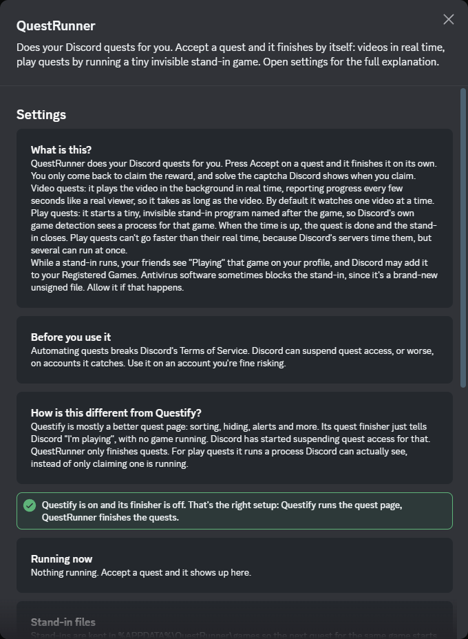
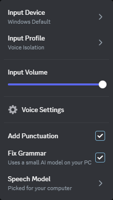
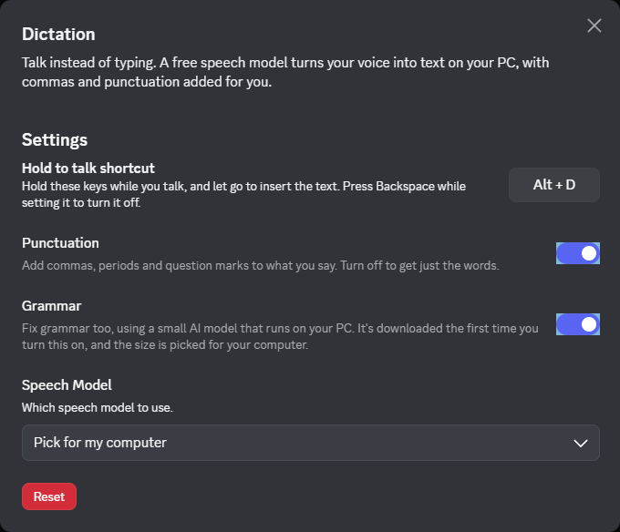

# cordmuffin

Discord stuff in one place: an easy Equicord installer, and plugins I made, including a store for plugins Equicord doesn't ship.

> [!WARNING]
> Client mods like Equicord break [Discord's Terms of Service](https://discord.com/terms). Nobody is known to have been banned just for using one, but if losing your account would be a disaster, don't use mods.

> [!IMPORTANT]
> This is not an official Equicord project. Equicord doesn't help with custom plugins or self-built installs, so please don't ask in their support channels. Open an issue here instead.

## Downloads

Grab **Cordmuffin Equicord Installer.zip** from the [Releases](../../releases) page. It installs Equicord with any plugins and themes you drop in.

Windows might say "Windows protected your PC" because the installer isn't signed. Click **More info**, then **Run anyway**.

## Equicord Installer

1. Unzip **Cordmuffin Equicord Installer.zip** anywhere.
2. Drop plugins into **Plugins Go Here**. A plugin is a folder with an `index.ts` or `index.tsx` inside, or a single `.ts`/`.tsx` file. Zip files work too.
3. Drop themes (`.css` files) into **Themes Go Here**.
4. Run **Cordmuffin Equicord Installer.exe** and click **Yes**.

It downloads Equicord, adds your plugins, builds it, puts it into Discord, and turns your themes on. The first run takes a few minutes. After that it's faster.

- **Automatic updates (optional, on by default).** The installer adds a small plugin, **CordmuffinUpdater**, that checks for newer versions of the cordmuffin plugins you use, plugins you got from Muffinshelf, and the installer. It builds them in the background while Discord stays open, and tells you when a restart will finish the job. Equicord itself is left as it is unless you turn on **Also update Equicord**. In **User Settings → Cordmuffin Updater** you can turn updates off, or get an "Update now" button instead of automatic installs (see [CordmuffinUpdater](#cordmuffinupdater-cordmuffinupdater)).
- **Add or update plugins:** change the folders and run it again. Plugins you installed with Muffinshelf are kept too. Running a newer download from a different folder keeps your plugins as well: the installer copies them from your last install into its **Plugins Go Here**.
- **Update by hand:** run it again and click **Yes**. It always grabs the newest Equicord, and swaps any cordmuffin plugins in **Plugins Go Here** for their newest version (the old copy is kept in `%LOCALAPPDATA%\Cordmuffin\plugin-backups`).
- **Remove it:** run it, click **No**, then confirm. Discord goes back to normal, and if you had another Discord mod before, it puts that back.

It finds Discord, Discord PTB and Discord Canary on its own, and doesn't need admin rights. If something goes wrong partway, Discord is left as it was, and if Equicord's files ever go missing, Discord simply starts without it.

### What it downloads and changes

**It downloads from these places:**
- **nodejs.org**: Node.js, which is needed to build Equicord. It's kept in `%LOCALAPPDATA%\Cordmuffin` and isn't installed on your PC.
- **api.github.com and codeload.github.com**: Equicord's source code, from [Equicord/Equicord](https://github.com/Equicord/Equicord), and the newest cordmuffin plugins from this repo.
- **github.com**: newer releases of the installer itself, when CordmuffinUpdater finds one.
- **registry.npmjs.org**: pnpm and the packages Equicord needs to build (Equicord's own `pnpm-lock.yaml` decides which).

**It changes these on your PC:**
- **Discord's `resources` folder**: it renames `app.asar` to `_app.asar` and adds a small `app.asar` folder that loads Equicord. This is the same way Equicord's own installer does it.
- **`%LOCALAPPDATA%\Cordmuffin`**: Node.js, Equicord's source, pnpm's download cache, the built files, a copy of the installer and of your plugins for background updates, `install.log` and `update.log`. Removing Equicord deletes this folder, except `plugin-backups` when updates saved old plugin copies there (delete it by hand if you don't need them).
- **`%APPDATA%\Equicord\themes`** and the `enabledThemes` list in `%APPDATA%\Equicord\settings\settings.json`, only if you added themes.

Nothing is uploaded anywhere.

## Custom Creations

### CordmuffinUpdater (`cordmuffinUpdater`)

Keeps the cordmuffin plugins, your Muffinshelf plugins and the installer up to date. It isn't in the plugin list: the installer adds it on its own, and its switches are on its own page, **User Settings → Cordmuffin Updater** (in the Equicord Settings section). Everything on it is optional; by default updates are on, install by themselves, and leave Equicord alone.



- When Discord starts, and every 6 hours, it asks GitHub whether there's a newer version of a cordmuffin plugin you use, of a plugin you installed with Muffinshelf (checked in the GitHub repo it came from), or of the installer.
- **Equicord updates are off by default**: updates rebuild with the Equicord you already have. Equicord's own updater can't be used, because it swaps in the official Equicord files, which don't have these plugins in them. Turn on **Also update Equicord** to update it from here: since Equicord changes several times a day, it's then updated at most once a day (or once a week, on every change, or only together with a plugin update), and the newest Equicord comes along whenever a plugin update happens.
- If there is, it runs the installer in the background to build the update while Discord keeps working. When it's done, a notification says what was updated; click it to restart Discord, or the update is used the next time Discord starts.
- Your other plugins, themes and settings are left alone. Before an update replaces a cordmuffin or Muffinshelf plugin, the old copy is saved in `%LOCALAPPDATA%\Cordmuffin\plugin-backups`. If a Muffinshelf plugin's new version doesn't build, it stays on the old one and the rest still updates. If an update fails, nothing changes, and the reason is in `%LOCALAPPDATA%\Cordmuffin\update.log`.
- **Settings** (User Settings → Cordmuffin Updater): turn off **Automatically update** to get an "Update now" button instead, turn off **Update Muffinshelf plugins** to leave Muffinshelf plugins alone, turn on **Also update Equicord** to keep Equicord up to date too, or turn off **Check for updates** to stop it completely. The page also has **Check now** and shows what's installed. Clicking an update notification opens it.

When an update is ready, you get a notification, or with **Automatically update** off, a bar with an **Update now** button:




**What it talks to:** **api.github.com**, **codeload.github.com** and **github.com** (including the repos your Muffinshelf plugins came from), plus **nodejs.org** and **registry.npmjs.org** while an update builds, the same places the installer uses.

### Game Browser (`gameTimeSpoof`)

Makes Discord think you're playing any game Discord can detect, so your Game Time and Game Variety profile badges keep counting.



- **Game Browser:** the controller button in Discord's top bar. It lists all of Discord's detectable games with cover art, search, genre filter, favorites and a Detected tab.
- **Click a cover** to open that game's real Discord page.
- **Spoof** switches to that game right away. The game you're spoofing always stays at the top.
- **Rotation:** cycles through your favorites or random games on a timer.
- **Add Time** and **Add Random Games:** add play time to one game, all your favorites, or any number of random games (or all of them). It can stick to games you've never played, so each one counts toward Game Variety.
- **Badge tracker:** Add Time shows your real Game Time and Game Variety rank straight from Discord, the time still waiting to be counted, the rank you'll reach after the run, how far the next rank is, and when your added time should be counted. That time comes from your own account: the plugin learns when Discord's daily update runs for you instead of guessing.
- **Works out the totals for you:** for example 2 games at 48 hours each shows "4 days (96 hours) in total", plus how long sending will take.
- **Runs in the background:** once you click Add Time the window closes and a small progress box in the bottom-right corner shows how far along it is, with a Stop button. Keep using Discord as normal; it sends at the same safe pace either way.
- **Real games count too.** The games you actually play also get reported, even with Equicord's NoTrack blocking Discord's own reports.



It starts turned off. Turn on **GameTimeSpoof** in Discord (User Settings, then Plugins), then pick a game with the controller button.

Badges don't update right away: Discord updates them once a day, so new play time shows up at its next daily update, within about 24 hours. There's no cap on games or time. Big runs just take longer, and if Discord asks it to slow down, it waits and carries on.

**Settings you need (and the one you don't):**
- **Leave NoTrack alone.** You don't need to turn off NoTrack or its "block analytics" option, whatever other guides say. GameTimeSpoof sends its own play-time reports, so they get through either way. Leaving it on is actually better: with it on, GameTimeSpoof also reports the real games you play, and nothing gets counted twice.
- **Turn on both "Use data" options** in Discord: User Settings → Data & Privacy → **Use data to improve Discord** and **Use data to personalize my Discord experience**. These are saved on Discord's side, on your account, so no plugin can skip them. If either one is off, Discord ignores the play time and your badges won't move.
- **Other tracking blockers do get in the way.** Unlike NoTrack, plugins such as DoNotTrack, NoTrack add-ons, ad blockers and Pi-hole can stop the play-time reports from reaching Discord. The Game Browser and the Add Time window show a warning when one of these plugins is on, and if a run gets blocked it stops right away and says so. Turn the blocker off (or let Discord's `/science` address through) while adding time.
- **Keep "Share your detected activities with others" on** (User Settings → Activity Privacy) if you want people to see the game you spoof. Play time still counts with it off, but nobody sees the game. DoNotTrack's **Stop Process Monitor** option turns this off by itself. The Game Browser warns you when it's off and has a **Turn On** button.

The Streaming badge can't be done this way. Discord only counts stream time when someone is really watching.

**What it talks to:**
- **discord.com** (Discord's own API): the list of detectable games, game pages, the play-time reports that badges are counted from, and your own badge progress and play history (read only).
- **cdn.discordapp.com**: game cover art and icons.

It talks to nothing else, and it never downloads or runs code from the internet: everything it does is in the plugin's own files.

**Heads up:** play-time reports are made-up analytics sent to Discord. That's against Discord's rules, so use it on an account you're fine risking.

**To install it:** copy the `custom-creations/gameTimeSpoof` folder into **Plugins Go Here**, then run the Equicord installer. If you build Equicord yourself, it goes in `src/userplugins` like any other user plugin.

### Muffinshelf (`muffinshelf`)

A plugin store inside Discord for plugins Equicord doesn't ship. Open it from the muffin button in Discord's top bar.



- **Equicord plugins** from community GitHub repos and venpm `plugins.json` indexes. Muffinshelf downloads the plugin's folder, rebuilds Equicord, turns the plugin on and asks you to restart Discord. If anything goes wrong, your plugins are put back the way they were and Discord keeps working.
- **BetterDiscord plugins** from the official BetterDiscord store. These run through Muffinshelf's own BetterDiscord layer, with no rebuild or restart. Plugins that need ZeresPluginLibrary, BDFDB or XenoLib get that library installed with them. They get the same Node.js modules BetterDiscord gives them. Their file access is kept to their own plugins folder, but that's not a safety wall: like on BetterDiscord, they run with full access to your Discord account.
- **Tested against the whole BetterDiscord store:** every store plugin was run in Muffinshelf, and 205 of the 207 tested work. The 2 that don't were made for an older Discord; they're hidden, with the reason shown. Some plugins (BetterAnimations, for example) are fixed up for today's Discord, and a few need one Discord restart after they're installed; Muffinshelf asks when that happens. A plugin that fails for you is hidden the same way, until a new version comes out.
- **shelter, Moonlight, Replugged and Evi** plugins are listed too, with links, so you can find them. They're built for other mods and can't run on Equicord.
- **Already in Equicord:** plugins Equicord already has (like InvisibleTyping, which is Equicord's SilentTyping) are marked and hidden by default.
- **Your own sources:** paste a GitHub repo link, a `plugins.json` link or a single `.plugin.js` link in the Sources tab.
- **How it works** tab explains all of this and shows every source and folder it uses.

It works with Equicord built by the Cordmuffin installer or from your own source folder. Equicord from the official installer can't be rebuilt, so there only BetterDiscord plugins work.

**What it talks to:**
- **api.betterdiscord.app** and **raw.githubusercontent.com**: the BetterDiscord store list and plugin files.
- **codeload.github.com** and **raw.githubusercontent.com**: GitHub repos and `plugins.json` indexes, including any you add yourself.
- **shindex.uwu.network**, **moonlight-mod.github.io** and **replugged.dev**: the shelter, Moonlight and Replugged plugin lists.
- Whatever an installed BetterDiscord plugin itself connects to. Those requests go out from Discord's main process.

**Heads up:** every plugin you install is someone else's code, and it runs inside your Discord with full access to your account. BetterDiscord plugins are downloaded and run as code at runtime. Only install plugins from people you trust, and use the Source button if you're unsure.

**Where files go:** Equicord plugins go in Equicord's `src/userplugins` folder, with a backup copy in `%APPDATA%\Equicord\muffinshelf\userplugins` so a Cordmuffin update can't lose them. BetterDiscord plugins and their settings go in `%APPDATA%\Equicord\muffinshelf\bd`.

**To install it:** copy the `custom-creations/muffinshelf` folder into **Plugins Go Here**, then run the Equicord installer. If you build Equicord yourself, it goes in `src/userplugins`.

### QuestRunner (`questRunner`)

Does your Discord quests for you. Press Accept on a quest and QuestRunner finishes it on its own. You only come back to claim the reward and solve the captcha Discord shows when you claim.



- **Video quests** play in the background in real time, reporting progress every few seconds like a real viewer. One video at a time by default.
- **Play quests** run a tiny, invisible stand-in program named after the game, so Discord's own game detection sees a process for it. Several can run at once. Each takes its real time, because Discord's servers time play quests.
- **Optional, off by default:** accept new quests automatically, finish activity and console-only quests by telling Discord directly (the Questify way, riskier), and activity achievement quests.
- The settings page shows what's running, what's waiting and why, and has a button to delete the stand-in files.

**How it compares to Questify:** Questify is mostly a better quest page (sorting, hiding, alerts). Its finisher just tells Discord a game is running when none is, and Discord has started suspending quest access for that. Keep Questify for its quest page if you like it, but turn its finisher off; QuestRunner offers a button for that. Quests you hid in Questify are skipped.

**Things to know:**
- While a stand-in runs, your friends see you "Playing" that game, and Discord may add it to your Registered Games.
- Game detection has to be on in Discord (User Settings, then Activity Privacy).
- Antivirus software sometimes blocks the stand-in, since it's a brand-new unsigned file. Allow it if that happens. Its source is in `questRunner/stub/stub.c`, and `stub/build.cmd` rebuilds it. Stand-ins close when Discord closes.
- Stand-ins only work on Windows.

**What it talks to:** only **discord.com** (Discord's own quest API). Activity achievement quests, if you turn them on, also talk to that activity's `discordsays.com` page.

**Where files go:** stand-ins are kept in `%APPDATA%\QuestRunner\games`, each under 300 KB.

**Heads up:** automating quests breaks Discord's Terms of Service. Discord can suspend quest access, or worse, on accounts it catches. Use it on an account you're fine risking.

**To install it:** copy the `custom-creations/questRunner` folder into **Plugins Go Here**, then run the Equicord installer. If you build Equicord yourself, it goes in `src/userplugins`.

### Dictation (`dictation`)

Talk instead of typing. Click the mic in the chat bar (or hold **Alt+D**), talk, and your words show up in the message box with commas, periods and capitals already in place.


 

- **Free and private.** Everything runs on your own computer. No account, no API key, and your voice never leaves your PC.
- **Picks the right setup for your computer.** On first use it downloads a speech engine and model that suit your PC: [Cohere Transcribe](https://huggingface.co/CohereLabs/cohere-transcribe-03-2026), the most accurate free English model on Hugging Face's Open ASR leaderboard, on stronger PCs, or the lighter [Parakeet TDT 0.6B v2](https://huggingface.co/nvidia/parakeet-tdt-0.6b-v2) on older ones. You can choose either one yourself.
- **Fix Grammar (optional):** turns on a small AI model that cleans up grammar as well. It uses Qwen3 4B (or Qwen2.5 1.5B on PCs with under 8 GB of memory), and runs on your graphics card when it has room, or on the processor otherwise. Each fix takes well under a second on a graphics card and about a second on a modern processor.
- **Live text while you talk:** your words show up above the message box as you speak, next to a small level meter that turns green when it hears you. The finished text goes into the message box when you stop. Turn the live text off in the plugin's settings if you don't want it.
- **Ignores silence:** if your mic is muted or you don't say anything, nothing gets added, so background noise never turns into made-up words.
- **Uses your Discord mic settings:** the same input device, input profile and input volume as your voice calls.
- **Right-click the mic** for Discord's own mic menu, plus Add Punctuation, Fix Grammar and Speech Model.
- **Hold-to-talk shortcut:** Alt+D by default. Change it in the plugin's settings. It works while Discord is focused.

Works on Windows, Linux and macOS.

**What it talks to:** only **github.com** and **huggingface.co**, once, to download the engines and models ([sherpa-onnx](https://github.com/k2-fsa/sherpa-onnx) and [llama.cpp](https://github.com/ggml-org/llama.cpp)). After that it works offline.

**Where files go:** `%APPDATA%\Equicord\dictation` (about 1.7 GB, plus about 2.5 GB if you turn on Fix Grammar). While in use, the speech engine takes around 3.5 GB of memory (plus about 3 GB with Fix Grammar on), and both unload themselves after 5 minutes without use.

**To install it:** copy the `custom-creations/dictation` folder into **Plugins Go Here**, then run the Equicord installer. If you build Equicord yourself, it goes in `src/userplugins`.

## Building it yourself

You need [Go](https://go.dev).

```bash
cd equicord-installer
go build -trimpath -ldflags "-s -w" -o "Cordmuffin Equicord Installer.exe" .
```

To make the release zip, run `equicord-installer/build-release.ps1 -Version 1.2.3` in PowerShell, with the version you'll tag the release as (`v1.2.3`); the background updater compares the two to find a newer installer. It only packs the installer and the empty **Plugins Go Here** and **Themes Go Here** folders, and stops if anything else would end up in the zip. Upload both files it makes, the zip and `Cordmuffin Equicord Installer.zip.sha256`; the background updater checks a new installer against the checksum before using it.

## License

GPL-3.0. See [LICENSE](LICENSE).
