# cordmuffin

Extra plugins for [Equicord](https://github.com/Equicord/Equicord), a mod for the Discord desktop app.

- **Muffinshelf:** an in-Discord store for plugins Equicord doesn't ship.
- **Installer (optional):** builds Equicord with the plugins and themes you pick.

> [!WARNING]
> Client mods like Equicord break [Discord's Terms of Service](https://discord.com/terms). Nobody is known to have been banned just for using one, but if losing your account would be a disaster, don't use mods.

> [!IMPORTANT]
> This is not an official Equicord project. Equicord doesn't help with custom plugins or self-built installs, so please don't ask in their support channels. [Open an issue here](#issues) instead.

**[Install](#equicord-installer)** · **[Plugins](#plugins-at-a-glance)** · **[Build it yourself](#building-it-yourself)** · **[Issues](#issues)** · **[License](#license)**

---

## Plugins at a glance

Each plugin is a folder in [`custom-creations`](custom-creations). You'll find the folder name under each plugin's heading.

⚠ = breaks Discord's rules beyond just using a mod (made-up reports, automation or spoofing). Only use these on an account you're fine risking.

**Store**

| Plugin | What it does |
|---|---|
| [Muffinshelf](#muffinshelf) | A plugin store inside Discord. Gets plugins Equicord doesn't ship, BetterDiscord ones included. |

**Everyday**

| Plugin | What it does |
|---|---|
| [Dictation](#dictation) | Talk instead of typing. Adds punctuation. Runs on your own computer. |
| [Autocorrect](#autocorrect) | Phone-style autocorrect: suggestions over the word you type, typos fixed when you press space, Backspace undoes. |
| [ShrinkUploads](#shrinkuploads) | Shrinks pictures, GIFs, videos and audio to fit your upload limit. Runs on your own computer. |
| [ProfileImages](#profileimages) | One-click buttons to see profile pictures, banners and server icons full size. |
| [PluginPresets](#pluginpresets) | Save which plugins are on as presets. Switch between them and share them. |
| [CustomRPCShare](#customrpcshare) | Share your Rich Presence setups: export and import CustomRPC presets as a code or a .json file. |
| [GreetStickerPicker+](#greetstickerpicker) | Pick any sticker for the "Wave to say hi!" button, in servers and DMs. |
| [HideClientBadges](#hideclientbadges) | Hides client mod badges. Profiles only show Discord's own. |
| [BadgeTierViewer](#badgetierviewer) | Click any tier in Your Badges to see it in the big preview, locked or as it looks once unlocked. |
| [TranslateItAll](#translateitall) | Translates messages with Google or Yandex Translate. No API key needed. |
| [OfficialCustomTypingIndicator](#officialcustomtypingindicator) ⚠ | Set Discord's own Nitro custom typing indicator from desktop. Phone users see it with no plugin. |
| [Discrub Loader](#discrub-loader) ⚠ | Opens Discrub inside Discord to export, search and clean up your messages. |
| [NoQuestsOnStartup](#noquestsonstartup) | Stops Discord opening the Quests page every time it starts. |

**Badges & quests**

| Plugin | What it does |
|---|---|
| [Game Browser](#game-browser-gametimespoof) (GameTimeSpoof) ⚠ | Makes Discord think you're playing any detectable game. Your Game Time and Game Variety badges keep counting. |
| [StreamTimeFarmer](#streamtimefarmer) ⚠ | Earns Streaming badge time by streaming to your own second account in a hidden window. **Add Streaming Time** adds up to 12 hours each hour. |
| [QuestRunner](#questrunner) ⚠ | Does your Discord quests for you. You just come back to claim the reward. |
| [PlatformSpoofer+](#platformspoofer) ⚠ | Choose whether people see you on phone, console, VR headset, web or desktop. |

**Fun**

| Plugin | What it does |
|---|---|
| [Ransom](#ransom) | Ransom from DOORS wanders around your Discord and holds it hostage for gold. Only you see it. |

The installer also adds [CordmuffinUpdater](#automatic-updates-cordmuffinupdater), which keeps everything up to date.

---

## Equicord Installer

The installer downloads Equicord, adds your plugins, builds it, puts it into Discord and turns your themes on.

1. Download **Cordmuffin Equicord Installer.zip** from [Releases](../../releases) and unzip it anywhere.
2. Get the plugins:
   - On this page, click **Code → Download ZIP** and unzip it.
   - Open `custom-creations` and copy the plugin folders you want into **Plugins Go Here**. Folder names are in the [plugin list](#plugins-at-a-glance).
   - Skip `cordmuffinUpdater`. The installer adds it on its own.
   - Plugins from other places work too: a folder with an `index.ts` or `index.tsx` inside, a single `.ts`/`.tsx` file, or a zip.
3. Drop themes (`.css` files) into **Themes Go Here**.
4. Run **Cordmuffin Equicord Installer.exe** and click **Yes**.

> [!NOTE]
> Windows might say "Windows protected your PC" because the installer isn't signed. Click **More info**, then **Run anyway**.

**Good to know**
- The first run takes a few minutes. Later runs are faster.
- It finds Discord, Discord PTB and Discord Canary on its own.
- It doesn't need admin rights.
- If something goes wrong partway, Discord is left as it was.
- If Equicord's files ever go missing, Discord just starts without it.

### Updating and removing

| To | Do this |
|---|---|
| **Get updates automatically** | Nothing. It's on by default through [CordmuffinUpdater](#automatic-updates-cordmuffinupdater). Change it in **User Settings → Cordmuffin Updater**. |
| **Add or update plugins** | Change the folders and run the installer again. Your Muffinshelf plugins are kept. A newer download in a different folder copies your plugins from the last install into its **Plugins Go Here**. |
| **Update by hand** | Run it again and click **Yes**. It always gets the newest Equicord. Cordmuffin plugins in **Plugins Go Here** are swapped for their newest version, and the old copy goes to `%LOCALAPPDATA%\Cordmuffin\plugin-backups`. |
| **Remove it** | Run it, click **No**, then confirm. Discord goes back to normal. If you had another Discord mod before, it puts that back. |

### Automatic updates (CordmuffinUpdater)

`cordmuffinUpdater` · Added by the installer · On by default

**Connects to:** api.github.com, codeload.github.com and github.com (including the repos your Muffinshelf plugins came from), release-assets.githubusercontent.com for new installer releases, plus nodejs.org and registry.npmjs.org while an update builds. Its files live in `%LOCALAPPDATA%\Cordmuffin`, listed under [What the installer downloads and changes](#what-the-installer-downloads-and-changes).

Keeps the cordmuffin plugins, your Muffinshelf plugins and the installer up to date. It isn't in the plugin list: its switches are on their own page, **User Settings → Cordmuffin Updater** (in the Equicord Settings section).

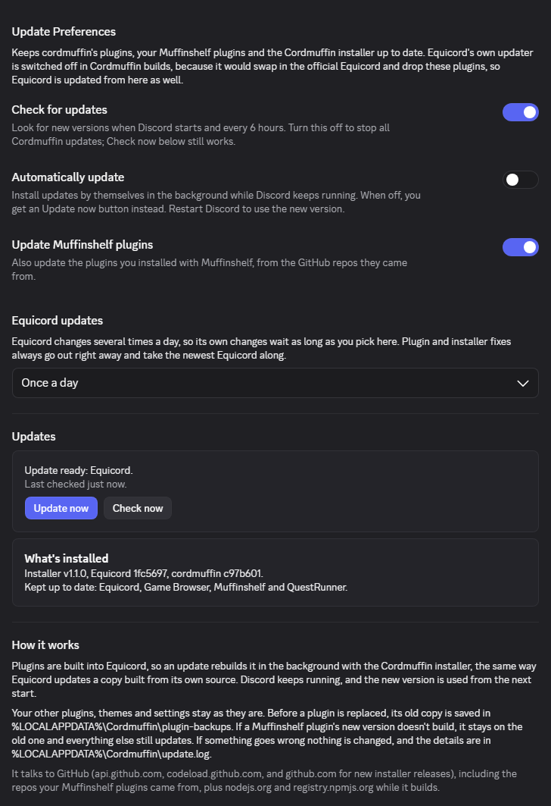

**What it does**
- Checks GitHub when Discord starts and every 6 hours.
- Looks for newer versions of the cordmuffin plugins you use and of the installer.
- Also checks each Muffinshelf plugin in the GitHub repo it came from.
- When there's an update, it runs the installer in the background. Discord keeps working while it builds.
- When it's done, a notification says what was updated.
- Click the notification to restart Discord (it asks first). Otherwise the update is used next time Discord starts.
- Updates install by themselves by default.
- Your other plugins, themes and settings are left alone.

<details>
<summary><b>Settings</b></summary>

All on **User Settings → Cordmuffin Updater**:
- **Automatically update** (on by default): turn it off to get an **Update now** button instead.
- **Muffinshelf updates**: turn it off to leave Muffinshelf plugins alone.
- **Also update Equicord** (off by default): turn it on to keep Equicord up to date too.
- **Check for updates**: turn it off to stop the updater completely.
- The page also has **Check now** and shows what's installed.
- Clicking a notification about a failed update, or one that needs no restart, opens this page.

**About Equicord updates**
- With **Also update Equicord** off, updates rebuild with the Equicord you already have.
- Equicord's own updater would replace your build with the official one, which doesn't include these plugins. Use **Also update Equicord** instead.
- Equicord changes several times a day, so you pick how often: at most once a day (default), once a week, on every change, or only with plugin updates.
- With it on, a plugin update also brings the newest Equicord.

</details>

<details>
<summary><b>What an update looks like</b></summary>

When an update is ready, you get a notification. With **Automatically update** off, you get a bar with an **Update now** button instead.

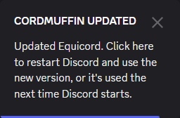


</details>

<details>
<summary><b>Things to know</b></summary>

- Before an update replaces a cordmuffin or Muffinshelf plugin, the old copy is saved in `%LOCALAPPDATA%\Cordmuffin\plugin-backups`.
- If a Muffinshelf plugin's new version doesn't build, that plugin stays on the old version. Everything else still updates.
- If an update fails, Discord keeps the version it has. It tries again an hour later.
- The reason for a failure is in `%LOCALAPPDATA%\Cordmuffin\update.log`.
- If the new files were only partly put in place, the notification says so and the next update rebuilds.

</details>

### What the installer downloads and changes

- **Downloads from:** nodejs.org, api.github.com, codeload.github.com, github.com, release-assets.githubusercontent.com, registry.npmjs.org
- **Changes:** Discord's `resources` folder, `%LOCALAPPDATA%\Cordmuffin`, Equicord's theme settings (only if you added themes)
- **Uploads:** nothing. Nothing is uploaded anywhere.

<details>
<summary><b>Full list of what it downloads and changes</b></summary>

**Downloads**
- **nodejs.org:** Node.js, which is needed to build Equicord. It's kept in `%LOCALAPPDATA%\Cordmuffin` and isn't installed on your PC.
- **api.github.com and codeload.github.com:** Equicord's source code from [Equicord/Equicord](https://github.com/Equicord/Equicord), and the newest cordmuffin plugins from this repo.
- **github.com and release-assets.githubusercontent.com:** newer installer releases, when CordmuffinUpdater finds one. GitHub forwards the download from github.com to release-assets.githubusercontent.com.
- **registry.npmjs.org:** pnpm and the packages Equicord needs to build. Equicord's own `pnpm-lock.yaml` decides which.

**Changes on your PC**
- **Discord's `resources` folder:** renames `app.asar` to `_app.asar` and adds a small `app.asar` folder that loads Equicord. Equicord's own installer does it the same way.
- **`%LOCALAPPDATA%\Cordmuffin`:** Node.js, Equicord's source, pnpm's download cache, the built files, `install.log` and `update.log`.
  - It also holds a copy of the installer and of your plugins, used for background updates.
  - Removing Equicord deletes this folder, except `plugin-backups` if updates saved old plugin copies there. Delete that by hand if you don't need it.
- **`%APPDATA%\Equicord\themes`** and the `enabledThemes` list in `%APPDATA%\Equicord\settings\settings.json`: only if you added themes.

</details>

---

## Plugins

**To install any plugin below:**

1. Copy its folder from `custom-creations` into **Plugins Go Here**.
2. Run the [installer](#equicord-installer).

If you build Equicord yourself, put the folder in `src/userplugins`, the same as any other user plugin.

---

### Muffinshelf

`muffinshelf` · On by default

**Connects to:** the BetterDiscord store, GitHub, and the shelter, Moonlight, Replugged and Evi plugin lists. Details below.

A plugin store inside Discord for plugins Equicord doesn't ship. Open it from the muffin button in Discord's top bar.

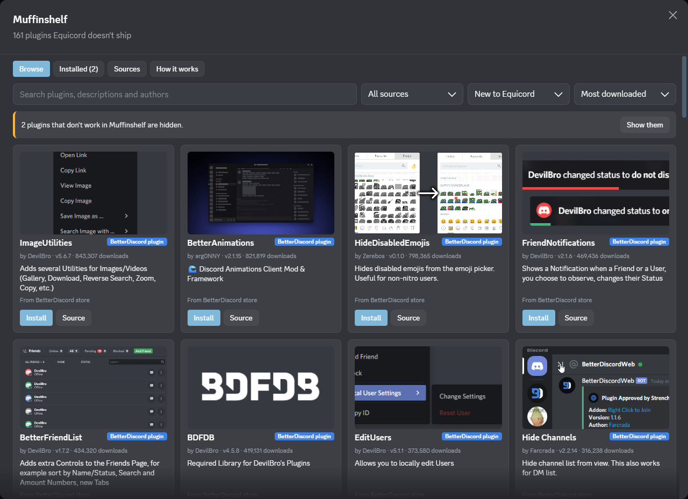

**What it does**
- Installs Equicord plugins from community GitHub repos and plugin lists (venpm `plugins.json`). Needs a rebuild and one restart.
- Installs BetterDiscord plugins from the official BetterDiscord store. No rebuild or restart needed.
- 205 of the 207 BetterDiscord store plugins tested so far work.
- Lists shelter, Moonlight, Replugged and Evi plugins with links, so you can find them. They're built for other mods and can't run on Equicord.
- Marks plugins Equicord already has and hides them by default. Example: InvisibleTyping is Equicord's SilentTyping.
- Takes your own sources in the **Sources** tab: a GitHub repo link, a `plugins.json` link or a single `.plugin.js` link.
- The **How it works** tab explains all of this and shows every source and folder it uses.
- Works with Equicord built by the Cordmuffin installer or from your own source folder.
- Equicord from the official installer can't be rebuilt, so only BetterDiscord plugins work there.

> [!CAUTION]
> Every plugin you install is someone else's code, and it runs inside your Discord with full access to your account. BetterDiscord plugins are downloaded and run as code at runtime. Only install plugins from people you trust, and use the **Source** button if you're unsure.

<details>
<summary><b>How installs work</b></summary>

**Equicord plugins**
- Muffinshelf downloads the plugin's folder, rebuilds Equicord, turns the plugin on and asks you to restart Discord.
- If anything goes wrong, your plugins are put back the way they were and Discord keeps working.

**BetterDiscord plugins**
- They run through Muffinshelf's own BetterDiscord layer, with no rebuild or restart.
- Some need a shared BetterDiscord library (ZeresPluginLibrary, BDFDB or XenoLib). It gets installed with them, only when their code really uses it.
- A library that's turned off is hidden from other plugins. Plugins that need it won't start until it's back on.
- They get the same Node.js modules BetterDiscord gives them.
- Their file access is kept to their own plugins folder. That's not a safety wall: like on BetterDiscord, they have full access to your Discord account.

**Which BetterDiscord plugins work**
- The store's plugins were run in Muffinshelf: 205 of the 207 tested work. The 2 that don't work were made for an older Discord.
- Those 2 are hidden, with the reason shown. Pick **Won't work here** in Browse to see them.
- Some plugins (BetterAnimations, for example) are fixed up for today's Discord.
- A few need one Discord restart after they're installed. Muffinshelf asks when that happens.
- A plugin that fails for you is hidden the same way, until a new version comes out.

</details>

<details>
<summary><b>Privacy, connections and files</b></summary>

**What it talks to:**
- api.betterdiscord.app, betterdiscord.app and raw.githubusercontent.com: the BetterDiscord store list, its thumbnails and plugin files.
- codeload.github.com and raw.githubusercontent.com: GitHub repos and `plugins.json` lists, including any you add yourself, and the Evi plugin list.
- shindex.uwu.network, moonlight-mod.github.io and replugged.dev: the shelter, Moonlight and Replugged plugin lists.
- Whatever an installed BetterDiscord plugin itself connects to. Those requests go out from Discord's main process.

**Where files go:**
- Equicord plugins go in Equicord's `src/userplugins` folder.
- A backup copy goes in `%APPDATA%\Equicord\muffinshelf\userplugins`, so a Cordmuffin update can't lose them.
- BetterDiscord plugins and their settings go in `%APPDATA%\Equicord\muffinshelf\bd`.

</details>

---

### Dictation

`dictation` · Off by default · Windows, Linux and macOS

**Connects to:** github.com and huggingface.co, once, to download the speech engine and models. Works offline after that.

Talk instead of typing. Your words show up in the message box with commas, periods and capitals already in place.


**What it does**
- Runs entirely on your computer. No account or API key needed.
- Your audio never leaves your PC.
- Picks the right speech engine and model for your computer on first use. You can choose one yourself.
- Shows your words live while you talk.
- A small level meter turns green when it hears you.
- Ignores silence, so background noise never turns into made-up words.
- Uses your Discord mic settings: the same input device, input profile and input volume as your voice calls.
- **Fix Grammar** (optional) turns on a small AI model that also cleans up grammar.

<details>
<summary><b>How to use it</b></summary>

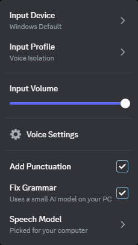 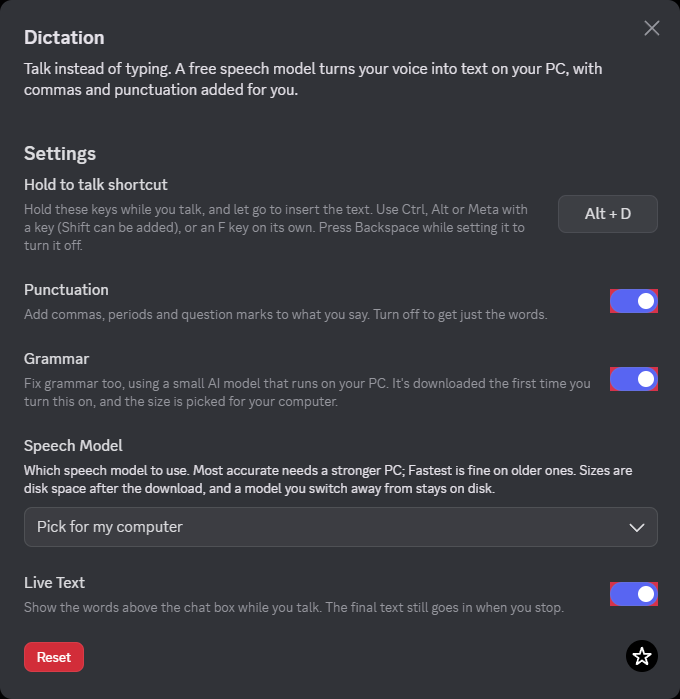

- Click the mic in the chat bar, or hold **Alt+D**, and talk.
- Your words show up above the message box as you speak, next to the level meter.
- When you stop, the finished text goes into the message box.
- If your mic is muted or you don't say anything, nothing gets added.
- Right-click the mic for Discord's own mic menu, plus **Add Punctuation**, **Fix Grammar** and **Speech Model**.

</details>

<details>
<summary><b>Settings</b></summary>

**Shortcut**
- Alt+D by default. Change it in the plugin's settings.
- It needs Ctrl, Alt or Meta plus a key (you can add Shift on top), or an F key on its own.
- Shift alone doesn't count, so typing capitals never sets it off.
- It works while Discord is focused.

**Live text**
- Turn it off if you don't want to see your words as you talk.

**Speech model**
- On first use it downloads a speech engine and model that suit your PC. You can choose either model yourself.
- Stronger PCs get [Cohere Transcribe](https://huggingface.co/CohereLabs/cohere-transcribe-03-2026), the most accurate free English model on Hugging Face's Open ASR leaderboard.
- Older PCs get the lighter [Parakeet TDT 0.6B v2](https://huggingface.co/nvidia/parakeet-tdt-0.6b-v2).

**Fix Grammar**
- Uses Qwen3 4B.
- Uses the smaller Qwen2.5 1.5B on PCs with under 8 GB of memory.
- Also uses Qwen2.5 1.5B on PCs with fewer than 8 processor threads and no NVIDIA or AMD graphics. AMD integrated graphics and Apple Silicon Macs count as having one.
- Runs on your graphics card when it has room, otherwise on the processor.
- Each fix takes well under a second on a graphics card, and about a second on a modern processor.

</details>

<details>
<summary><b>Privacy, connections and files</b></summary>

**What it talks to**
- Only github.com and huggingface.co, once, to download the engines and models ([sherpa-onnx](https://github.com/k2-fsa/sherpa-onnx) and [llama.cpp](https://github.com/ggml-org/llama.cpp)).
- After that it works offline.

**Where files go:** `%APPDATA%\Equicord\dictation`
- About 2.8 GB on disk with the most accurate speech model, or 0.7 GB with the fastest one.
- About 2.5 GB more if you turn on Fix Grammar.
- Downloads are smaller, but unpacking needs room for the download and the unpacked files at the same time.
- It checks for free space first.
- A speech model you switch away from stays on disk, so switching back is instant.

**Memory**
- While in use, the speech engine takes around 3.5 GB of memory.
- Fix Grammar adds about 3 GB.
- Both unload themselves after 5 minutes without use.

</details>

---

### Autocorrect

`autocorrect` · Off by default · English only

**Connects to:** cdn.jsdelivr.net, once, to download two English word lists. Works offline after that.

Autocorrect like on your phone. Suggestions show right above the word you're typing, typos get fixed when you press space, and Backspace puts your word back.

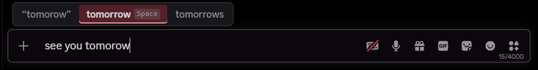

**What it does**
- Shows up to three suggestions above the word you're typing. The highlighted one is its best guess.
- Fixes typos when you press space or type `.` `,` `!` `?`. It only fixes when it's very sure, and you can make it bolder in settings.
- Backspace (or Ctrl+Z) right after a fix undoes it. Undo the same fix twice and it stops making it, and adds your word to your dictionary.
- Click a suggestion to use it. Right-click the word you typed to add it to your dictionary, or right-click a suggestion so it's never suggested again.
- Suggests the next word after you type a space.
- Leaves alone: code, links, mentions, emoji, slang and chat words like "lol", "ngl" and "tmrw", and the names of people in the server or chat when you type them with a capital.
- Learns which words you use from messages you send, so its guesses get better over time.
- Works when editing a message too.

<details>
<summary><b>How to use it</b></summary>

- Just type. When it's sure a word is a typo, the fix above it shows **Space**, and space puts it in.
- When it's not sure, it only highlights its best guess and space leaves your word alone. **Ctrl+Space** (**Ctrl+Enter** on Mac) uses the highlighted guess anyway.
- **Alt+1**, **Alt+2** and **Alt+3** pick the first, second or third suggestion (**Ctrl+1** to **Ctrl+3** on Mac).
- **Esc** hides the suggestions for the word you're on.
- Right-click the message box and open **Autocorrect** to switch between **Fix typos**, **Suggestions only** and **Off**.

</details>

<details>
<summary><b>Settings</b></summary>

- **What happens while you type:** fix typos when you press space (default), only show suggestions, or off.
- **How sure it has to be:** "Very sure" (default) fixes fewer words, "Fairly sure" fixes more.
- **Suggest the next word** after a space. On by default.
- **Capitalize the first word of a sentence** when fixing it. Off by default.
- **Tab picks the highlighted suggestion.** Off by default, so Tab keeps working as usual.
- **Also work when editing a message.** On by default.
- **Where the suggestions sit:** above the word you're typing (default), or on the right, left or middle of the message box.
- **Show which key picks the highlighted suggestion.** On by default.
- **Learn from messages you send.** On by default. It stays on your PC.
- **Share your dictionary with Discord's spellcheck,** so added words lose their red underline too. On by default.

**Your dictionary**
- Add words by hand, search them, and remove them.
- **Import** a plain text list (one word per line, up to 5 MB and 20,000 words) and **Export** yours.
- **Forget learned typing** clears what it learned from your messages. Your dictionary stays.
- **Never suggested** lists the words you blocked, so you can bring them back.

</details>

<details>
<summary><b>Things to know</b></summary>

- It knows English words only. If you mostly chat in another language, pick **Only show suggestions** or leave it off.
- Until the word lists finish downloading (or if the download fails), it uses a built-in list of 20,000 common words. Settings show **Try again** if a download failed.
- Discord in a web browser can't download the lists, so it always uses the built-in list there.

</details>

<details>
<summary><b>Privacy, connections and files</b></summary>

**What it talks to**
- Only cdn.jsdelivr.net, once, for SymSpell's English word list and word-pair list (about 6.5 MB). They are pinned to one version and checked against a fingerprint built into the plugin.
- Nothing you type or send is uploaded anywhere.

**Where files go:** `%APPDATA%\Equicord\autocorrect` (the two word lists). Delete the folder to remove them.

**Stays inside Discord:** your dictionary, what it learned from your messages, and your blocked words, in Equicord's own storage.

**Discord's spellcheck:** with **Share your dictionary with Discord's spellcheck** on, your dictionary words are also added to Discord's own spellcheck dictionary. They stay there if you turn the plugin off, so remove words in the plugin first if you want them gone from Discord too.

</details>

> [!NOTE]
> The word lists come from [SymSpell](https://github.com/wolfgarbe/SymSpell) by Wolf Garbe (MIT License), built from Google Books Ngram counts and SCOWL. The full notice is in [`custom-creations/autocorrect/LICENSE-SymSpell.txt`](custom-creations/autocorrect/LICENSE-SymSpell.txt).

---

### ShrinkUploads

`shrinkUploads` · Off by default

**Connects to:** github.com, once, for the video tool (skipped if you already have a full ffmpeg). Your files never leave your computer until Discord uploads them.

Shrinks pictures, GIFs, videos and audio so they fit your Discord upload limit. All the work happens on your own computer.

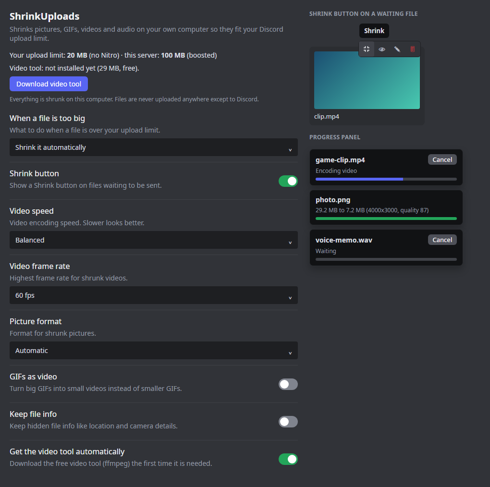

<table>
<tr>
<td align="center">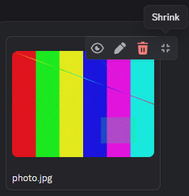<br><sub>The Shrink button on a waiting file</sub></td>
<td align="center">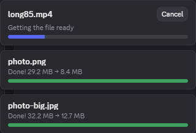<br><sub>Progress panel: pictures don't wait for videos</sub></td>
</tr>
<tr>
<td align="center">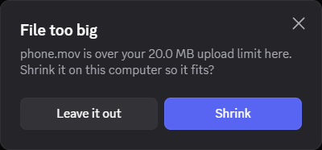<br><sub>"Ask me first" mode</sub></td>
<td align="center">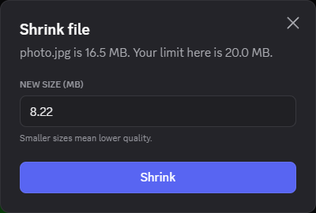<br><sub>Pick your own size</sub></td>
</tr>
</table>

**What it does**
- Send a file over your limit and it's shrunk to just under the limit, then added back to the message.
- The **Shrink** button on any waiting file lets you pick your own size.
- Knows your real limit for no Nitro, Nitro Basic, Nitro and every server boost level.
- Handles huge files, even multi-GB 4K camera clips.
- Removes hidden file info, like your location and camera details, by default.

<details>
<summary><b>How to use it</b></summary>

- Send the file as usual. Files in the same drop that already fit go through like normal.
- Don't want it automatic? Set it to ask first or do nothing (see Settings).
- Use the **Shrink** button to pick a smaller size yourself, for example to save someone's data.
- A shrunk file keeps its spoiler, description and name.
- A small panel shows each file's progress, with **Cancel**.
- Cancelling a Shrink button job puts the original file back.
- If a too-big file is cancelled or can't be shrunk, it's left out of the message. The panel says why until you close it.
- To retry a file that was left out, send it again.
- If the message fills up (10 files) while a file is shrinking, the panel holds the shrunk file. Remove a file, then press **Add**.
- Shrunk and restored files go back to the original file's spot in the list.
- It checks there's enough free disk space before starting.

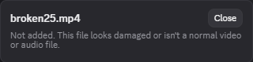

</details>

<details>
<summary><b>Settings</b></summary>

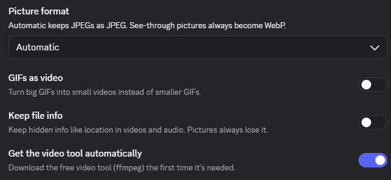

- **If a file is too big**: shrink it automatically (default), ask first, or do nothing.
- **Shrink button** (on): show the Shrink button on files waiting to be sent.
- **Video speed**: Fast, Balanced (default) or Best quality (slow). Slower looks better.
- **Video frame rate**: 60 fps (smoother, default) or 30 fps (sharper).
- **Picture format**: Automatic (default), WebP (smallest) or JPEG.
  - Automatic keeps JPEGs as JPEG. See-through pictures always become WebP.
- **GIFs as video** (off): turn big GIFs into small videos instead of smaller GIFs.
- **Keep file info** (off): keep hidden info, like location, in videos and audio. Pictures and GIFs always lose it.
- **Auto-get video tool** (on): download ffmpeg the first time it's needed.
- The settings page also shows your real limit, for DMs and for the server you're in.
- That limit comes from Discord's own code, the same check Discord runs on upload. So it stays right when Discord changes the numbers.

</details>

<details>
<summary><b>What it does to each kind of file</b></summary>

- **Videos** (MP4, MOV, MKV, WebM, AVI and more): re-encoded in two careful passes aimed at the exact size. Long videos take a while.
- After encoding, the video is checked and fixed if it missed the size.
- It picks the size and frame rate that look best for the space, for example 720p at 30 fps rather than a blurry 540p at 60.
- If a video is too long to look OK at all, it says so instead of making mush.
- Phone HDR videos get normal colors, so they don't look washed out.
- Old camcorder and TV recordings get cleaned up so motion doesn't look doubled.
- **Pictures**: the best quality that fits, made smaller only if it has to be.
- Screenshots stay pin-sharp when they can. See-through pictures stay see-through.
- **GIFs**: rebuilt smaller, or turned into a small video if you turn that on.
- **Audio**: turned into small Opus audio.
- Pictures and GIFs always lose their hidden file info. Videos and audio keep it if you turn on **Keep file info**.

</details>

<details>
<summary><b>Things to know</b></summary>

Videos, GIFs and audio need ffmpeg, a free video tool. Pictures don't need it.

- Already have a full ffmpeg build (with libx264 and libopus) from scoop, winget, Chocolatey or your PATH? It's found and used, and nothing is downloaded.
- An ffmpeg that fails a quick test encode is skipped.
- To use a specific one, click **Use my own ffmpeg** in the settings and pick it.
- That file must be named exactly ffmpeg (ffmpeg.exe on Windows) and pass the same test. **Back to automatic** undoes it.
- No ffmpeg? The plugin downloads it once (about 30 MB) the first time it's needed, or when you click **Download video tool** in the settings.
- The download comes from a fixed release of ffmpeg-static on GitHub.
- Before use, it's checked against a fingerprint built into the plugin.
- If the download fails, check your internet and click **Download video tool** in the settings to try again.
- It works through your computer's proxy settings, like Discord does.
- Moving pictures (animated WebP, PNG or AVIF) aren't shrunk yet. They go to Discord as they are and get no Shrink button.
- .ts files only count as video when they really are one (MPEG-TS). Code files named .ts are left alone.

</details>

---

### ProfileImages

`profileImages` · Off by default

**Connects to:** cdn.discordapp.com only, for the images themselves, through Discord's own viewer.

See anyone's profile picture and banner full size with one click. Equicord's ViewIcons hides this in right-click menus, while ProfileImages puts the buttons right on the profile.


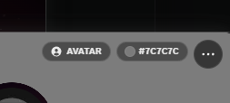

**What it does**
- Full profile: two square buttons next to Message, one for the avatar and one for the banner.
- These look like Discord's own buttons, and themes style them the same way.
- Popout and DM side panel: small **Avatar** and **Banner** buttons in the top corner of the banner.
- Those move aside on their own, so they never cover Discord's buttons there.
- Servers get **Icon** and **Banner** buttons on their banner.
- Images open full size in Discord's own viewer. Animated avatars and banners stay animated.
- If someone has a server avatar or banner, that one opens first.
- If someone has no banner, the banner button shows their banner colour instead.
- Works fine next to ViewIcons, so you can keep both on.

<details>
<summary><b>How to use it</b></summary>

- Use the viewer's arrows to switch between the server and main avatar or banner.
- Prefer the main one first? Pick main-first in settings.
- Banner-colour button: hover to see the colour code, click to copy it, or hide it in settings.
- Right-click any profile button to:
  - pick the server or main version
  - view the avatar decoration
  - copy the link
  - open it in your browser
  - copy the banner colour

  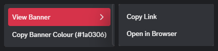

- Server buttons: if a server has a banner, its **Icon** and **Banner** buttons sit in the bottom-right corner at the top of the channel list.
- They open the server icon or banner full size.
- Right-click them for **Copy Link** and **Open in Browser**.

  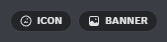

</details>

<details>
<summary><b>Settings</b></summary>

- Turn each button on or off, including the banner-colour button.
- Pick where they show: full profile, popout, DM side panel, server banner.
- Pick which banner corner they sit in.
- Pick whether the server or main avatar and banner open first.
- Image format: webp, png or jpg, and webp or gif for animated ones.
- Size: 512 to 4096.

</details>

---

### PluginPresets

`pluginPresets` · Off by default

**Connects to:** nothing. Presets are saved in Equicord's own storage inside Discord, not in settings.json.

Save which plugins are on, plus their settings, as a named preset. Then switch between presets in one go.

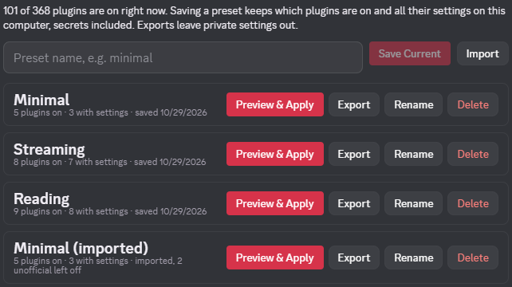

**What it does**
- Keep a "Minimal" preset with 5 plugins and an "Everything" one with 100, and flip between them without clicking through 300 toggles.
- **Save Current** saves the plugins that are on now and every setting they have.
- **Preview & Apply** shows what a preset turns on, turns off and changes before anything happens.
- **Share** presets as a code or a .json file, with your private settings left out.
- **Import** someone else's preset safely: it only turns on official Equicord and Vencord plugins you have.
- Everything is on the plugin's settings page (**Plugins → PluginPresets**).

<details>
<summary><b>How to use it</b></summary>

- Saving with a name that's already taken replaces that preset.
- Presets you save yourself keep everything, secrets included, so treat them like your settings. Only exports leave private settings out.
- Applying turns on exactly the plugins in the preset and turns the rest off.
- Required, core and API plugins aren't touched. Plugins that others depend on stay on.
- If a saved value would be rejected by the plugin's own settings page, it's skipped and shown in Preview.

  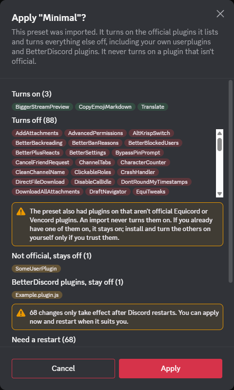

- Most plugins switch right away.
- Plugins that change Discord's code, and some settings, only take effect after a restart. The preview lists them.
- After applying, pick **Restart Now** or restart later.
- A plugin that fails to start is left off and listed.
- **Rename** and **Delete** only change the saved preset, never your plugins.

</details>

<details>
<summary><b>Sharing and importing</b></summary>

- **Export** gives you a code to copy (it starts with `PP1.`) or a .json file.
- Before you copy it, it lists every setting it left out and why.

  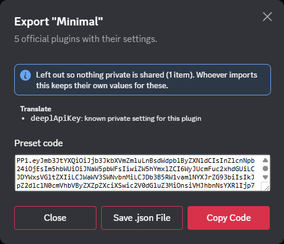

- Left out: API keys, tokens, passwords, webhooks, and login and cookie values.
- Also left out: user, channel and server IDs and lists of them, file paths, web addresses, and free text that could be personal.
- To decide, it checks the setting's name and what the value looks like (token and key shapes, Discord IDs, emails, paths, addresses).
- It also uses a list of plugins known to keep private settings, such as Translate's DeepL key or CustomRPC.
- If a value can't be shown to be harmless, it's left out.
- Shared: switches, choices from a plugin's own list, plain numbers and default values.
- Plugins that aren't official Equicord or Vencord plugins (cordmuffin plugins, other userplugins, Muffinshelf BetterDiscord plugins) are shared by name only, without their settings.
- Exports carry nothing about your account.
- **Import** takes a code or a .json file, checks it, and saves it as a preset you can look over before applying.

  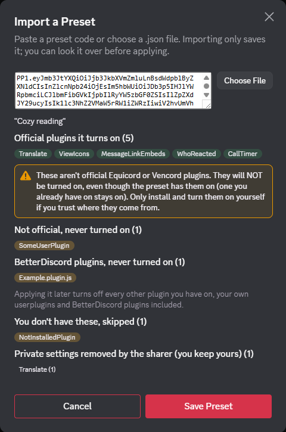

- An imported preset only turns on official Equicord and Vencord plugins you have.
- Applying it turns everything else off, your own userplugins and BetterDiscord plugins included.
- Other plugins in it are listed with a warning and are never turned on, even if the preset has them on.
- If you already have one of them on, it stays on.
- Plugins you don't have are listed as missing.
- Imported settings go through the same checks, so a preset can't point your plugins at someone else's server.
- Settings the sharer's export left out keep your own values.

</details>

---

### CustomRPCShare

`customRPCShare` · Off by default

**Connects to:** nothing. It reads and adds to the presets CustomRPC already saves inside Discord.

Equicord's CustomRPC can save Rich Presence presets, but you couldn't hand one to a friend. This plugin adds **Export Presets** and **Import Presets** buttons so you can.

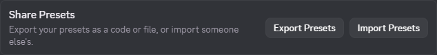

**What it does**
- Adds **Export Presets** and **Import Presets** at the top of CustomRPC's settings and on this plugin's own page.
- Doesn't change any of Equicord's own files.
- **Export Presets** turns one preset, or all of them, into a code to copy (it starts with `RPC1.`) or a .json file.
- **Import Presets** takes a code or a .json file, checks every field, and adds the presets to CustomRPC's list.
- Nothing is loaded until you pick an imported preset in CustomRPC.
- CustomRPC itself doesn't have to be on to share presets.

<details>
<summary><b>What gets shared</b></summary>

- Only the fields you typed into the preset: application ID and name, the two lines, links, images, buttons, party size and timestamps.
- CustomRPC's on/off switches are never in an export.
- A field that contains your own user ID, or looks like a Discord login token, is left out.
- The export window lists what it left out and why. Privacy removals are listed apart from fields CustomRPC wouldn't accept.

  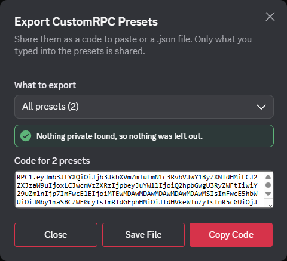

</details>

<details>
<summary><b>What's checked on import</b></summary>

- Imports go through the same limits CustomRPC's own boxes use:
  - application ID shape
  - 128-character lines
  - 31-character button text
  - web links that start with http or https
  - Twitch or YouTube stream links
  - CustomRPC's own activity and timestamp choices
- Anything that doesn't pass, or isn't a CustomRPC field, is skipped and listed.
- A preset with no application name is skipped, since CustomRPC shows nothing without one.
- Fields a shared preset doesn't have are saved empty, so loading it doesn't mix in your old buttons or images.
- It also reads a raw CustomRPC preset or preset list (the `{ "name", "config" }` shape), so older shared setups work too.

</details>

<details>
<summary><b>Name clashes</b></summary>

- If a preset has the same name as one you already have, you choose what happens.
- **Keep Both** saves it as "Name (2)".
- **Replace Same Names** overwrites yours. Nothing of yours is overwritten unless you click that.

  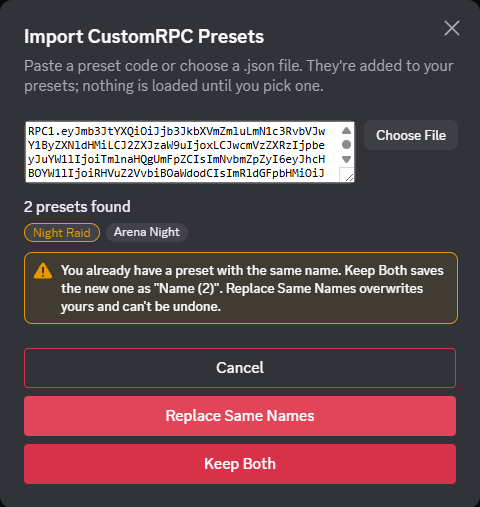

</details>

---

### GreetStickerPicker+

`greetStickerPickerPlus` · Off by default

**Connects to:** Discord itself, plus cdn.discordapp.com and media.discordapp.net for the sticker thumbnails.

A bigger version of Vencord's GreetStickerPicker. It upgrades the **Wave to say hi!** button you get on welcome messages and in new DMs.

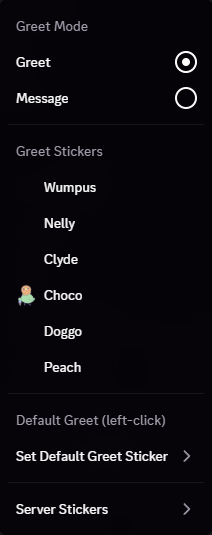

**What it does**

- Keeps everything the original does: Greet or Normal Message mode, and picking which welcome sticker to wave with.
- Works in DMs too. The original only reacts on a server's welcome message.
- Also works on the wave buttons in new DMs and on the in-channel greet.
- Lets you greet with any sticker, picked from Discord's real sticker picker.
- Adds a searchable **Server Stickers** menu that lists every sticker you're allowed to send, grouped by server.
- Shows thumbnails next to the stickers in the menus.
- Gives **Unholy Multi-Greet** (up to 3 welcome stickers in one message) a normal switch in settings.

<details>
<summary><b>How to use</b></summary>

- **Left-click** the wave button to send your default sticker.
- With no default set, left-click does Discord's normal random wave.
- **Right-click** opens Discord's real sticker picker in a small window, with search, the server list on the side, thumbnails and favorites.
- Pick any sticker in that window and it's sent as your greet.
- **Shift+right-click** opens the list menu instead.
- To choose a default, turn on **Set as default** in the picker window, or use the list menu.

</details>

<details>
<summary><b>Settings</b></summary>

- Greet mode.
- Whether right-click opens the picker or the list menu.
- The Server Stickers menu, on or off.
- **only this server's stickers**. In DMs this has no effect.
- Unholy Multi-Greet.

</details>

<details>
<summary><b>Things to know</b></summary>

- Thumbnails show for every sticker, including Discord's Lottie welcome stickers, which Discord's own sticker renderer draws.
- Greet mode only applies to welcome stickers: the list, Multi-Greet and a welcome default sticker.
- Any other sticker always goes out as a reply, because Discord's greet only takes welcome stickers.
- The sticker lists only show stickers Discord would let you send in that channel.
- If your default sticker can't be sent where you click, you get a message instead and nothing is sent.
- In the original, Unholy Multi-Greet is a hidden setting you can't turn on from the settings page.
- If you used the original, GreetStickerPicker+ takes over its settings and turns it off, so the two don't fight over the same button.
- If you turn the original back on, GreetStickerPicker+ stands aside and says so.

</details>

---

### HideClientBadges

`hideClientBadges` · Off by default

**Connects to:** nothing new. With **Block Donor Lists** on, badges.vencord.dev and badge.equicord.org are no longer contacted.

Takes client mod badges off profiles. Only Discord's own badges stay: Nitro, server boost, HypeSquad, Active Developer, quests, game badges and the rest.

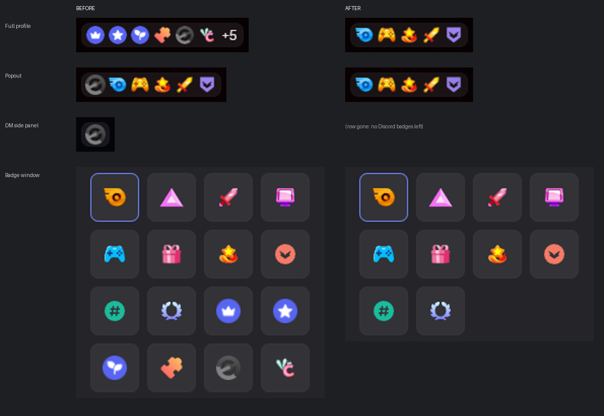

**What it does**
- Hides Vencord and Equicord donor, custom, translator and contributor badges.
- Hides badges from other mods that the GlobalBadges plugin shows (Aliucord, BetterDiscord, Replugged, Nekocord, ReviewDB and more).
- Hides badges that plugins add, like FriendshipRanks.
- Works in the profile popout, the full profile, the DM side panel, and the badge window you get when you click a badge.
- Removes badges from the list itself, so there are no gaps and the "+3" count stays right.
- Doesn't touch Discord's own badges.
- Only changes what you see. Other people still see their badges, and yours, the same as before.

<details>
<summary><b>Settings</b></summary>

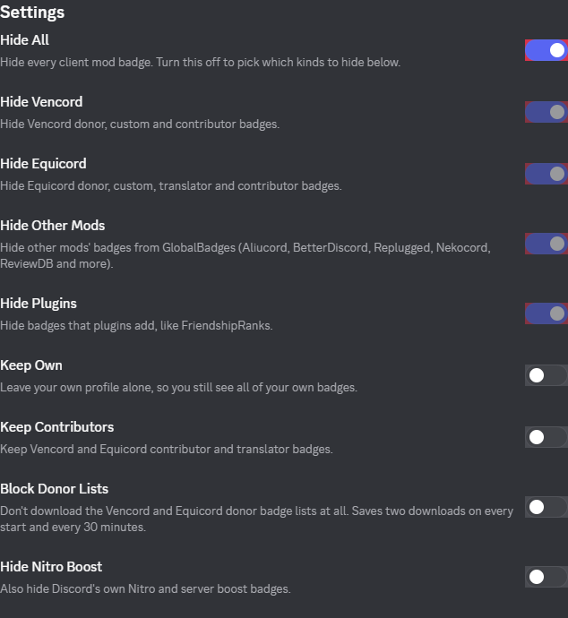

- **Hide All** is on by default. Turn it off to pick which kinds to hide: Vencord, Equicord, other mods or plugins.
- **Keep Own** leaves your own profile alone, so you still see all of your own badges.
- **Keep Contributors** keeps Vencord and Equicord contributor and translator badges.
- **Block Donor Lists** stops Equicord from downloading the Vencord and Equicord donor badge lists at all. Normally it grabs them on every start and every 30 minutes.
- **Hide Nitro Boost** also hides Discord's own Nitro and server boost badges, in profiles and in other people's badge window. Off by default.

</details>

<details>
<summary><b>Things to know</b></summary>

- Client mods hand out their own profile badges to donors and contributors. Donors can also pick custom ones that everyone with the mod sees.
- In a big server, half the profiles end up covered in them. That's what this plugin cleans up.
- Badges next to names in chat from the ShowBadgesInChat plugin aren't covered. Use that plugin's own toggles, or Block Donor Lists for donor badges.
- Block Donor Lists also empties donor badges in chat if you use ShowBadgesInChat.
- While Block Donor Lists is on, Equicord's settings page can't tell that you're a donor, so the Donate button comes back.
- While Block Donor Lists is on, BadgeAPI's "Refetch Badges" toolbox action still says it worked, even though nothing was downloaded.
- With Hide Nitro Boost on, your own badge window keeps your Nitro and boost badges, because that's where you customize your badges.

</details>

---

### BadgeTierViewer

`badgeTierViewer` · Off by default

**Connects to:** nothing new.

See every tier of a tiered badge (Streaming, Game Time and the rest) in the big preview at the top of the badge window, not just the tier you're on.

| 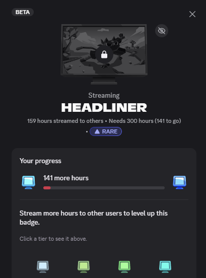<br>A locked tier, shown locked | 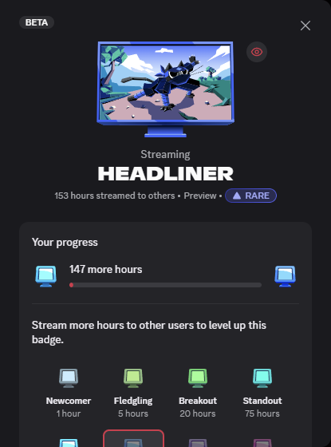<br>The same tier with the eye on |
|---|---|

**What it does**
- Click any tier and the big preview switches to it, with its name, art and rarity.
- Locked tiers show greyed out with a lock, plus what they take and how far off you are.
- An eye button lets you see locked tiers the way they look once unlocked.
- Works on your own badges and on other people's.

<details>
<summary><b>How to use</b></summary>

- Click any tier in the grid under **Your progress**, or tab to it and press Enter or Space.
- The picked tier gets a ring around it.
- Until you click a tier, the badge window looks exactly like Discord's own. The eye is the one exception (see below).
- Closing the window puts it back on the tier it normally opens on.

</details>

<details>
<summary><b>Locked tiers and the eye button</b></summary>

- Most locked tiers show what's left, like "Needs 300 hours (141 to go)".
- Nitro and Server Boosting tiers show a rough unlock date instead, like "Unlocks around Aug 22, 2027 if you stay subscribed".
- The eye button sits next to the big preview.
- Open eye: locked tiers show the way they look once unlocked, marked "Preview".
- Closed eye with a line through it: locked tiers show locked again.
- The eye only shows up on badges that still have locked tiers.
- It's dimmed while you're looking at a tier you already have.
- With the eye on, a badge that opens on a locked tier shows it unlocked straight away. This is the one time the window differs from Discord's before you click.

</details>

<details>
<summary><b>Settings</b></summary>

- **Reveal Locked** is the same switch as the eye button, so it remembers your choice. Off by default.

</details>

<details>
<summary><b>Privacy</b></summary>

- Only changes what you see. Nothing extra is sent to Discord.
- Discord's own stats still get the tier you really have, not the one you're previewing.

</details>

---

### TranslateItAll

`translateItAll` · Off by default

**Connects to:** Google Translate, or Yandex Translate if you turn it on. Toki Pona, Sitelen Pona and Shavian use a few more hosts, listed below.

Translate+ (by Prince527, based on Vencord's Translate) as a userplugin. It adds Yandex Translate as a free choice next to Google Translate.

**What it does**
- Adds **Translate** to the message hover buttons and the message right-click menu.
- Works on forwarded messages and on bot messages built from components.
- Works in search results too (right-click, with FullSearchContext on).
- Shows the translation under the message.
- Translates into the language you pick in settings. The list is searchable and set to English by default.
- Uses Google Translate by default. Turn on **Use Yandex Translate** to use Yandex instead.
- Neither one needs an account or API key.
- Languages Yandex doesn't have (such as Chinese (Traditional) or Hawaiian) go through Google instead, and the settings say so.
- Toki Pona, Sitelen Pona and Shavian work like in Translate+.
- Short Toki Pona and sentences with names in them are caught too.
- Each of those three can be turned off in settings, with no restart needed.

<details>
<summary><b>Things to know</b></summary>

- The first time you translate with Yandex, Equicord asks to allow `translate.yandex.net`. Accept it and restart Discord.
- While **Use Yandex Translate** is on and the host is blocked, the settings page shows an **Allow Host** button.
- Turn off the built-in Translate+ and Vencord's Translate while using this, so you don't get two Translate buttons.

</details>

<details>
<summary><b>Privacy, connections and files</b></summary>

**What it talks to:** the text of the message you translate goes to:
- translate.googleapis.com: Google Translate (the default).
- translate.yandex.net: only with **Use Yandex Translate** on.
- aiapi.serversmp.xyz: the Toki Pona translation service Translate+ uses, for Toki Pona and Sitelen Pona messages.
- raw.githubusercontent.com: the Sitelen Pona and Shavian word lists from Translate+'s repo. No message text is sent here.

</details>

---

### OfficialCustomTypingIndicator

`officialCustomTypingIndicator` · Off by default

**Connects to:** nothing new. It only talks to Discord, through Discord's own connection.

Lets you set Discord's own [Custom Typing Indicator](https://support.discord.com/hc/en-us/articles/42962943077271-Custom-Typing-Indicator-FAQ) from desktop. This is a real Discord Nitro perk, not something the plugin made up, and so far Discord only lets you set it up in the phone app.


**What it does**
- Swaps "is typing…" for 3 emoji, an animation and a word like "is yapping…".
- Adds an editor to the plugin's settings: pick 3 emoji, an animation (None, Pulse, Ring or Wave) and a word, then click **Apply**.
- Your style is saved on your Discord account, the same as setting it on your phone.
- **Everyone on an up-to-date Discord phone app sees your style, no plugin needed.** Discord shows it to them itself.
- Discord is starting to draw these styles on desktop too, turning it on for some people at a time. Until yours has it, the plugin draws other people's styles for you.
- Where Discord already draws a style itself, the plugin steps aside so you never see it twice.
- Turn **Show Others** off for plain dots everywhere, even where Discord draws styles itself.
- The word shows in your Discord language.

> [!CAUTION]
> **Use at your own risk.** So far Discord only accepts this setting from its phone app, so on that one save the plugin says the request comes from the Android app. That's spoofing, which is against Discord's rules. Nothing else you do in Discord is changed. Discord's desktop app has started getting its own save code, so this may not be needed once Discord ships its own desktop editor.

<details>
<summary><b>How to use it</b></summary>

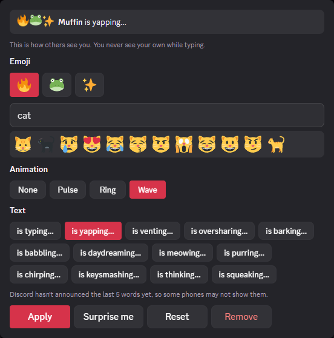

- Your first emoji pick fills all 3 slots, like on the phone.
- To swap one, click a slot and pick another emoji.
- Search emoji by name (`thumbs_up`, `+1`) or type an emoji in.
- The preview at the top shows how others see you.
- You never see your own style while you type. Discord doesn't show you your own typing.
- **Surprise me** picks a random combo.
- **Reset** undoes what you haven't applied.
- **Remove** puts the normal dots back.
- Discord sometimes asks for a captcha when you save. Solve it and the save goes through.
- Saving a lot in a short time makes the captcha show up more often.

</details>

<details>
<summary><b>What you need and who sees it</b></summary>

- **Full Nitro.** Nitro Basic isn't enough, and Discord won't save it without Nitro.
- **Your account in Discord's rollout.** Discord says every Nitro user gets it within a few weeks.
- If your phone app shows **Settings → App Settings → Typing Indicator**, you're in.
- It only shows when you're the only one typing. With two or more people typing, everyone goes back to "is typing…".
- In a server with **Use External Emoji** turned off, people there see the normal dots instead of emoji from other servers. They still see your word.
- Discord's FAQ lists 7 words: yapping, venting, oversharing, barking, babbling, daydreaming, meowing.
- Discord's code has 5 more that aren't announced yet: purring, chirping, keysmashing, thinking, squeaking. Some phones may not show those.
- **Surprise me** only uses the announced words.
- If saving says **"Discord didn't save it"** while you have full Nitro, Discord may want a newer app version than the plugin sends. [Open an issue](#issues) so it can be bumped.

</details>

---

### NoQuestsOnStartup

`noQuestsOnStartup` · Off by default

**Connects to:** nothing.

Some accounts land on the Quests page every time Discord starts or reloads. This plugin turns that off, so Discord opens where it normally would.

**What it does**
- Turns off the experiment's "open Quests on start" switch.
- Turns off the startup check that acts on that switch.
- Leaves everything else about quests alone. The Quests page, quest bar and QuestRunner work as before.

<details><summary><b>Things to know</b></summary>

- The redirect comes from Discord, not a mod. It's a quest campaign experiment.
- Stock Discord does it to those accounts too.
- Accounts that aren't in the experiment see no difference.

</details>

---

### Discrub Loader

`discrubLoader` · Off by default · Desktop app

**Connects to:** the Chrome Web Store (to get Discrub), GitHub (to check it) and discord.com. Details below.

Runs [Discrub](https://github.com/pratherbytecraft/discrub) inside Discord. Discrub exports, searches and bulk-deletes your messages, and normally runs as a browser extension.

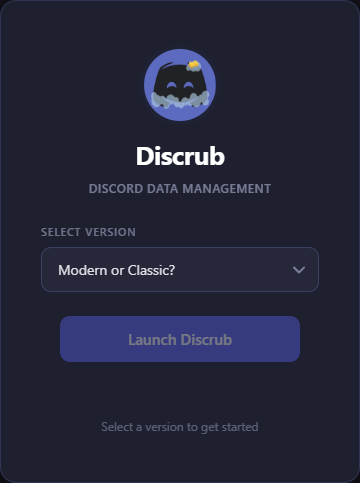

**What it does**
- Opens Discrub from the broom button in the top bar.
- Includes both versions: the new Discrub and Discrub Classic, the older one that's no longer updated.
- Uses the Chrome Web Store build exactly as published. Nothing is changed, and nothing is copied into this repo.
- Discrub signs in with your Discord session on its own, like it does in the browser.
- Checks every download three ways and installs nothing if a check fails.
- Updates on your terms, and goes back to the last working version if a new one won't start.

> [!CAUTION]
> Bulk deleting or exporting with your own account is automation Discord's rules don't allow, the same as with the browser extension. Discrub waits between requests and slows down when Discord asks it to, so keep its delays at their defaults.

<details>
<summary><b>Settings</b></summary>

**Which version opens:** New, Classic, or ask each time on Discrub's own start screen. With ask each time, the start screen waits for your pick instead of counting down into the last one.

**Updates:** it looks for a new Discrub 20 seconds after Discord starts, then every 6 hours. Pick one:
- **Ask before updating** (default): offers each new version once. Press **Check now** to see it again.
- **Update automatically**: downloads and checks new versions on its own.
- **Stay on this version**: no background checks at all. Only **Check now** contacts the store.

A new version starts after Discord reloads. If it won't start, the plugin goes back to the last one that worked.

**The settings page shows:**
- The installed version.
- The newest version on the store.
- Any update waiting.
- When it last checked.
- A **Check now** button.

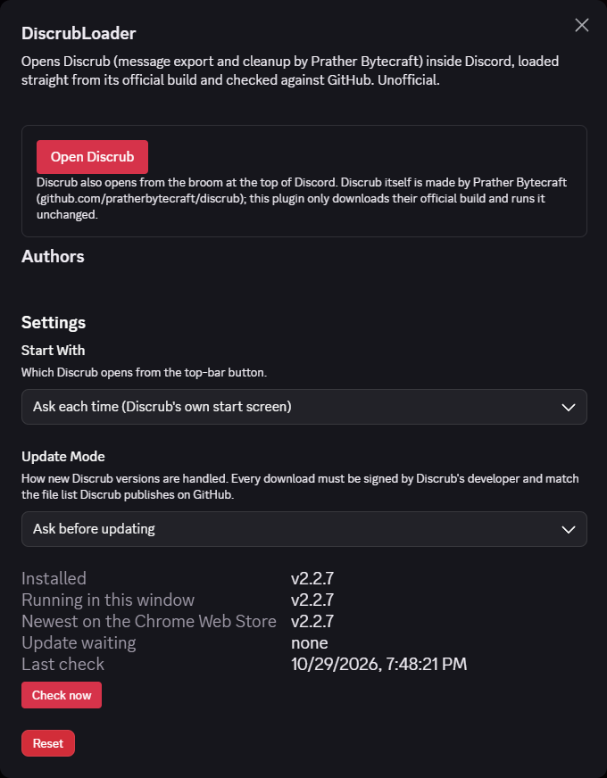

</details>

<details>
<summary><b>Things to know</b></summary>

- A download is only used if it passes all three checks:
  1. It matches the size and fingerprint the Chrome Web Store announces.
  2. It's signed by Discrub's own developer key.
  3. Every file matches the list Discrub publishes on GitHub for that version.
- The first install needs one Discord reload. The plugin asks before reloading.
- Exports save straight to your Downloads folder.
- Discrub Classic signs in on its own only while the Discord window is focused. That's always true when you click the broom yourself.
- Works in the Discord desktop app with Equicord, not in Discord on the web.

</details>

<details>
<summary><b>Privacy, connections and files</b></summary>

**What it talks to:**
- clients2.google.com: the Chrome Web Store, to check for Discrub updates.
- Google's download servers (*.googleusercontent.com, *.google.com or *.gvt1.com, plus wherever Google redirects the download): to download Discrub. Every download gets the same three checks, whatever server it comes from.
- raw.githubusercontent.com: Discrub's published file list, to check each download.
- discord.com: Discrub itself, using your own account.

**Where files go:** `%APPDATA%\Equicord\discrubLoader`
- About 11 MB for each saved version, plus one 11 MB working copy.
- It keeps the current version and the one before it.
- Discrub keeps its own settings inside Discord.

</details>

> [!NOTE]
> Discrub is by [Prather Bytecraft](https://github.com/pratherbytecraft) and is their trademark. This plugin is unofficial and not made or supported by them: it downloads their official build and changes nothing. Please don't send them support requests about it. [Support them on Ko-fi](https://ko-fi.com/prathercc).

---

### Game Browser (GameTimeSpoof)

`gameTimeSpoof` · Off by default

**Connects to:** discord.com and cdn.discordapp.com only. It never downloads or runs code from the internet.

Makes Discord think you're playing any game it can detect. Your Game Time and Game Variety profile badges keep counting.

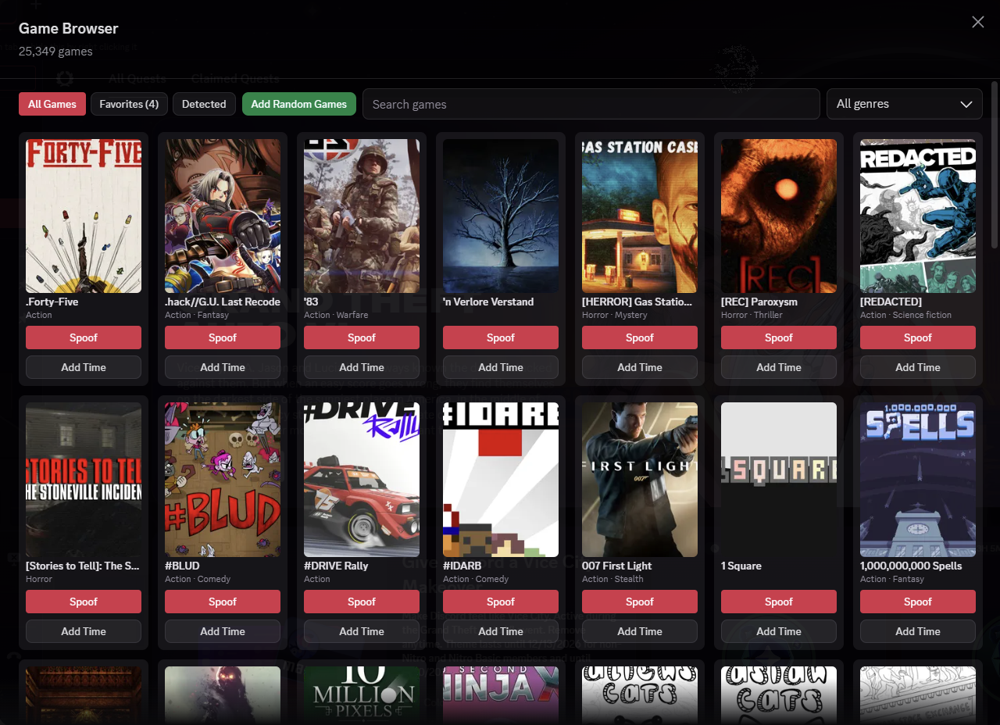

**What it does**
- The controller button in Discord's top bar opens the Game Browser.
- It lists all of Discord's detectable games, with cover art, search, genre filter, favorites and a **Detected** tab.
- Click a cover to open that game's real Discord page.
- **Spoof** switches to that game right away. The game you're spoofing always stays at the top.
- **Stop** also turns rotation off, so the game doesn't come back on the next switch.
- **Rotation** cycles through your favorites or random games (any game Discord can detect) on a timer.
- If no game is picked yet, rotation starts one right away.
- **Add Time** and **Add Random Games** add play time to one game, all your favorites, or any number of random games (or all of them).
- A badge tracker shows your real badge ranks and when your added time should be counted.
- Real games count too, even when Equicord's NoTrack blocks Discord's own game reports.
- Spoofed and real games are each counted once, whatever NoTrack is set to.

> [!IMPORTANT]
> Turn on both "Use data" options in User Settings → Data & Privacy, or Discord ignores the play time and your badges won't move. Details under "What it needs" below.

> [!CAUTION]
> Play-time reports are made-up analytics sent to Discord. That's against Discord's rules, so use it on an account you're fine risking.

<details>
<summary><b>How to use it</b></summary>

1. Turn on **GameTimeSpoof** in Discord (User Settings, then Plugins).
2. Click the controller button and pick a game.

**Add Time**
- It can stick to games you've never played, so each one counts toward Game Variety.
- It works out the totals for you. Example: 2 games at 48 hours each shows "4 days (96 hours) in total".
- It also shows how long sending will take.
- It runs in the background. Once you click **Add Time**, the window closes.
- A small progress box in the bottom-right corner shows how far along it is, with a **Stop** button.
- Keep using Discord as normal. It sends at the same pace either way.

**Badge tracker** (inside **Add Time**)
- Your real Game Time and Game Variety rank, straight from Discord.
- The time still waiting to be counted.
- The rank you'll reach after the run, and how far the next rank is.
- When your added time should be counted. This comes from your own account: the plugin learns when Discord's daily update runs for you instead of guessing.

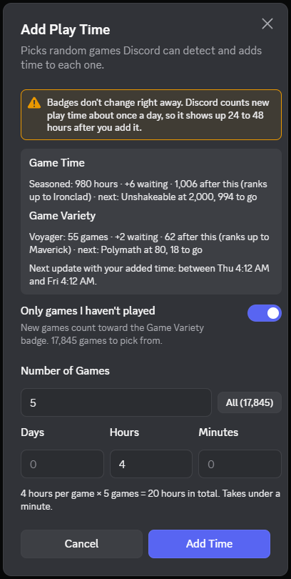

</details>

<details>
<summary><b>What it needs, and settings</b></summary>

**What it needs**

- **Turn on both "Use data" options:** User Settings → Data & Privacy → **Use data to improve Discord** and **Use data to personalize my Discord experience**.
  - Without them, Discord ignores the play time and your badges won't move.
  - These are saved on your account, on Discord's side, so no plugin can skip them.
- **Turn off other tracking blockers while adding time.** DoNotTrack, NoTrack add-ons, ad blockers and Pi-hole can stop the play-time reports from reaching Discord.
  - The Game Browser and the **Add Time** window warn you when one of these plugins is on.
  - A blocked run stops right away and says so.
  - Turn the blocker off, or let Discord's `/science` address through.
- **Keep "Share your detected activities with others" on** (User Settings → Activity Privacy) if you want people to see the game you spoof.
  - Play time still counts with it off, but nobody sees the game.
  - DoNotTrack's **Stop Process Monitor** option turns this off by itself.
  - The Game Browser warns you when it's off and has a **Turn On** button.

**NoTrack doesn't matter here**

- GameTimeSpoof works with any NoTrack setup.
- Spoofed games: it sends its own play-time reports, and Discord's own game reports never include them, so each is counted once.
- Real games are counted once too, by either Discord or GameTimeSpoof:
  - NoTrack's **Disable Analytics** ("Block Discord's tracking analytics") only stops Discord's game reports when its **Allow Badge Tracking** ("Still send the events needed for badges...") is off.
  - Both are on by default. In that case Discord reports real games.
  - When **Disable Analytics** is on and **Allow Badge Tracking** is off, GameTimeSpoof reports them itself.
- Like NoTrack, it goes by the switches Discord started with. A change to either one counts after a restart.
- StreamTimeFarmer needs **Allow Badge Tracking** on too (or **Disable Analytics** off), the same as NoTrack's defaults (see [StreamTimeFarmer](#streamtimefarmer)).

**Settings**

- **Report real games** (on): reports games you really play while NoTrack's **Disable Analytics** is on and its **Allow Badge Tracking** is off, since Discord stops counting them then.
  - With NoTrack's defaults, Discord still counts them and this sends nothing.
  - Turn it off to never send anything for real games.

</details>

<details>
<summary><b>Things to know</b></summary>

- Badges don't update right away. Discord doesn't publish a schedule, so new play time can take many hours to show up.
- There's no cap on games or time. Big runs just take longer.
- If Discord asks it to slow down, it waits and carries on.
- discord.com (Discord's own API) is used for:
  - the list of detectable games and game pages
  - the play-time reports that badges are counted from
  - your own badge progress and play history (read only)
- cdn.discordapp.com is used for game cover art and icons.
- Everything it does is in the plugin's own files.

</details>

---

### StreamTimeFarmer

`streamTimeFarmer` · Off by default · Desktop app

**Connects to:** discord.com and Discord's voice servers, plus GitHub for Equicord's web build. Details below.

Earns Streaming badge time by streaming to a second account of yours. That account runs hidden inside your same Discord, so you don't need a second Discord install.

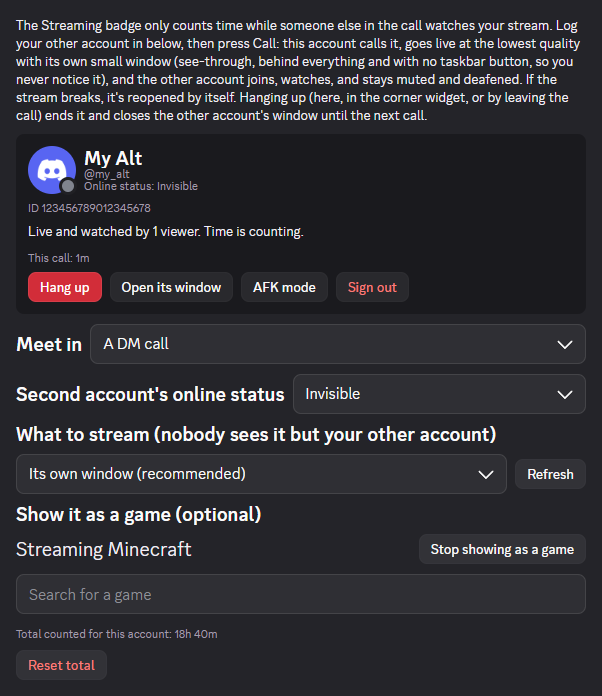 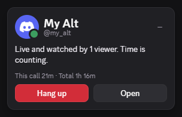

**What it does**
- **Logs in your second account once** (QR code or email and password), then runs it hidden.
- Calls only ever go to that second account.
- **Call** starts a DM call. Your account goes live at 480p / 5 fps and the second account watches.
- Both accounts mute and deafen themselves, so a real call on top of the farm's can't feed sound back.
- Fixes itself when either account drops or the stream breaks.
- Can show your stream as "Streaming <game>" (optional).
- Reports the time regularly (every hour by default), so a crash doesn't lose it all.
- **AFK mode** lets you leave it running for hours or days, at about half the CPU.
- Checks your settings on both accounts and shows each one green or red.
- **Add Streaming Time** (optional) adds badge time faster than real time: up to 12 hours for every hour the farm runs.

> [!CAUTION]
> Discord doesn't allow automating accounts, so both accounts are at risk. Don't use one you can't afford to lose.
> **Add Streaming Time** goes further: it sends Discord stream reports that claim more time than was really streamed.
> That's a made-up report, the kind of thing Discord bans for. Only use it on an account you're fine risking.

> [!IMPORTANT]
> **Equicord blocks the Streaming badge by default.** StreamTimeFarmer shows what to change and has a **Fix these for me** button. Details under "Settings" below.

<details>
<summary><b>How to use it</b></summary>

**Setup**

1. Turn on **StreamTimeFarmer** in Discord (User Settings, then Plugins). Or press **Log in second account** in its settings, which turns it on for you.
   - If its settings say to quit Discord fully, do that once (right-click Discord's tray icon, then **Quit Discord**) and open it again.
2. Press **Log in second account**.
   - A warning first explains what it does: it turns the plugin on and runs a hidden second Discord.
   - Press **Log in**, then log your other account in once (QR code or email and password) in the window that opens.
   - The settings then show its picture, name, tag and ID.

   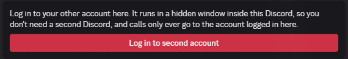

   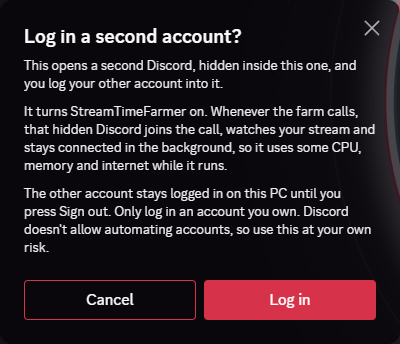

3. Press **Call**, in the settings or in the small call widget in the bottom-right corner.
   - Your account calls the second one in DMs, mutes and deafens itself, and goes live with its own small window.
   - That window sits in the bottom-right corner behind everything. It's see-through and click-through, with no taskbar button.
   - It shows only its name (or the game's cover), a ticking clock of how long it's been streaming and a moving bar.
   - You can pick the screen or another window instead. Only your second account sees it.
   - The second account joins, mutes and deafens itself too, and watches.
   - Discord clears both whenever a stream starts, so the farm sets them again rather than assuming they stuck.
   - Prefer a server? Pick **A server voice channel** instead of the DM call.

**Stopping and managing it**
- **Hang up** in the widget or settings, or leave the call in Discord. This ends the stream and fully closes the second account's window.
- The second account's login stays saved, so the next Call starts straight away.
- **Open** shows its window as a small panel if you want to see or control it.
- **Sign out** forgets it.

</details>

<details>
<summary><b>While it runs</b></summary>

**Status and time**
- The farm only adds time while the second account is really watching.
- The widget and settings show what's happening and the time counted.
- If no time has counted for a while, the status says for how long.
- After 15 minutes with no time counted, a notice pops up so you don't find out hours later.
- Offline? It says so and waits for the internet to come back, instead of blaming Discord.

**When something breaks**
- If either account drops, they reconnect on their own.
- If Discord drops you from the call (you were alone in it too long, or it moved you to the AFK channel), the farm joins again after a short wait and tells you.
- Meant to hang up? Click that notice and it stays off.
- If the second account's hidden Discord breaks, it rebuilds itself about every 15 minutes.
- If the farm's own window can't open (an antivirus blocking it, say), a DM call shows your screen to the second account instead, so time keeps counting.
- It tries its own window again each time it reports the time.
- If you picked a window to stream and it's minimized, the status tells you to open it. A minimized window doesn't count.
- If the stream fails (like Discord's error 2012), gets stuck paused, or Discord says no picture is getting through, both sides fix it.
  - The second account reopens the stream, and your account restarts Go Live (and reopens its window if something closed it).
- Time doesn't count while the stream is broken.

**Show it as a game** (optional)
- Search for a game and pick it. The farm's window takes that game's name and cover art.
- Discord's own game detection is told the window is that game. Your stream shows as "Streaming <game>" and your profile as playing it.
- The game itself never runs. The picture is still the farm's window.
- If another plugin (gameSessionSpoofer) is already showing a game, the window streams as itself until that ends, so the two don't fight.

**AFK mode** (the **AFK** button during a call)
- Discord is hidden behind a black screen showing your total streaming time, how long the current call has run and whether it's counting.
- Discord then uses about half the CPU and next to no graphics card. The call and stream keep going.
- Press **Esc twice** or the **Leave AFK** button to come back.
- If a setting might stop the badge counting, the AFK screen says so.
- While it's on, your keyboard doesn't reach Discord, so nothing gets typed into a chat by accident.
- If Discord restarts, it comes back in AFK mode.

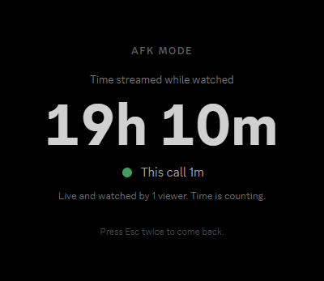

</details>

<details>
<summary><b>Add Streaming Time</b></summary>

Adds Streaming badge time faster than the clock: up to 12 hours of badge time for each hour the farm streams.


**How to use it**
1. Get the farm streaming first (see **How to use it** above), with its source on the farm's own window.
2. Press **Add Streaming Time** in StreamTimeFarmer's settings, or in Equicord's toolbox.
3. Type how many hours to add (1 to 9,999), check the summary under the box and press **Add Time**.

A small box in the top-right corner then shows:
- How far along it is.
- When the next send goes out and how long the rest takes.
- A **Stop** button. Click the box's title to make it bigger or smaller.
- It stays where it is. Drag it by its title to move it anywhere, and it remembers the spot and size.

**How it works**
- Discord adds up streaming time from the report your Discord sends when a stream ends.
- Once each hour, Add Streaming Time sends one of those reports for the farm's stream, with the length raised to what's left of your total.
- Each report is capped just under 12 hours. Discord counts nothing for a report of 12 hours or more.
- Sends go out between a few minutes past the hour and a few minutes before the next one, at most one per hour (UTC).
- Example: 100 hours is 9 sends, so it takes about 7 to 9 hours. The window shows the exact time before you start.
- Usually it sends the farm's last real report again, so the stream keeps running.
- When that report is over about 5 hours old, it ends the farm's stream instead so a fresh report goes out. The farm then goes live again by itself.
- Only reports of the farm's own window are changed.
- A stream of your screen, a window you picked or a Go Live you start yourself is never touched.
- Nothing is changed while no job is running.
- Each send shows up on the badge about 1.5 to 3 hours after it goes out.

**Things to know**
- Keep Discord open. A job survives a restart and carries on where it stopped.
- **Stop** keeps everything already sent.
- It only works in the desktop app, and only for the account that started it.
- Your second account has to be set up first.
- Everything under **What the badge needs** below has to be right first, including **Use data to improve Discord** (only recommended for the farm itself). The window says what's missing.
- The **Sends** list in the settings shows every send: when it went out, how long the stream really ran, what was added and whether Discord accepted it.
- **Clear log** empties that list but keeps this hour's and last hour's rows, so a restart can't send twice in one hour.

</details>

<details>
<summary><b>Settings</b></summary>

**What the badge needs, on both accounts**

Discord adds up streaming time from the report your Discord sends when a stream ends. Equicord's NoTrack plugin can throw that report away, and then no stream counts, farmed or real.

- NoTrack's **Disable Analytics** ("Block Discord's tracking analytics", on by default) blocks the report unless **Allow Badge Tracking** is on too.
- NoTrack's **Allow Badge Tracking** ("Still send the events needed for badges...", also on by default) lets only the badge reports through.

What to set:
- NoTrack: **Allow Badge Tracking** on (NoTrack's default), or **Disable Analytics** off. Then restart Discord.
- Data & Privacy → **Use data to personalize my Discord experience** must be **on** (Discord's own badge article asks for this one).
- Data & Privacy → **Use data to improve Discord** should be **on** (recommended; it's not known whether Discord ignores reports without it).

**How it checks them**
- StreamTimeFarmer checks all of them on both accounts. Your second account's are checked while it's in a call.
- Each one shows green when it's right and red when it isn't, in StreamTimeFarmer's settings and in the corner call widget.
- The minimized widget gets a red ring.
- **Fix these for me** changes what's red after a confirm box that lists every change.
- For NoTrack it turns **Allow Badge Tracking** on, so the rest of Discord's tracking stays blocked.
- On an older NoTrack without that switch, it turns **Disable Analytics** off instead.
- If your NoTrack changed, it asks to restart Discord. NoTrack keeps blocking until you do.
- The second account's hidden Discord reloads and rejoins the call by itself.

**Other blockers**
- It names other plugins that may block the reports.
- It warns when a report that should have gone out never reached Discord (an ad blocker or Pi-hole, say).
- Time streamed while they were blocking was never reported and can't be added back.
- Once Discord has actually accepted a report, those warnings stand down. A report getting through proves nothing on your PC is in the way, whatever the switches say.
- Discord's own two privacy settings keep warning either way. Discord can accept a report and still decide to ignore it, and nothing on your PC can see that happen.

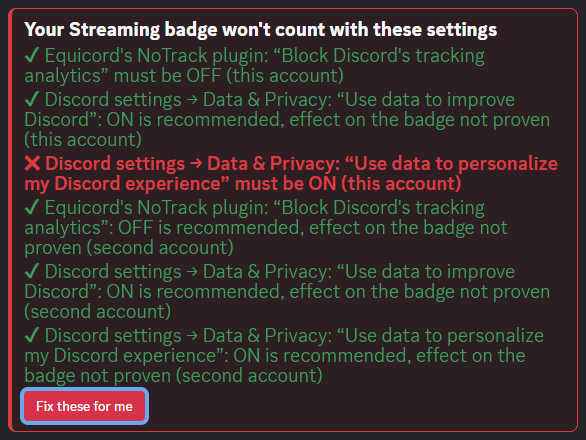 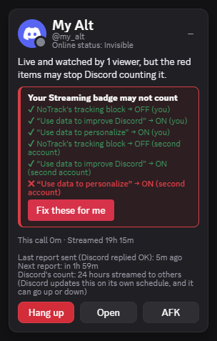

**Discord ending the call**

- Discord ends a call after you've been alone in it for a few minutes, or away for a while.
- Equicord's **DisableCallIdle** plugin stops that.
- If it's off, the farm's settings show a **Turn it on** button. Discord then needs a restart.
- The second account's hidden Discord gets it turned on by itself.

**Plugin settings**

- **Second account's online status** (default: leave as is): sets it to Online, Idle, Do Not Disturb or Invisible each time it starts.
  - It's that account's own Discord setting, so it changes everywhere it's logged in.
- **Mute Mic** (on): mutes your mic when the farm joins the call, and unmutes it when the farm stops.
  - **Deafen Both** mutes your mic too, so this only matters with that off.
- **Deafen Both** (on): both accounts deafen themselves in the farm's call, so a real call on top of it can't feed sound back either way. Undone when the farm stops.
  - Discord clears mute and deafen every time a stream starts, so the farm checks them as it runs and sets them again.
- **Call Widget** (on): shows the small widget in the bottom-right corner while a second account is logged in, to call, hang up and open its window.
- **Quiet Second Account** (on): keeps the second account's unreads off your taskbar badge and stops its desktop notifications.
  - Turning it off takes effect right away, also during a call.
- **Mute Call Sounds** (on): silences Discord's call sounds while the farm runs, so restarts stay quiet on your PC.
  - Covers calling and ringing, Go Live starting and ending, joins and leaves, mute and deafen.
  - Real incoming calls ring silently too, but their popup still shows. Message sounds stay on.
- **Keep Computer Awake** (off): stops your PC from sleeping on its own while the farm or AFK mode runs.
  - Choosing Sleep yourself or closing a laptop lid still works.
- **Report Every** (every hour): ends and restarts Go Live this often so the time so far gets sent.
  - Pick 30 minutes, 1, 2 or 4 hours, or Never.
  - It goes by time really watched. The call and the second account stay during the restart.

</details>

<details>
<summary><b>Things to know</b></summary>

**Counting time**
- Discord only counts streaming with someone else in the call, so the farm streams for real: an hour of badge time per hour.
- **Add Streaming Time** (above) is the faster way.
- Discord only counts a stream's time when the stream ends. A stream left running for days would count nothing until then.
- That's why **Report Every** restarts Go Live: a crash then only loses the time since the last report.
- Quitting or reloading Discord sends the time so far as it closes.
- A crash, a kill or Discord's own relaunch still lose the time since the last report.
- The widget and settings show when the last report was sent and Discord replied OK, and when the next one goes out.
- They also show Discord's own count for the badge, which Discord updates on its own schedule. It can go up or down.
- The badge doesn't update right after a report. It can take many hours, and Discord doesn't publish a schedule.

**Sound and notifications**
- Each report restart plays Discord's stream sounds unless **Mute Call Sounds** is on.
- **Mute Call Sounds** can't change what other people in the call hear, so a DM call with your second account is the quiet choice.
- The second account's window shares one program with your Discord. Without **Quiet Second Account**, your taskbar badge creeps up every time it's invited to a call and never clears.
- The second account still receives everything. **Open** its window to read it.

**Second account**
- The dot on its picture in the widget and settings shows its real online status, with the name next to it.
- It shows Offline while it isn't running.

**Keep Computer Awake**
- It also covers moments when no call is live, such as AFK mode with the farm stopped or a farm waiting to reconnect.
- During a call Discord already keeps the PC awake and the screen on. Otherwise the screen can still turn off.
- Your normal sleep settings come back when both stop.
- Some laptops on battery can still sleep after a while.

**Other**
- It needs the desktop app. The second account's window fetches its own Equicord, so there's nothing extra to install.
- It used to be part of GameTimeSpoof. If you used the stream farm there, updating adds StreamTimeFarmer and turns it on, with your settings and your second account's login kept.
- Settings and totals are saved per account, so two accounts on one PC don't overwrite each other.
- Your own Go Live quality is put back after each call.

</details>

<details>
<summary><b>Privacy, connections and files</b></summary>

- It uses discord.com and Discord's voice servers through Discord's own calls and Go Live, like pressing the buttons yourself.
- The second account's window is Discord's own web app.
- The first time that window opens, the plugin downloads Equicord's own released web build (about 3 MB).
- It keeps that build on your PC for 6 hours and fetches it again after that, so the second window always runs a current Equicord.
- This plugin doesn't have to be built into that Equicord. The plugin sends the viewer half of the farm into the window itself.
- So there's nothing extra to install. It works the same with the Cordmuffin installer or a self-built Equicord.
- If the download fails (no internet, GitHub blocked), the card says so and offers a **Try again** button.
- **Add Streaming Time** connects to nothing new. It changes the length in your Discord's own stream report on its way to discord.com, or sends the farm's last real report again through Discord's own tracker.
- Its job, send log, hourly state and the last real report are saved in Equicord's local storage on your PC.

</details>

---

### QuestRunner

`questRunner` · Off by default · Play quests need Windows

**Connects to:** discord.com only, which is Discord's own quest API (plus an activity's discordsays.com page for activity achievement quests, if you turn them on).

Does your Discord quests for you. Press Accept on a quest and QuestRunner finishes it on its own. You only come back to claim the reward and solve the captcha Discord shows when you claim.

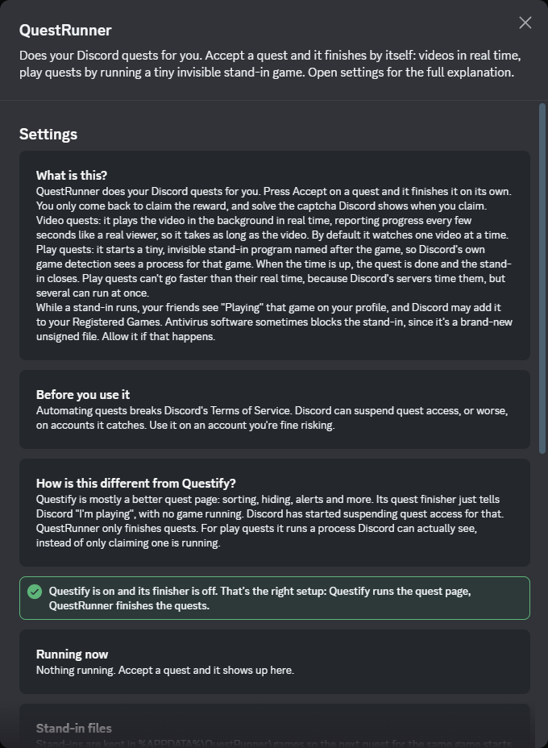

**What it does**
- **Video quests** play in the background in real time, reporting progress every few seconds like a real viewer.
- One video runs at a time by default.
- **Play quests** run a tiny, invisible stand-in program named after the game, so Discord's own game detection sees a process for it.
- Several play quests can run at once. Each takes its real time, because Discord's servers time play quests.
- Every quest it can do gets a **Complete** button on its card.
- The settings page shows what's running, what's waiting and why.
- The settings page also has a button to delete the stand-in files.

**Optional extras (all off by default)**
- Auto-accept new quests.
- Finish activity and console-only quests by reporting them straight to Discord (riskier, the method Questify uses).
- Finish activity achievement quests.

> [!CAUTION]
> Automating quests breaks Discord's Terms of Service. Discord can suspend quest access, or worse, on accounts it catches. Use it on an account you're fine risking.

<details>
<summary><b>How the Complete button works</b></summary>

- On an activity, Xbox or PlayStation quest, it uses direct heartbeats, the riskier method.
- On a play quest whose game has nothing to run, it falls back to direct heartbeats only when that setting is on.

</details>

<details>
<summary><b>How it compares to Questify</b></summary>

- Questify is mostly a better quest page: sorting, hiding and alerts.
- Its finisher just tells Discord a game is running when none is. Discord has started suspending quest access for that.
- Keep Questify for its quest page if you like it, but turn its finisher off. QuestRunner has a button for that.
- Auto-accept skips quests you hid in Questify.

</details>

<details>
<summary><b>Things to know</b></summary>

- While a stand-in runs, your friends see you "Playing" that game.
- Discord may add that game to your Registered Games.
- Game detection has to be on in Discord (User Settings, then Activity Privacy).
- Antivirus software sometimes blocks the stand-in, since it's a brand-new unsigned file. Allow it if that happens.
- The stand-in's source is in `questRunner/stub/stub.c`, and `stub/build.cmd` rebuilds it.
- Stand-ins close when Discord closes, and only work on Windows.

</details>

<details>
<summary><b>Privacy, connections and files</b></summary>

**What it talks to:** only discord.com (Discord's own quest API). Activity achievement quests, if you turn them on, also talk to that activity's `discordsays.com` page.

**Where files go:** stand-ins are kept in `%APPDATA%\QuestRunner\games`, each under 300 KB.

</details>

---

### PlatformSpoofer+

`platformSpooferPlus` · Off by default

**Connects to:** nothing. It only changes what your Discord already sends to Discord.

Pick which platform others see you on: phone, console, VR headset, web or desktop. It replaces the PlatformSpoofer that Equicord removed on 2026-11-03, rebuilt from scratch without the random logouts.


**What it does**
- Adds a button next to mute and deafen.
- Click the button to flip between your real platform and the last one you picked.
- Right-click the button to pick any platform.
- Switches live. Discord reconnects for a second, with no restart.
- If you're in a call, it asks first, because the reconnect drops the call and any stream.
- Spoofs from the very first connect, so you never flash up as desktop first.
- Phone uses the Android app's name and device fields. Console uses the Xbox app's. Web uses a real browser name.
- Details only the real app knows, like its build number, stay as your client sends them.
- Turning the plugin off puts your real platform back right away. It asks first if you're in a call.
- Equicord still shows its restart notice when you turn it off. You can ignore it.

> [!CAUTION]
> **Use at your own risk.** Changing what platform you report is against Discord's rules. Discord also turns some features on per platform, so things like Quests or Orbs may hide while you show as something else. Switch back if something you need disappears.

<details>
<summary><b>How to use it</b></summary>

- Turning the plugin on needs one restart, like any plugin that changes Discord's code. Switching platforms after that never does.
- The button's icon shows what Discord shows you as right now.
- If you pick something during a call and choose **Later**, the icon stays on what you still show as. The tooltip says what you picked.
- Picking Desktop on the desktop app counts as your real platform. It changes nothing, so it doesn't reconnect.
- You can hide the button in the settings.

  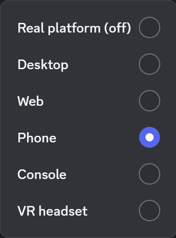

- Other ways to switch, which work the same as the button:
  - **Right-click yourself → Show me as**
  - The **Platform** setting
  - **`/platform`** (run it empty to see what Discord shows you as right now)
- After each switch, a message says what Discord now shows you as.
- The settings page has a **What Discord sees right now** panel. It lists every session on your account and how Discord sees it.

  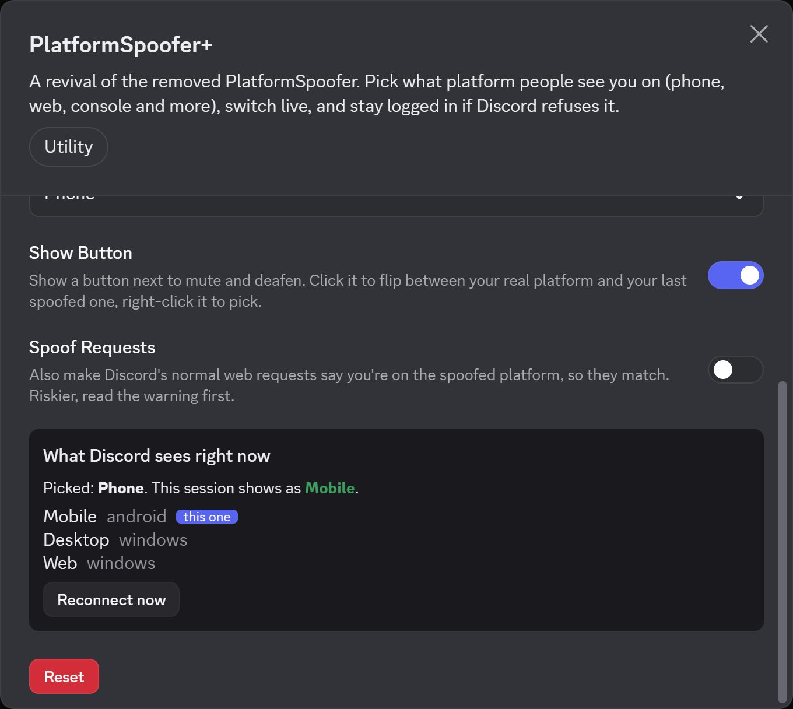

</details>

<details>
<summary><b>What people see</b></summary>

| You pick | Others see |
|---|---|
| Phone | The phone icon next to your status |
| VR headset | The VR icon |
| Console | Console (shown by plugins like PlatformIndicators) |
| Web / Desktop | No special icon |

- The phone icon only shows while you're Online. That's how Discord works.
- Your other devices still show up as themselves.

</details>

<details>
<summary><b>What's different from the old PlatformSpoofer</b></summary>

- **No random logouts.** Discord sometimes refuses a spoofed connection with an "authentication failed" code. Discord's app treats that code as "log out now", which is why the old plugin logged people out.
- PlatformSpoofer+ catches that one case. You stay logged in and get put back on your real platform.
- The button then says Discord refused it. Click it to try again.
- If your login really did expire or got revoked, Discord still logs you out like normal.
- **No early desktop connect.** Discord's desktop app opens its connection before plugins load. The plugin skips that early connection while a spoof is on.
- **Real app names.** Phone uses the Android app's name and device fields, Console the Xbox app's. Web uses a real browser name instead of the made-up "Discord Web".
- **Clean off switch.** When you turn the plugin off, its button, menu and command go away with it.
- **Your pick carries over.** If you used the old PlatformSpoofer, your choice moves over by itself.

</details>

<details>
<summary><b>Spoof web requests too (off by default, riskier)</b></summary>

- Normally only the live connection changes. Discord's normal web requests still say what you really are.
- This option makes those requests match the platform you picked, from the very first request after Discord starts.
- Turning it on shows a warning first. Nothing changes until you click **Turn it on**.
- It's riskier. Discord picks some features and tests by platform from those requests, so parts of Discord can change or break.
- Discord also sees more of the spoof.
- Turn it off if anything acts weird.
- The sign-in page always stays real.

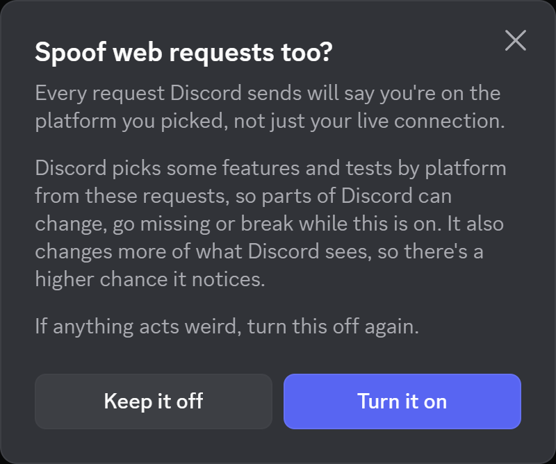

</details>

---

### Ransom

`ransom` · Off by default · Desktop app

**Connects to:** static.wikitide.net (the DOORS wiki's files) while **Doors Assets** is on. Details below.

A harmless jump-scare game. Ransom from DOORS wanders your Discord window, and if you move while it holds up its sign, it fake-"encrypts" your screen until you pay it in gold you find around Discord.

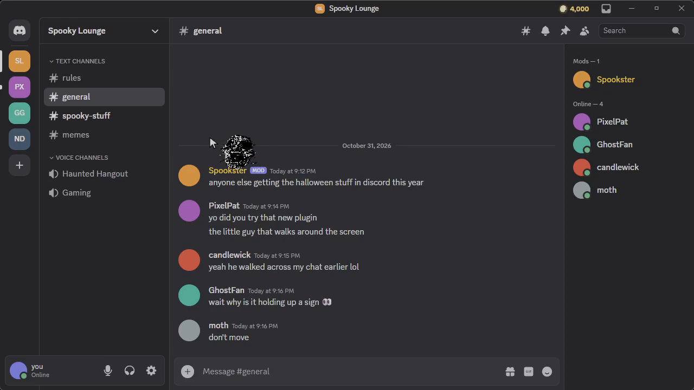

**What it does**
- Ransom's little face wanders around the window, like Oneko.
- Now and then it stops and holds up its stop sign, with a split second of freeze like in the game.
- Hold still and Ransom leaves. Move your mouse or press a key and it catches you.
- When caught, names, channels and messages turn into scrambled text, the message box locks and pop-ups fill the screen.
- Click the gold piles around Discord to pay it off before the 90-second timer runs out.
- Run out of time and Discord falls apart. Revive with your gold, or give up and get the DOORS death screen.
- Loose gold and hidden items turn up around Discord for you to collect.
- The Ransom panel shows your gold, items and scores.
- Everything is visual and only on your screen. Nothing is really encrypted or deleted, and nobody else sees any of it.

<details>
<summary><b>How it plays</b></summary>

**During a challenge**
- Spam clicking costs you gold.
- Paying it off drops a Honey Pot on something in view. If nothing is in view, like on a settings page, no Honey Pot drops.
- Press Esc at any time during a challenge to end it with no loss.

**When time runs out**
- Discord stays broken until you revive with all your gold (at least 1,000).
- With under 1,000 gold there is nothing to revive with, so a loss goes straight to the death screen.
- Give up and you get the DOORS death screen with the Guiding Light and its music, then an overview of your run.
- The revive card comes up by itself and stays until you revive or give up.

**Gold and items**
- Like the gold in DOORS drawers, a small pile of loose gold turns up somewhere in Discord now and then.
- Taking loose gold brings Ransom sooner.
- Sometimes a small spooky item hides in a DM or server channel when you open it. Click it to collect it.
- Losing a ransom can take up to 3 hidden items.

**Where to find it**
- The Ransom panel is in the Equicord toolbox (**Open Ransom**) and behind the Ransom button in the top bar.
- The toolbox also has **Try a challenge** and **Drop some gold**.

| 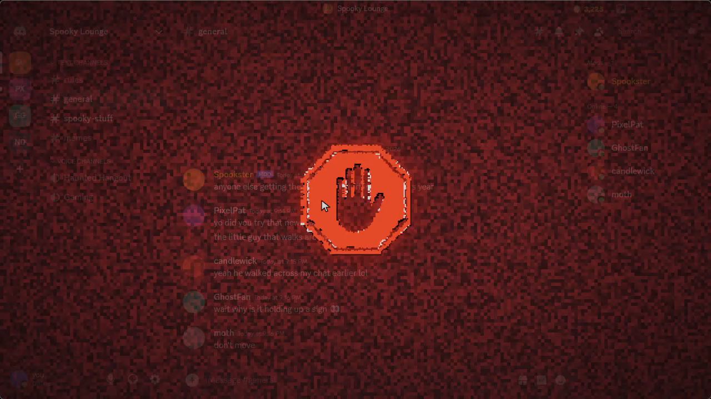<br>The stop sign | 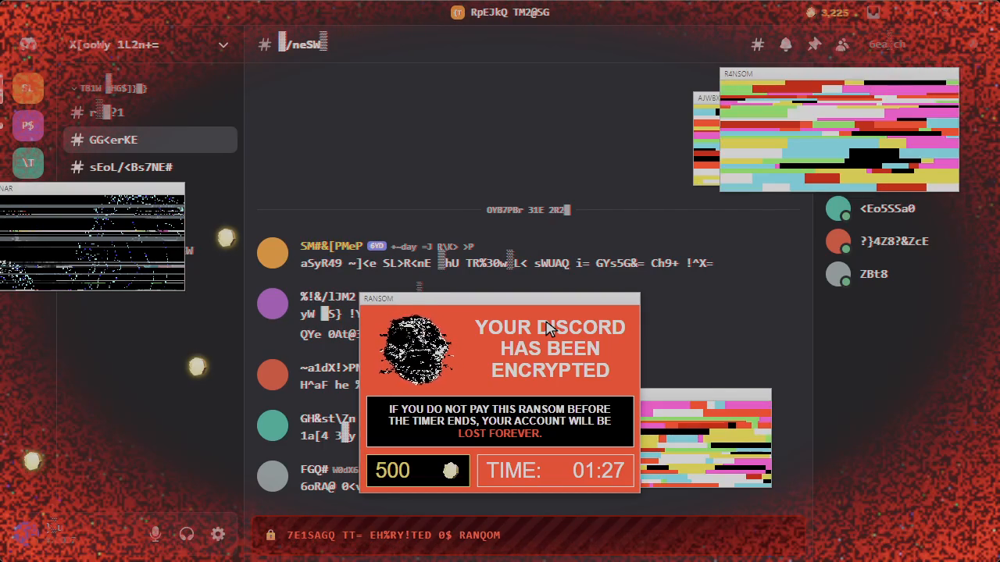<br>Discord encrypted, with the ransom window and its timer |
|---|---|
| 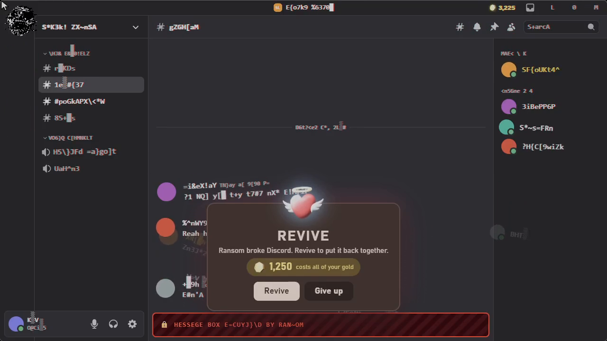<br>The revive card | 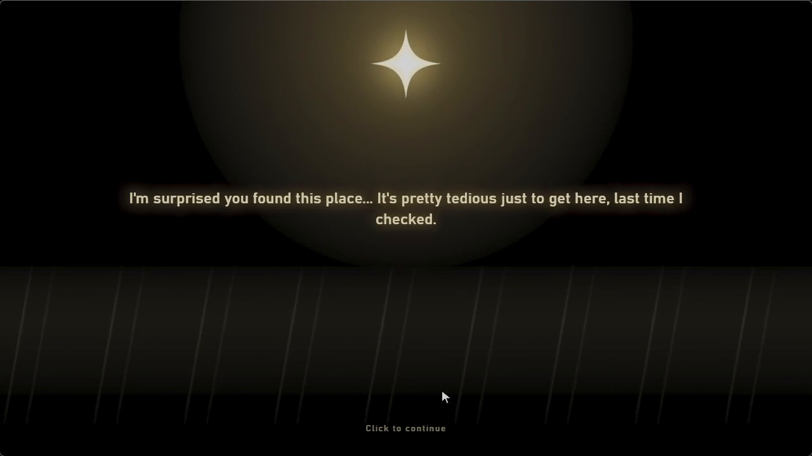<br>The death screen |

<p align="center">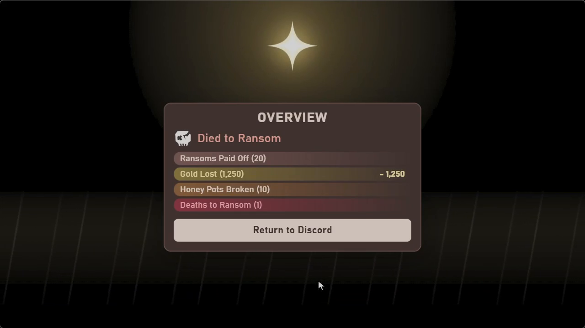<br>The overview after dying</p>

</details>

<details>
<summary><b>Settings</b></summary>

- Turn the wandering, the challenges, loose gold and hidden items on or off one by one.
- Set how often challenges can happen and how much gold Ransom asks for.
- Set how fast and how big Ransom is.
- **Break UI** (Discord falls apart) and **Encrypt UI** (scrambled text) can each be turned off. Both are only visual, and everything comes back when it ends.
- **See Through** tints the sign and download screens red instead of solid, so you can still read your chat.
- **Jumpscare** has its own volume, or you can get a plain "TIME'S UP" screen instead.
- **Calm Effects** turns off flashing and softens the static and shaking.
- Challenges can be kept away while you're typing, or in a voice call or stream.
- **Reset scores** in the Ransom panel asks first and keeps your gold.
- **Forget all finds** asks first too.

</details>

<details>
<summary><b>Things to know</b></summary>

- The wait between challenges only counts down while you're actually using Discord. It never counts while Discord is in the background, idle, or you're in a call.
- While Discord is encrypted or broken, only the message box is locked. Search fields and settings still work, and windows stay readable.
- It ends when you press Revive or Give up on the revive card, or turn Break UI or challenges off.
- Works in the Discord desktop app with Equicord, not in Discord on the web.

</details>

<details>
<summary><b>Privacy, connections and files</b></summary>

**What it talks to**
- static.wikitide.net, the DOORS wiki's files: Ransom's sprites, pop-ups, sounds and music.
- Only while **Doors Assets** is on. It's on by default.
- With it off, or if a download fails, Ransom's face doesn't show and it doesn't wander around at all.
- In that case the stop sign, gold, Honey Pot, revive heart and skull get plain drawn stand-ins.

**Where files go**
- `%APPDATA%\<your Discord>\RansomPlugin` holds the downloaded DOORS files. `<your Discord>` is `discord`, `discordptb` or `discordcanary`.
- Your gold, items and scores stay inside Discord.

**Optional files of your own**
- Put `gun.png`, `hand.png`, `music.mp3` and `death.mp3` in `RansomPlugin\EasterEgg` to use them in the rare B▓GG▓R encounter and its death screen.
- They are only read on your PC, never uploaded.

</details>

> [!NOTE]
> Ransom, its art, sounds and music belong to LSPLASH, the makers of DOORS. They aren't in this repo: the plugin downloads them from the DOORS wiki. This plugin is unofficial and not made or supported by them.

---

## Building it yourself

**Repo layout**

| Folder | What's in it |
|---|---|
| `custom-creations/` | One folder per plugin |
| `equicord-installer/` | The Go installer |
| `docs/` | Screenshots used in this README |
| `tools/patchtest/` | Checks if a plugin's patches still fit the Discord you have open |

**Build the installer**

You need [Go](https://go.dev) 1.27 or newer (see `equicord-installer/go.mod`).

```bash
cd equicord-installer
go build -trimpath -ldflags "-s -w" -o "Cordmuffin Equicord Installer.exe" .
```

**Use the plugins without the installer**

1. Copy any folder from `custom-creations` into your Equicord checkout's `src/userplugins`.
2. Run `pnpm build && pnpm inject`.

**Make the release zip**

1. In PowerShell, run `equicord-installer/build-release.ps1 -Version 1.2.3`.
2. Use the same version you'll tag the release as (`v1.2.3`). The background updater compares the two to find a newer installer.
3. Upload both files it makes: the zip and `Cordmuffin Equicord Installer.zip.sha256`.

- The zip only holds the installer and the empty **Plugins Go Here** and **Themes Go Here** folders.
- The script stops if anything else would end up in the zip.
- The background updater checks a new installer against the checksum before using it.

## Issues

[Open an issue](../../issues) for bugs or questions. Please include:

- Which plugin
- What you did
- What happened

For install or update problems, attach `install.log` or `update.log` from `%LOCALAPPDATA%\Cordmuffin`.

## License

GPL-3.0. See [LICENSE](LICENSE).

Autocorrect's word lists are from SymSpell by Wolf Garbe (MIT). See [`custom-creations/autocorrect/LICENSE-SymSpell.txt`](custom-creations/autocorrect/LICENSE-SymSpell.txt).
