# cordmuffin

Plugins for [Equicord](https://github.com/Equicord/Equicord), a mod for the Discord desktop app. Includes Muffinshelf, an in-Discord store for plugins Equicord doesn't ship, and an optional installer that builds Equicord with the plugins and themes you choose.

> [!WARNING]
> Client mods like Equicord break [Discord's Terms of Service](https://discord.com/terms). Nobody is known to have been banned just for using one, but if losing your account would be a disaster, don't use mods.

> [!IMPORTANT]
> This is not an official Equicord project. Equicord doesn't help with custom plugins or self-built installs, so please don't ask in their support channels. [Open an issue here](#issues) instead.

**[Install](#equicord-installer)** · **[Plugins](#plugins-at-a-glance)** · **[Build it yourself](#building-it-yourself)** · **[Issues](#issues)** · **[License](#license)**

---

## Plugins at a glance

Each plugin is a folder in [`custom-creations`](custom-creations). The folder name is listed under each plugin's heading.

**Store**

| Plugin | What it does |
|---|---|
| [Muffinshelf](#muffinshelf) | A plugin store inside Discord for plugins Equicord doesn't ship, BetterDiscord ones included. |

**Everyday**

| Plugin | What it does |
|---|---|
| [Dictation](#dictation) | Talk instead of typing, with punctuation added. Runs on your own computer. |
| [ShrinkUploads](#shrinkuploads) | Shrinks pictures, GIFs, videos and audio to fit your upload limit, on your own computer. |
| [ProfileImages](#profileimages) | One-click buttons to see profile pictures, banners and server icons full size. |
| [PluginPresets](#pluginpresets) | Saves which plugins are on as presets you can switch between and share. |
| [GreetStickerPicker+](#greetstickerpicker) | Pick any sticker for the "Wave to say hi!" button, in servers and in DMs. |
| [HideClientBadges](#hideclientbadges) | Hides client mod badges, so profiles only show Discord's own. |
| [BadgeTierViewer](#badgetierviewer) | Click any tier in Your Badges to see it in the big preview, locked or as it looks once unlocked. |
| [TranslateItAll](#translateitall) | Translates messages with Google or Yandex Translate, no API key needed. |
| [Discrub Loader](#discrub-loader) ⚠ | Opens Discrub, which exports, searches and cleans up your messages, inside Discord. |

**Badges & quests**

| Plugin | What it does |
|---|---|
| [Game Browser](#game-browser-gametimespoof) (GameTimeSpoof) ⚠ | Makes Discord think you're playing any detectable game, so your Game Time and Game Variety badges keep counting. |
| [StreamTimeFarmer](#streamtimefarmer) | Earns Streaming badge time by streaming to a second account of yours, which runs in a hidden window. No second Discord install needed. |
| [QuestRunner](#questrunner) ⚠ | Does your Discord quests for you. You only come back to claim the reward. |
| [PlatformSpoofer+](#platformspoofer) ⚠ | Pick whether people see you on phone, console, VR headset, web or desktop. |

**Fun**

| Plugin | What it does |
|---|---|
| [Ransom](#ransom) | Ransom from DOORS wanders around your Discord and holds it hostage for gold. Only on your screen. |

⚠ These do things Discord's rules forbid on top of using a mod (made-up reports, automation or spoofing). Only use them on an account you're fine risking.

The installer also adds [CordmuffinUpdater](#automatic-updates-cordmuffinupdater), which keeps everything up to date.

---

## Equicord Installer

The installer downloads Equicord, adds your plugins, builds it, puts it into Discord, and turns your themes on.

1. Download **Cordmuffin Equicord Installer.zip** from [Releases](../../releases) and unzip it anywhere.
2. Get the plugins: on this page click **Code → Download ZIP**, unzip it, open `custom-creations`, and copy the folders of the plugins you want (names are in the [plugin list](#plugins-at-a-glance)) into **Plugins Go Here**. You don't need `cordmuffinUpdater`: the installer adds it on its own.
   - Plugins from anywhere else work as well: a folder with an `index.ts` or `index.tsx` inside, a single `.ts`/`.tsx` file, or a zip.
3. Drop themes (`.css` files) into **Themes Go Here**.
4. Run **Cordmuffin Equicord Installer.exe** and click **Yes**.

> [!NOTE]
> Windows might say "Windows protected your PC" because the installer isn't signed. Click **More info**, then **Run anyway**.

The first run takes a few minutes. After that it's faster.

It finds Discord, Discord PTB and Discord Canary on its own, and doesn't need admin rights. If something goes wrong partway, Discord is left as it was, and if Equicord's files ever go missing, Discord simply starts without it.

### Updating and removing

| To | Do this |
|---|---|
| **Get updates automatically** | Nothing to do. It's on by default through [CordmuffinUpdater](#automatic-updates-cordmuffinupdater). Change it in **User Settings → Cordmuffin Updater**. |
| **Add or update plugins** | Change the folders and run the installer again. Your Muffinshelf plugins are kept. A newer download in a different folder copies your plugins over from the last install into its **Plugins Go Here**. |
| **Update by hand** | Run it again and click **Yes**. It always grabs the newest Equicord, and swaps any cordmuffin plugins in **Plugins Go Here** for their newest version (the old copy is kept in `%LOCALAPPDATA%\Cordmuffin\plugin-backups`). |
| **Remove it** | Run it, click **No**, then confirm. Discord goes back to normal, and if you had another Discord mod before, it puts that back. |

### Automatic updates (CordmuffinUpdater)

`cordmuffinUpdater` · Added by the installer · On by default

**Connects to:** api.github.com, codeload.github.com and github.com (including the repos your Muffinshelf plugins came from), plus nodejs.org and registry.npmjs.org while an update builds. Its files live in `%LOCALAPPDATA%\Cordmuffin`, listed under [What the installer downloads and changes](#what-the-installer-downloads-and-changes).

Keeps the cordmuffin plugins, your Muffinshelf plugins and the installer up to date.

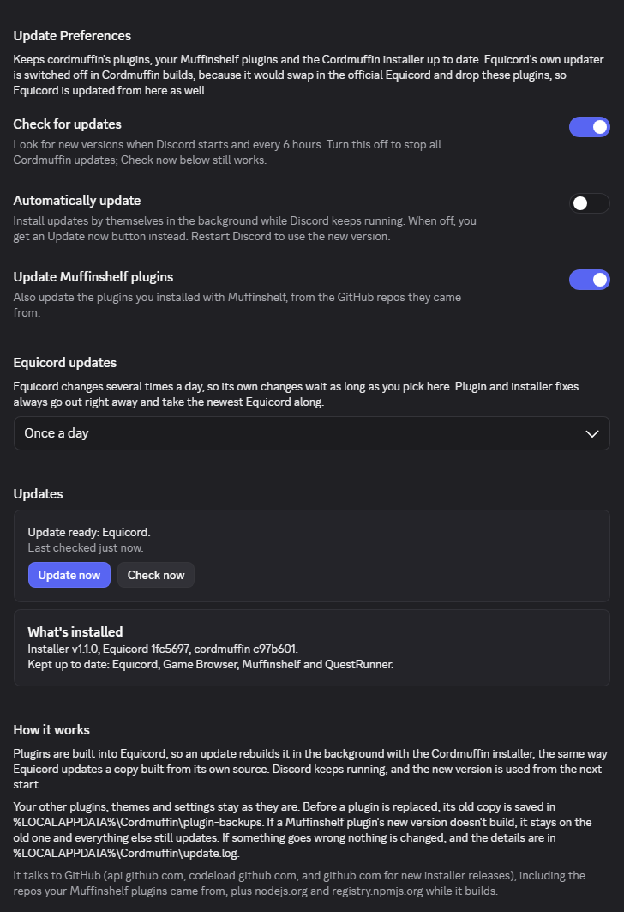

**What it does**
- Asks GitHub when Discord starts, and every 6 hours, whether there's a newer version of a cordmuffin plugin you use, of a plugin you installed with Muffinshelf (checked in the GitHub repo it came from), or of the installer.
- If there is, it runs the installer in the background to build the update while Discord keeps working.
- When it's done, a notification says what was updated. Click it to restart Discord, or the update is used the next time Discord starts.
- Updates install by themselves by default.
- Your other plugins, themes and settings are left alone.
- Equicord updates are off by default: updates rebuild with the Equicord you already have.

It isn't in the plugin list. Its switches are on its own page, **User Settings → Cordmuffin Updater** (in the Equicord Settings section).

<details>
<summary><b>Settings</b></summary>

All on **User Settings → Cordmuffin Updater**:
- **Automatically update** (on by default): turn it off to get an **Update now** button instead.
- **Update Muffinshelf plugins**: turn it off to leave Muffinshelf plugins alone.
- **Also update Equicord**: turn it on to keep Equicord up to date too.
- **Check for updates**: turn it off to stop it completely.
- The page also has **Check now** and shows what's installed. Clicking an update notification opens it.

Equicord's own updater would replace your build with the official one, which doesn't include these plugins. Turn on **Also update Equicord** to update it from here instead. Equicord changes several times a day, so you choose how often: at most once a day (default), once a week, on every change, or only with plugin updates. With it on, a plugin update also brings the newest Equicord.

</details>

<details>
<summary><b>What an update looks like</b></summary>

When an update is ready, you get a notification, or with **Automatically update** off, a bar with an **Update now** button:

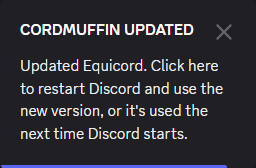


</details>

<details>
<summary><b>Things to know</b></summary>

- Before an update replaces a cordmuffin or Muffinshelf plugin, the old copy is saved in `%LOCALAPPDATA%\Cordmuffin\plugin-backups`.
- If a Muffinshelf plugin's new version doesn't build, it stays on the old one and the rest still updates.
- If an update fails, nothing changes, and the reason is in `%LOCALAPPDATA%\Cordmuffin\update.log`.

</details>

### What the installer downloads and changes

- **Downloads from:** nodejs.org, api.github.com, codeload.github.com, github.com, registry.npmjs.org
- **Changes:** Discord's `resources` folder, `%LOCALAPPDATA%\Cordmuffin`, Equicord's theme settings (only if you added themes)
- **Uploads:** nothing. Nothing is uploaded anywhere.

<details>
<summary><b>Full list of what it downloads and changes</b></summary>

**It downloads from these places:**
- nodejs.org: Node.js, which is needed to build Equicord. It's kept in `%LOCALAPPDATA%\Cordmuffin` and isn't installed on your PC.
- api.github.com and codeload.github.com: Equicord's source code, from [Equicord/Equicord](https://github.com/Equicord/Equicord), and the newest cordmuffin plugins from this repo.
- github.com: newer releases of the installer itself, when CordmuffinUpdater finds one.
- registry.npmjs.org: pnpm and the packages Equicord needs to build (Equicord's own `pnpm-lock.yaml` decides which).

**It changes these on your PC:**
- Discord's `resources` folder: it renames `app.asar` to `_app.asar` and adds a small `app.asar` folder that loads Equicord. This is the same way Equicord's own installer does it.
- `%LOCALAPPDATA%\Cordmuffin`: Node.js, Equicord's source, pnpm's download cache, the built files, a copy of the installer and of your plugins for background updates, `install.log` and `update.log`. Removing Equicord deletes this folder, except `plugin-backups` when updates saved old plugin copies there (delete it by hand if you don't need them).
- `%APPDATA%\Equicord\themes` and the `enabledThemes` list in `%APPDATA%\Equicord\settings\settings.json`, only if you added themes.

</details>

---

## Plugins

**Installing any plugin below:** copy its folder from `custom-creations` into **Plugins Go Here**, then run the [installer](#equicord-installer). If you build Equicord yourself, it goes in `src/userplugins` like any other user plugin.

---

### Muffinshelf

`muffinshelf` · On by default

**Connects to:** the BetterDiscord store, GitHub, and the shelter, Moonlight and Replugged plugin lists. Details below.

A plugin store inside Discord for plugins Equicord doesn't ship. Open it from the muffin button in Discord's top bar.

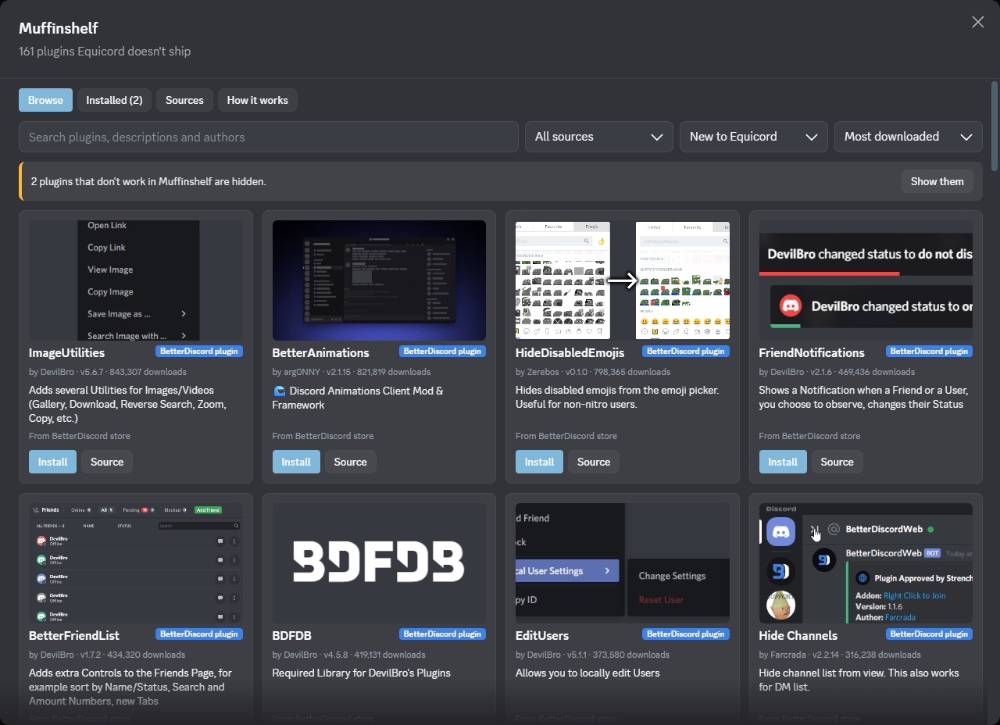

**What it does**
- Installs Equicord plugins from community GitHub repos and plugin lists (venpm `plugins.json`), with a rebuild and one restart.
- Installs BetterDiscord plugins from the official BetterDiscord store, with no rebuild or restart. 205 of the 207 tested store plugins work.
- Lists shelter, Moonlight, Replugged and Evi plugins too, with links, so you can find them. They're built for other mods and can't run on Equicord.
- Marks plugins Equicord already has (like InvisibleTyping, which is Equicord's SilentTyping) and hides them by default.
- Takes your own sources: paste a GitHub repo link, a `plugins.json` link or a single `.plugin.js` link in the **Sources** tab.
- The **How it works** tab explains all of this and shows every source and folder it uses.
- Works with Equicord built by the Cordmuffin installer or from your own source folder. Equicord from the official installer can't be rebuilt, so only BetterDiscord plugins work there.

> [!CAUTION]
> Every plugin you install is someone else's code, and it runs inside your Discord with full access to your account. BetterDiscord plugins are downloaded and run as code at runtime. Only install plugins from people you trust, and use the **Source** button if you're unsure.

<details>
<summary><b>How installs work</b></summary>

- Equicord plugins: Muffinshelf downloads the plugin's folder, rebuilds Equicord, turns the plugin on and asks you to restart Discord. If anything goes wrong, your plugins are put back the way they were and Discord keeps working.
- BetterDiscord plugins run through Muffinshelf's own BetterDiscord layer, with no rebuild or restart. Plugins that need one of the shared BetterDiscord libraries (ZeresPluginLibrary, BDFDB or XenoLib) get it installed with them. They get the same Node.js modules BetterDiscord gives them. Their file access is kept to their own plugins folder, but that's not a safety wall: like on BetterDiscord, they run with full access to your Discord account.
- Every BetterDiscord store plugin was run in Muffinshelf, and 205 of the 207 tested work. The 2 that don't were made for an older Discord; they're hidden, with the reason shown. Some plugins (BetterAnimations, for example) are fixed up for today's Discord, and a few need one Discord restart after they're installed; Muffinshelf asks when that happens. A plugin that fails for you is hidden the same way, until a new version comes out.

</details>

<details>
<summary><b>Privacy, connections and files</b></summary>

**What it talks to:**
- api.betterdiscord.app and raw.githubusercontent.com: the BetterDiscord store list and plugin files.
- codeload.github.com and raw.githubusercontent.com: GitHub repos and `plugins.json` lists, including any you add yourself.
- shindex.uwu.network, moonlight-mod.github.io and replugged.dev: the shelter, Moonlight and Replugged plugin lists.
- Whatever an installed BetterDiscord plugin itself connects to. Those requests go out from Discord's main process.

**Where files go:** Equicord plugins go in Equicord's `src/userplugins` folder, with a backup copy in `%APPDATA%\Equicord\muffinshelf\userplugins` so a Cordmuffin update can't lose them. BetterDiscord plugins and their settings go in `%APPDATA%\Equicord\muffinshelf\bd`.

</details>

---

### Dictation

`dictation` · Off by default · Windows, Linux and macOS

**Connects to:** github.com and huggingface.co, once, to download the speech engine and models. Works offline after that.

Talk instead of typing. Click the mic in the chat bar (or hold **Alt+D**), talk, and your words show up in the message box with commas, periods and capitals already in place.

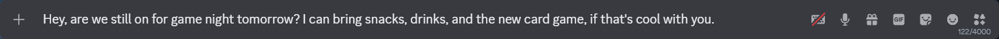

**What it does**
- Runs entirely on your computer: no account or API key, and audio never leaves your PC.
- Picks the right speech engine and model for your computer on first use. You can choose one yourself.
- **Fix Grammar** (optional) turns on a small AI model that cleans up grammar as well.
- Shows the text live while you talk, with a small level meter that turns green when it hears you.
- Ignores silence, so background noise never turns into made-up words.
- Uses your Discord mic settings: the same input device, input profile and input volume as your voice calls.

<details>
<summary><b>How to use it</b></summary>

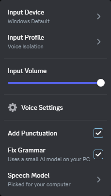 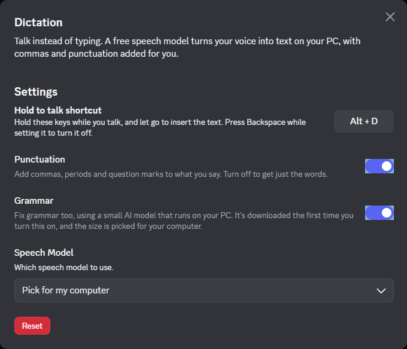

- Click the mic in the chat bar, or hold the shortcut, and talk. Your words show up above the message box as you speak, next to the level meter. The finished text goes into the message box when you stop.
- Right-click the mic for Discord's own mic menu, plus **Add Punctuation**, **Fix Grammar** and **Speech Model**.
- If your mic is muted or you don't say anything, nothing gets added.

</details>

<details>
<summary><b>Settings</b></summary>

- The shortcut is Alt+D by default. Change it in the plugin's settings. It works while Discord is focused.
- Turn the live text off if you don't want it.
- Speech model: on first use it downloads a speech engine and model that suit your PC: [Cohere Transcribe](https://huggingface.co/CohereLabs/cohere-transcribe-03-2026), the most accurate free English model on Hugging Face's Open ASR leaderboard, on stronger PCs, or the lighter [Parakeet TDT 0.6B v2](https://huggingface.co/nvidia/parakeet-tdt-0.6b-v2) on older ones. You can choose either one yourself.
- Fix Grammar uses Qwen3 4B (or Qwen2.5 1.5B on PCs with under 8 GB of memory), and runs on your graphics card when it has room, or on the processor otherwise. Each fix takes well under a second on a graphics card and about a second on a modern processor.

</details>

<details>
<summary><b>Privacy, connections and files</b></summary>

**What it talks to:** only github.com and huggingface.co, once, to download the engines and models ([sherpa-onnx](https://github.com/k2-fsa/sherpa-onnx) and [llama.cpp](https://github.com/ggml-org/llama.cpp)). After that it works offline.

**Where files go:** `%APPDATA%\Equicord\dictation` (about 1.7 GB, plus about 2.5 GB if you turn on Fix Grammar).

**Memory:** while in use, the speech engine takes around 3.5 GB of memory (plus about 3 GB with Fix Grammar on), and both unload themselves after 5 minutes without use.

</details>

---

### ShrinkUploads

`shrinkUploads` · Off by default

**Connects to:** github.com, once, for the video tool (skipped if you already have a full ffmpeg). Your files never leave your computer until Discord uploads them.

Shrinks pictures, GIFs, videos and audio so they fit your Discord upload limit, right on your own computer.

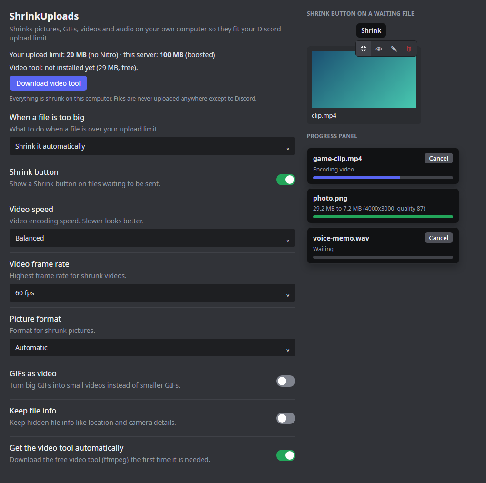

<table>
<tr>
<td align="center">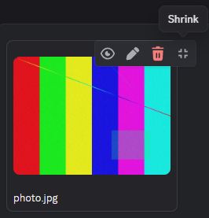<br><sub>The Shrink button on a waiting file</sub></td>
<td align="center">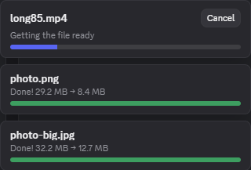<br><sub>Progress panel: pictures don't wait for videos</sub></td>
</tr>
<tr>
<td align="center">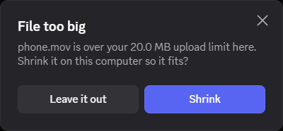<br><sub>"Ask me first" mode</sub></td>
<td align="center">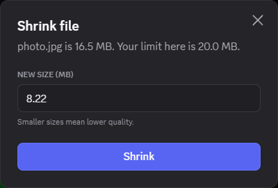<br><sub>Pick your own size</sub></td>
</tr>
</table>

**What it does**
- When you send a file over your limit, it's shrunk to just under the limit and added back to the message.
- The **Shrink** button on any file waiting to be sent lets you pick your own size.
- Uses your real limit for no Nitro, Nitro Basic, Nitro and every server boost level.
- Handles huge files. A 6 GB 4K camera clip shrinks to fit a free account's 20 MB in under half a minute on a fast PC.
- Removes hidden file info like your location and camera details by default.

<details>
<summary><b>How to use it</b></summary>

- Send the file as usual. You can have it ask first or do nothing instead. Files that already fit in the same drop go through like normal.
- Use the **Shrink** button to pick a smaller size yourself, for example to save someone's data. The file keeps its spoiler, description and name.
- A small panel shows each file's progress, with **Cancel**. Cancelling a Shrink button job puts the original file back. If a too-big file gets cancelled or can't be shrunk, it's left out of the message and the panel says why, until you close it. Send it again to retry.

  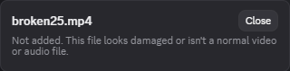
- It checks there's enough free disk space before starting.
- The settings page shows your real limit, for DMs and for the server you're in. It gets the limit from Discord's own code, the same check Discord runs when you upload, so it stays right when Discord changes the numbers.

</details>

<details>
<summary><b>Settings</b></summary>

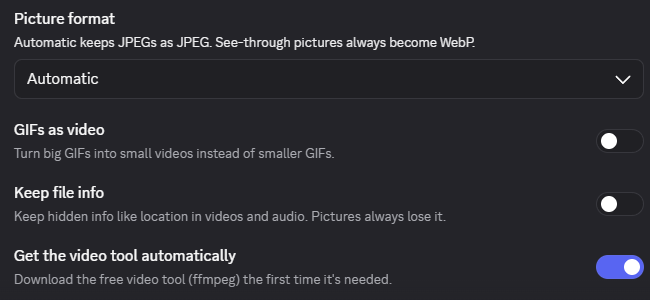

- **When a file is too big**: shrink it automatically (default), ask first, or do nothing.
- **Shrink button** (on): show the Shrink button on files waiting to be sent.
- **Video speed**: Fast, Balanced (default) or Best quality (slow). Slower looks better.
- **Video frame rate**: 60 fps (smoother, default) or 30 fps (sharper).
- **Picture format**: Automatic (default), WebP (smallest) or JPEG. Automatic keeps JPEGs as JPEG. See-through pictures always become WebP.
- **GIFs as video** (off): turn big GIFs into small videos instead of smaller GIFs.
- **Keep file info** (off): keep hidden info like location in videos and audio.
- **Get the video tool automatically** (on): download ffmpeg the first time it's needed.

</details>

<details>
<summary><b>What it does to each kind of file</b></summary>

- Videos (MP4, MOV, MKV, WebM, AVI and more): re-encoded in two passes aimed at the exact size, then checked and fixed if it missed. It picks the size and frame rate that look best for the space, for example 720p at 30 fps rather than a blurry 540p at 60. If a video is too long to look OK at all, it says so instead of making mush.
- Pictures: the best quality that fits, and smaller only if it has to. Screenshots stay pin-sharp when they can. See-through pictures stay see-through.
- GIFs: rebuilt smaller, or turned into a small video if you turn that on.
- Audio: turned into small Opus audio.
- Phone HDR videos get normal colors, so they don't look washed out. Old camcorder and TV recordings get cleaned up so motion doesn't look doubled.
- Pictures and GIFs always lose their hidden file info. Videos and audio keep it if you turn on **Keep file info**.

</details>

<details>
<summary><b>Things to know</b></summary>

Videos, GIFs and audio need ffmpeg, a free video tool. Pictures don't need it.

- If you already have a full ffmpeg build (with libx264 and libopus) from scoop, winget, Chocolatey or your PATH, it's found and used, and nothing gets downloaded. An ffmpeg that fails a quick test encode is skipped.
- To use a specific one, click **Use my own ffmpeg** in the settings and pick it. It has to pass the same test. **Back to automatic** undoes that.
- If you don't have it, the plugin downloads it once (about 30 MB) the first time it's needed, or when you click **Download video tool** in the settings.
- It comes from a fixed release of ffmpeg-static on GitHub and is checked against a fingerprint built into the plugin before it's used.
- If the download fails, check your internet and click **Download video tool** in the settings to try again.
- It works through your computer's proxy settings, like Discord does.

</details>

---

### ProfileImages

`profileImages` · Off by default

**Connects to:** cdn.discordapp.com only, for the images themselves, through Discord's own viewer.

See anyone's profile picture and banner full size with one click. Equicord's ViewIcons hides this in right-click menus; ProfileImages puts the buttons right on the profile. It works fine next to ViewIcons, so you can keep both on.


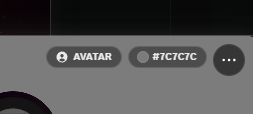

**What it does**
- On the full profile: two square buttons next to Message, one for the avatar and one for the banner. They look like Discord's own buttons, and themes style them the same way.
- On the popout and DM side panel: small **Avatar** and **Banner** buttons in the top corner of the banner. They move aside on their own so they never cover Discord's buttons there.
- Opens images in Discord's own viewer, full size, and animated avatars and banners stay animated.
- If someone has a server avatar or banner, that one opens first.
- With no banner, the banner button shows their banner color instead.
- Servers get **Icon** and **Banner** buttons on their banner.

<details>
<summary><b>How to use it</b></summary>

- Use the viewer's arrows to switch between the server and main avatar or banner (or pick main-first in settings).
- Hover the banner-color button to see the code, click to copy it, or hide the button in settings.
- Right-click a button to pick the server or main version, view the avatar decoration, copy the link, open it in your browser, or copy the banner color.

  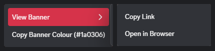

- If a server has a banner, its **Icon** and **Banner** buttons sit in the bottom-right corner at the top of the channel list. They open the server icon or banner full size, and right-click gives **Copy Link** and **Open in Browser**.

  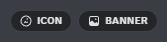

</details>

<details>
<summary><b>Settings</b></summary>

- Turn each button on or off.
- Pick where they show: full profile, popout, DM side panel, server banner.
- Pick which banner corner they sit in.
- Image format: webp, png or jpg, and webp or gif for animated ones.
- Size: 512 to 4096.

</details>

---

### PluginPresets

`pluginPresets` · Off by default

**Connects to:** nothing. Presets are saved in Equicord's own storage inside Discord, not in settings.json.

Save which plugins are on, along with their settings, as a named preset, and switch between presets in one go. Have a "Minimal" preset with 5 plugins and an "Everything" one with 100, and flip between them without clicking through 300 toggles.

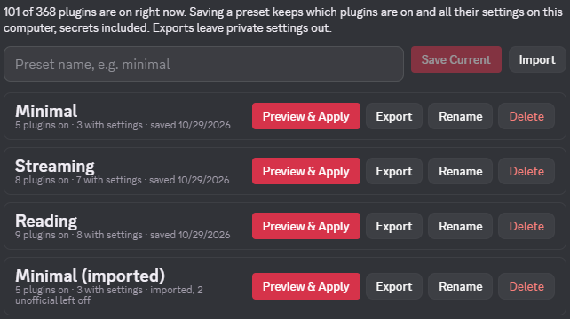

**What it does**
- **Save Current** saves the plugins that are on now and every setting they have.
- **Preview & Apply** shows what a preset turns on, turns off and changes before anything happens.
- **Share** presets as a code or a .json file, with your private settings left out.
- **Import** someone else's preset safely: it only turns on official Equicord and Vencord plugins you have.
- Everything is on the plugin's settings page (**Plugins → PluginPresets**).

<details>
<summary><b>How to use it</b></summary>

- Saving with a name that's already taken replaces that preset. Presets you save yourself keep everything, secrets included, so treat them like your settings. Only exports leave private settings out.
- Applying turns on exactly the plugins in the preset and turns the rest off. Required, core and API plugins aren't touched, and plugins that others depend on stay on.

  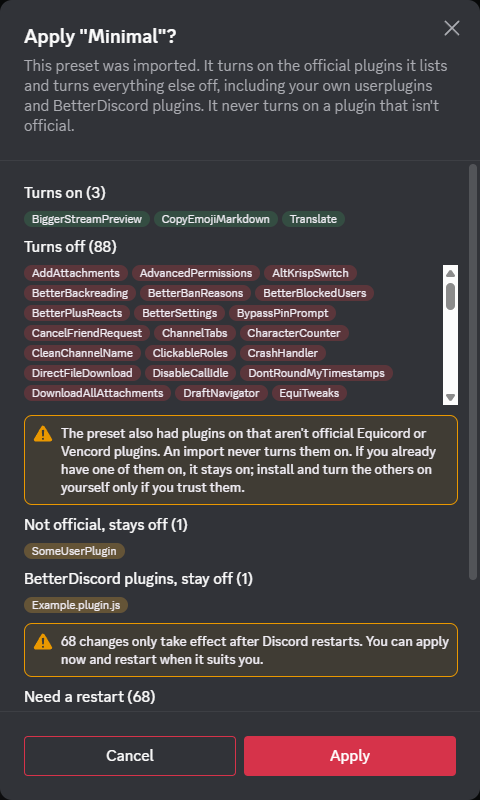

- Most plugins switch right away. Plugins that change Discord's code, and some settings, only take effect after a restart. The preview lists them, and after applying you get **Restart Now** or can restart later. A plugin that fails to start is left off and listed.
- **Rename** and **Delete** only change the saved preset, never your plugins.

</details>

<details>
<summary><b>Sharing and importing</b></summary>

- **Export** gives you a code to copy (it starts with `PP1.`) or a .json file. Before you copy it, it lists every setting it left out and why.

  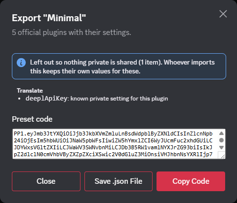

- Exports leave out API keys, tokens, passwords, webhooks, login and cookie values, user, channel and server IDs and lists of them, file paths, web addresses and free text that could be personal. It checks the setting's name, what the value looks like (token and key shapes, Discord IDs, emails, paths, addresses) and a list of plugins known to keep private settings, such as Translate's DeepL key or CustomRPC. If a value can't be shown to be harmless, it's left out. Switches, choices from a plugin's own list, plain numbers and default values are shared.
- Plugins that aren't official Equicord or Vencord plugins (cordmuffin plugins, other userplugins, Muffinshelf BetterDiscord plugins) are shared by name only, without their settings. Exports carry nothing about your account.
- **Import** takes a code or a .json file, checks it, and saves it as a preset you can look over before applying.

  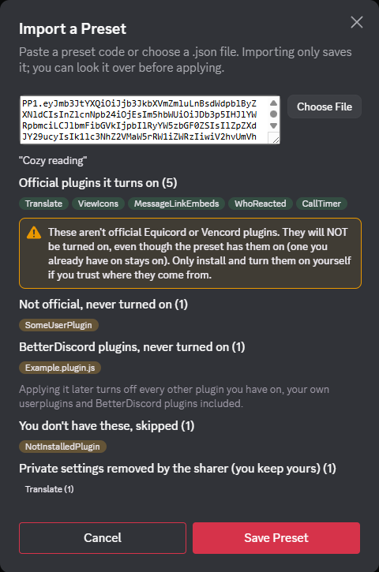

- An imported preset only turns on official Equicord and Vencord plugins you have, and applying it turns everything else off, your own userplugins and BetterDiscord plugins included. Other plugins in it are listed with a warning and are never turned on, even if the preset has them on. If you already have one of them on, it stays on. Plugins you don't have are listed as missing.
- Imported settings go through the same checks, so a preset can't point your plugins at someone else's server. Settings the sharer's export left out keep your own values.

</details>

---

### GreetStickerPicker+

`greetStickerPickerPlus` · Off by default

**Connects to:** Discord itself, plus cdn.discordapp.com and media.discordapp.net for the sticker thumbnails.

A bigger version of Vencord's GreetStickerPicker, for the **Wave to say hi!** button you get on welcome messages and in new DMs.

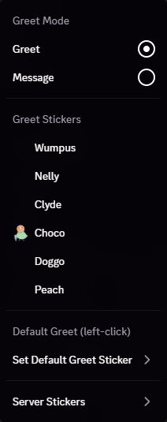

**What it does**

Everything the original does (Greet or Normal Message mode, picking which welcome sticker to wave with), plus:
- Works in DMs. The original only reacts on a server's welcome message. GreetStickerPicker+ also works on the wave buttons in new DMs and on the in-channel greet.
- Right-click opens Discord's real sticker picker in a small window: search, the server list on the side, thumbnails and favorites. Pick any sticker and it's sent as your greet. Shift+right-click opens the list menu instead.
- Left-click sends your default sticker. Turn on **Set as default** in the picker window (or use the list menu) to choose it. Without a default, left-click does Discord's normal random wave.
- A searchable **Server Stickers** menu, with thumbnails, lists every sticker you're allowed to send, grouped by server.
- Thumbnails show next to the stickers in the menus.
- **Unholy Multi-Greet** (up to 3 welcome stickers in one message) gets a normal switch in settings.

<details>
<summary><b>Settings</b></summary>

Greet mode, whether right-click opens the picker or the list menu, the Server Stickers menu on or off, only this server's stickers, and Unholy Multi-Greet.

</details>

<details>
<summary><b>Things to know</b></summary>

- Thumbnails show for PNG, APNG and GIF stickers. Discord's Lottie stickers, like most of the default welcome ones, have no plain image, so they show just the name.
- Unholy Multi-Greet is a hidden setting in the original that you can't turn on from the settings page.
- If you used the original, GreetStickerPicker+ takes over its settings and turns it off, so the two don't fight over the same button. If you turn the original back on, GreetStickerPicker+ stands aside and says so.

</details>

---

### HideClientBadges

`hideClientBadges` · Off by default

**Connects to:** nothing new. With **Block Donor Lists** on, badges.vencord.dev and badge.equicord.org are no longer contacted.

Takes client mod badges off profiles, so they only show Discord's own badges: Nitro, server boost, HypeSquad, Active Developer, quests, game badges and the rest.

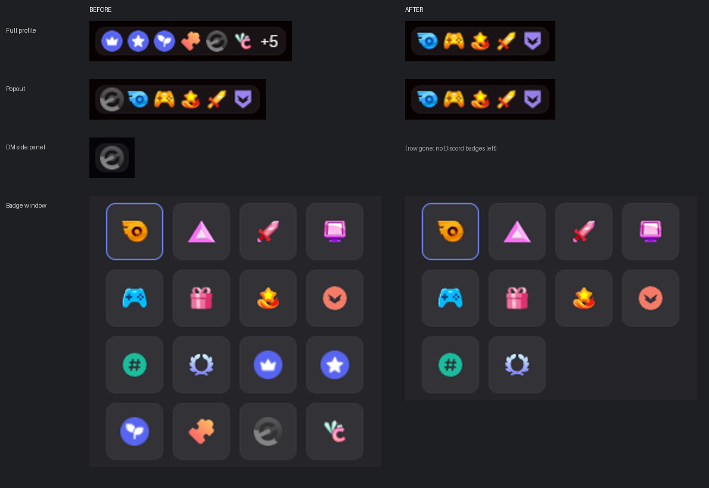

**What it does**
- Works everywhere badges show: the profile popout, the full profile, the DM side panel, and the badge window you get when you click a badge.
- Hides Vencord and Equicord donor, custom, translator and contributor badges, badges from other mods that the GlobalBadges plugin shows (Aliucord, BetterDiscord, Replugged, Nekocord, ReviewDB and more), and badges that plugins add, like FriendshipRanks.
- Removes them from the badge list itself, so there are no gaps and the "+3" count stays right. Discord's own badges aren't touched.
- Only changes what you see. Other people still see their badges, and yours, the same as before.

<details>
<summary><b>Settings</b></summary>

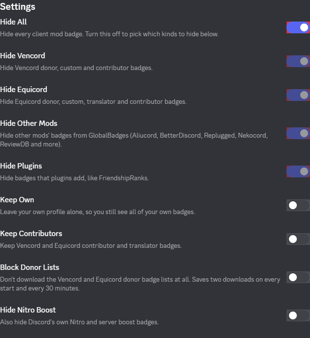

- **Hide All** is on by default. Turn it off to pick which kinds to hide: Vencord, Equicord, other mods or plugins.
- **Keep Own** leaves your own profile alone, so you still see all of your own badges.
- **Keep Contributors** keeps Vencord and Equicord contributor and translator badges.
- **Block Donor Lists** stops Equicord from downloading the Vencord and Equicord donor badge lists at all (it normally grabs them on every start and every 30 minutes). This also empties donor badges in chat if you use ShowBadgesInChat.
- **Hide Nitro Boost** also hides Discord's own Nitro and server boost badges. Off by default.

</details>

<details>
<summary><b>Things to know</b></summary>

Client mods hand out their own profile badges to donors and contributors, and donors can pick custom ones that everyone with the mod sees. In a big server, half the profiles end up covered in them. That's what this plugin cleans up.

</details>

---

### BadgeTierViewer

`badgeTierViewer` · Off by default

**Connects to:** nothing new.

Lets you look at every tier of a tiered badge (Streaming, Game Time and the rest) in the big preview at the top of the badge window, not just the one you're on.

| 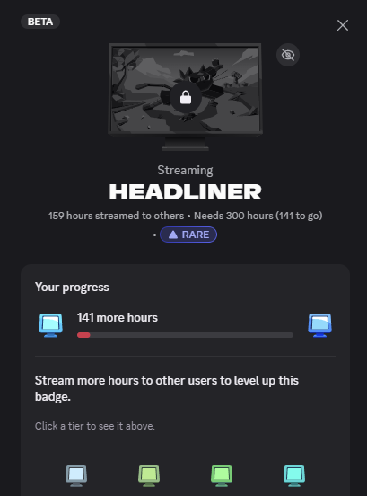<br>A locked tier, shown locked | 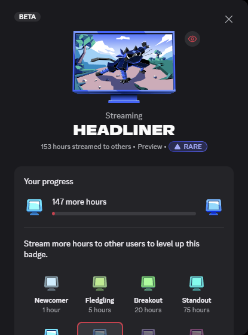<br>The same tier with the eye on |
|---|---|

**What it does**
- Click any tier in the grid under **Your progress** (or tab to it and press Enter) and the big preview switches to it, with its name, art and rarity. The picked tier gets a ring around it.
- Tiers you haven't unlocked show greyed out with a lock, along with what they take and how far off you are, like "Needs 300 hours (141 to go)". Nitro and Server Boosting tiers show a rough unlock date instead, like "Unlocks around Aug 22, 2027 if you stay subscribed".
- The eye button next to the big preview flips that: open eye shows locked tiers the way they look once unlocked (marked "Preview"), closed eye with a line through it shows them locked again. It only shows up on badges that still have locked tiers, and it's dimmed while you're looking at a tier you already have.
- Works on your own badges and on other people's. Closing the window puts it back on the tier it normally opens on.
- Only changes what you see. Nothing extra is sent to Discord, and Discord's own stats still get the tier you really have, not the one you're previewing.

<details>
<summary><b>Settings</b></summary>

- **Reveal Locked** is the same switch as the eye button, so it remembers your choice. Off by default.

</details>

---

### TranslateItAll

`translateItAll` · Off by default

**Connects to:** Google Translate, or Yandex Translate if you turn it on. Toki Pona, Sitelen Pona and Shavian use a few more hosts, listed below.

Translate+ (by Prince527, based on Vencord's Translate) as a userplugin, with Yandex Translate added as a free choice next to Google Translate.

**What it does**
- Adds **Translate** to the message hover buttons and the message right-click menu. The translation shows under the message.
- Translates into the language you pick in settings (searchable list, English by default).
- Uses Google Translate by default. Turn on **Use Yandex Translate** to use Yandex instead. Neither needs an account or API key.
- Toki Pona, Sitelen Pona and Shavian work the same as in Translate+. Each one can be turned off in settings (needs a restart).

<details>
<summary><b>Things to know</b></summary>

- The first time you translate with Yandex, Equicord asks to allow `translate.yandex.net`. Accept it and restart Discord. The settings page also shows an **Allow Host** button while **Use Yandex Translate** is on and the host is blocked.
- Turn off the built-in Translate+ while using this, so you don't get two Translate buttons.

</details>

<details>
<summary><b>Privacy, connections and files</b></summary>

**What it talks to:** the text of the message you translate goes to:
- translate.googleapis.com: Google Translate (the default).
- translate.yandex.net: only with **Use Yandex Translate** on.
- aiapi.serversmp.xyz: the Toki Pona translation service Translate+ uses, for Toki Pona and Sitelen Pona messages.
- raw.githubusercontent.com: the Sitelen Pona and Shavian word lists from Translate+'s repo (no message text is sent).

</details>

---

### Discrub Loader

`discrubLoader` · Off by default · Desktop app

**Connects to:** the Chrome Web Store (to get Discrub), GitHub (to check it) and discord.com. Details below.

Runs [Discrub](https://github.com/pratherbytecraft/discrub) inside Discord, a tool for exporting, searching and bulk-deleting your messages that normally runs as a browser extension. Open it from the broom button in the top bar.

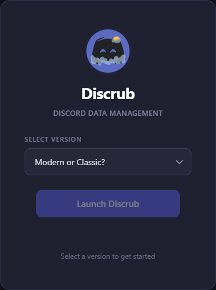

**What it does**
- Includes both versions: the new Discrub and Discrub Classic, the older version that's no longer updated. In settings you pick which one opens: New, Classic, or ask each time on Discrub's own start screen.
- Uses the Chrome Web Store build of Discrub as published, unmodified, with nothing copied into this repo. Discrub signs in with your Discord session on its own, like it does in the browser.
- Checks every download three ways, and installs nothing if a check fails.
- Updates on your terms, and goes back to the last working version if a new one won't start.
- Its settings page shows the installed version, the newest one on the store, any update waiting, when it last checked, and a **Check now** button.

> [!CAUTION]
> Bulk deleting or exporting with your own account is automation Discord's rules don't allow, the same as with the browser extension. Discrub waits between requests and slows down when Discord asks it to, so keep its delays at their defaults.

<details>
<summary><b>Settings</b></summary>

It looks for a new Discrub 20 seconds after Discord starts and every 6 hours after that. Pick how updates happen:
- **Ask before updating** (default)
- **Always take the latest**
- **Stay on the installed version**

A new version starts after Discord reloads. If it won't start, the plugin goes back to the last one that worked.

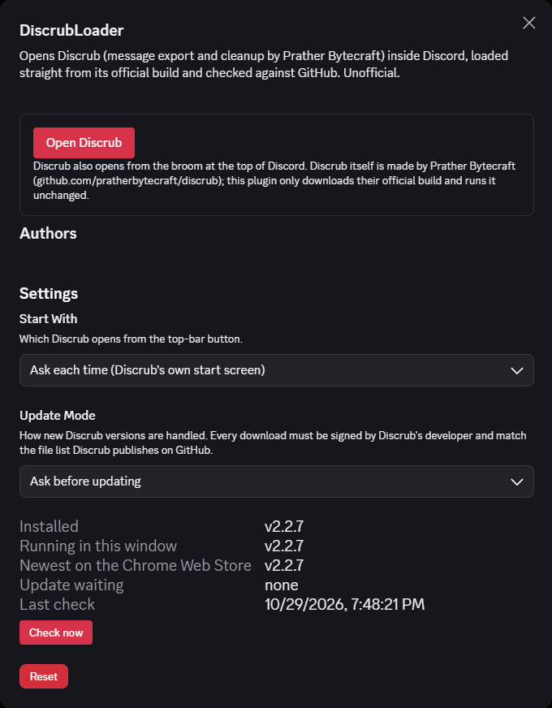

</details>

<details>
<summary><b>Things to know</b></summary>

- A download is only used if it matches the size and fingerprint the Chrome Web Store announces, it's signed by Discrub's own developer key, and every file matches the list Discrub publishes on GitHub for that version.
- The first install needs one Discord reload, and the plugin asks before reloading.
- Exports save straight to your Downloads folder.
- Discrub Classic signs in on its own only while the Discord window is focused, which is always the case when you click the broom yourself.
- Works in the Discord desktop app with Equicord, not in Discord on the web.

</details>

<details>
<summary><b>Privacy, connections and files</b></summary>

**What it talks to:**
- clients2.google.com and clients2.googleusercontent.com: the Chrome Web Store, to check for and download Discrub.
- raw.githubusercontent.com: Discrub's published file list, to check each download.
- discord.com: Discrub itself, using your own account.

**Where files go:** `%APPDATA%\Equicord\discrubLoader` (about 11 MB for each saved version, plus one 11 MB working copy; it keeps the current version and the one before it). Discrub keeps its own settings inside Discord.

</details>

> [!NOTE]
> Discrub is by [Prather Bytecraft](https://github.com/pratherbytecraft) and is their trademark. This plugin is unofficial and not made or supported by them: it downloads their official build and changes nothing. Please don't send them support requests about it. [Support them on Ko-fi](https://ko-fi.com/prathercc).

---

### Game Browser (GameTimeSpoof)

`gameTimeSpoof` · Off by default

**Connects to:** discord.com and cdn.discordapp.com only. It never downloads or runs code from the internet.

Makes Discord think you're playing any game Discord can detect, so your Game Time and Game Variety profile badges keep counting.

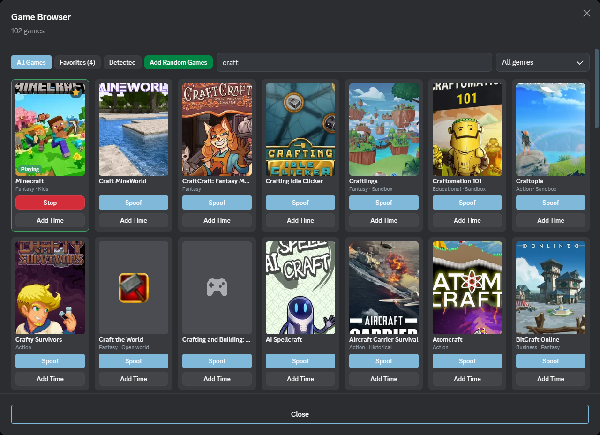

**What it does**
- The controller button in Discord's top bar opens the Game Browser: all of Discord's detectable games, with cover art, search, genre filter, favorites and a **Detected** tab.
- Click a cover to open that game's real Discord page.
- **Spoof** switches to that game right away. The game you're spoofing always stays at the top.
- **Rotation** cycles through your favorites or random games on a timer.
- **Add Time** and **Add Random Games** add play time to one game, all your favorites, or any number of random games (or all of them).
- The badge tracker shows your real badge ranks and when your added time should be counted.
- Real games count too, even with Equicord's NoTrack blocking Discord's own reports.

> [!IMPORTANT]
> Turn on both "Use data" options in User Settings → Data & Privacy, or Discord ignores the play time and your badges won't move. Details under "What it needs" below.

> [!CAUTION]
> Play-time reports are made-up analytics sent to Discord. That's against Discord's rules, so use it on an account you're fine risking.

<details>
<summary><b>How to use it</b></summary>

Turn on **GameTimeSpoof** in Discord (User Settings, then Plugins), then pick a game with the controller button.

- **Add Time** can stick to games you've never played, so each one counts toward Game Variety.
- It works out the totals for you: for example 2 games at 48 hours each shows "4 days (96 hours) in total", plus how long sending will take.
- It runs in the background. Once you click **Add Time** the window closes and a small progress box in the bottom-right corner shows how far along it is, with a **Stop** button. Keep using Discord as normal. It sends at the same pace either way.
- The badge tracker in **Add Time** shows your real Game Time and Game Variety rank straight from Discord, the time still waiting to be counted, the rank you'll reach after the run, how far the next rank is, and when your added time should be counted. That time comes from your own account: the plugin learns when Discord's daily update runs for you instead of guessing.

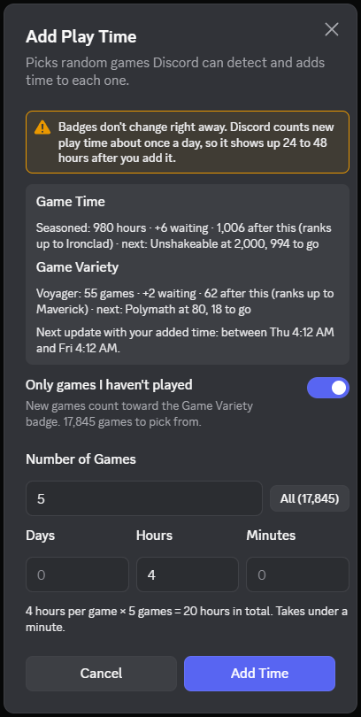

</details>

<details>
<summary><b>What it needs, and settings</b></summary>

**What it needs**

- **Turn on both "Use data" options** (User Settings → Data & Privacy → **Use data to improve Discord** and **Use data to personalize my Discord experience**). Without them, Discord ignores the play time and your badges won't move.
  - These are saved on your account, on Discord's side, so no plugin can skip them.
- **Turn off other tracking blockers while adding time.** DoNotTrack, NoTrack add-ons, ad blockers and Pi-hole can stop the play-time reports from reaching Discord.
  - The Game Browser and the **Add Time** window warn you when one of these plugins is on, and a blocked run stops right away and says so.
  - Turn the blocker off, or let Discord's `/science` address through.
- **NoTrack doesn't matter here.** GameTimeSpoof works with NoTrack's "block analytics" option on or off, since it sends its own play-time reports and real games are counted once either way.
  - If you also use StreamTimeFarmer, that option has to be off, because it blocks the Streaming badge (see [StreamTimeFarmer](#streamtimefarmer)).
- **Keep "Share your detected activities with others" on** (User Settings → Activity Privacy) if you want people to see the game you spoof.
  - Play time still counts with it off, but nobody sees the game.
  - DoNotTrack's **Stop Process Monitor** option turns this off by itself. The Game Browser warns you when it's off and has a **Turn On** button.

**Settings**

- **Report real games** (on): while Discord's analytics are blocked (by NoTrack or similar), Discord stops counting games you really play, so GameTimeSpoof reports them itself. Turn it off to send nothing for real games.

</details>

<details>
<summary><b>Things to know</b></summary>

- Badges don't update right away. Discord doesn't publish a schedule, so new play time can take many hours to show up.
- There's no cap on games or time. Big runs just take longer, and if Discord asks it to slow down, it waits and carries on.
- It uses discord.com (Discord's own API) for the list of detectable games, game pages, the play-time reports that badges are counted from, and your own badge progress and play history (read only), and cdn.discordapp.com for game cover art and icons. Everything it does is in the plugin's own files.

</details>

---

### StreamTimeFarmer

`streamTimeFarmer` · Off by default · Desktop app

**Connects to:** discord.com and Discord's voice servers, plus GitHub for Equicord's web build. Details below.

Earns Streaming badge time by streaming to a second account of yours, which runs hidden inside your same Discord. No second Discord install needed.

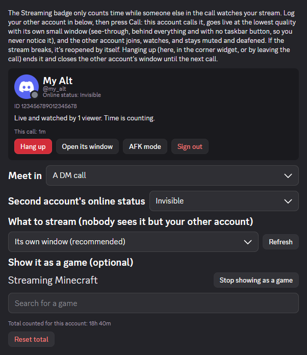 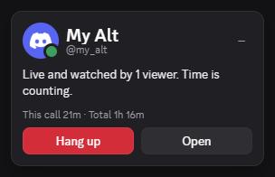

**What it does**
- **Logs in your second account once** (QR code or email and password), then runs it hidden. Calls only ever go to that account.
- **Call** starts a DM call. Your account goes live at 480p / 5 fps and the second account watches, muted and deafened.
- Fixes itself when either account drops or the stream breaks.
- Can show your stream as "Streaming <game>" (optional).
- Reports the time regularly (every hour by default), so a crash doesn't lose it all.
- **AFK mode** for leaving it running for hours or days, at about half the CPU.
- Checks your settings on both accounts and shows each one green or red.

> [!IMPORTANT]
> **Equicord blocks the Streaming badge by default.** StreamTimeFarmer shows what to change and has a **Fix these for me** button. Details under "Settings" below.

<details>
<summary><b>How to use it</b></summary>

**Setup**

1. Turn on **StreamTimeFarmer** in Discord (User Settings, then Plugins), or press **Log in to second account** in its settings, which turns it on for you. If its settings say to quit Discord fully, do that once (right-click Discord's tray icon, then **Quit Discord**) and open it again.
2. Press **Log in to second account**. A warning first explains what it does (it turns the plugin on and runs a hidden second Discord). Press **Log in**, then log your other account in once (QR code or email and password) in the window that opens. The settings then show its picture, name, tag and ID.

   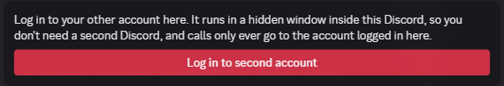

   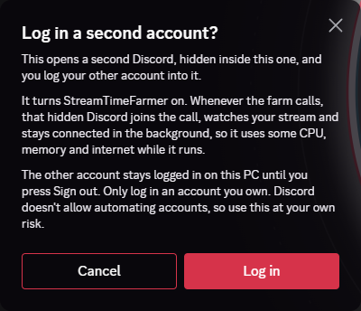

3. Press **Call** (in the settings or in the small call widget in the bottom-right corner).
   - Your account calls the second one in DMs, mutes itself and goes live with its own small window.
   - That window sits in the bottom-right corner behind everything, see-through and click-through, with no taskbar button. It shows only its name (or the game's cover), a ticking clock of how long it's been streaming and a moving bar.
   - You can pick the screen or another window instead. Only your second account sees it.
   - The second account joins, mutes, deafens itself (so nothing can feed back) and watches.
   - Prefer a server? Pick **A server voice channel** instead of the DM call.

**Stopping and managing it**
- **Hang up** in the widget or settings, or leave the call in Discord. This ends the stream and fully closes the second account's window. Its login stays saved, so the next Call starts straight away.
- **Open** shows its window as a small panel if you want to see or control it.
- **Sign out** forgets it.

</details>

<details>
<summary><b>While it runs</b></summary>

- The farm only adds time while the second account is really watching. The widget and settings show what's happening and the time counted.
- If either account drops, they reconnect on their own.
- If the stream fails (like Discord's error 2012), gets stuck paused, or Discord says no picture is getting through, the second account reopens it, and your account restarts Go Live (and reopens its window if something closed it). Time doesn't count while it's broken.
- **Show it as a game** (optional): search for a game and pick it. The farm's window takes that game's name and cover art, and Discord's own game detection is told the window is that game, so your stream shows as "Streaming <game>" and your profile as playing it. The game itself never runs; the picture is still the farm's window.
  - If another plugin (gameSessionSpoofer) is already showing a game, the window streams as itself until that ends, so the two don't fight.

**AFK mode** (the **AFK** button during a call):
- Discord is hidden behind a black screen that shows your total streaming time, how long the current call has run and whether it's counting.
- Discord then uses about half the CPU and next to no graphics card. The call and stream keep going.
- Press **Esc twice** to come back.
- While it's on, your keyboard doesn't reach Discord, so nothing gets typed into a chat by accident.
- If Discord restarts, it comes back in AFK mode.

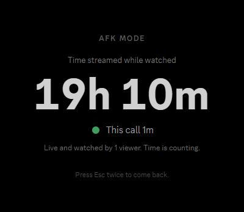

</details>

<details>
<summary><b>Settings</b></summary>

**What the badge needs, on both accounts**

Discord adds up streaming time from the report your Discord sends when a stream ends. Equicord's NoTrack plugin ("Block Discord's tracking analytics", on by default) throws that report away, so no stream counts, farmed or real.

- NoTrack's **Block Discord's tracking analytics** must be **off** (then restart Discord).
- Data & Privacy → **Use data to personalize my Discord experience** must be **on** (Discord's own badge article asks for this one).
- Data & Privacy → **Use data to improve Discord** should be **on** (recommended; it's not known whether Discord ignores reports without it).

StreamTimeFarmer checks all of them on both accounts (your second account's while it's in a call) and shows each one in green when it's right and red when it isn't, in its settings and in the corner call widget (the minimized widget gets a red ring).

**Fix these for me** changes what's red after a confirm box that lists every change. If your NoTrack changed, it then asks to restart Discord (NoTrack keeps blocking until you do), and the second account's hidden Discord reloads and rejoins the call by itself.

It also names other plugins that may block the reports, and warns when a report that should have gone out never reached Discord (an ad blocker or Pi-hole, say). Time streamed while they were blocking was never reported and can't be added back.

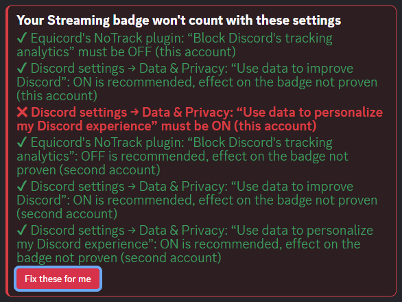 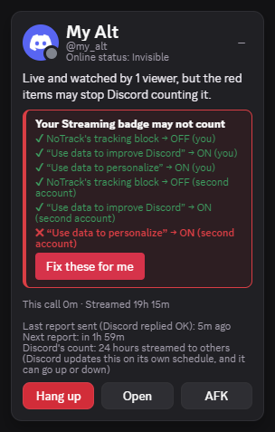

**Plugin settings**

- **Second account's online status** (default: leave as is): sets it to Online, Idle, Do Not Disturb or Invisible each time it starts.
  - It's that account's own Discord setting, so it changes everywhere it's logged in.
- **Quiet Second Account** (on): keeps the second account's unreads off your taskbar badge and stops its desktop notifications.
- **Mute Call Sounds** (on): silences Discord's call sounds while the farm runs, so restarts stay quiet on your PC: calling and ringing, Go Live starting and ending, joins and leaves, mute and deafen.
  - Real incoming calls ring silently too, but their popup still shows. Message sounds stay on.
- **Keep Computer Awake** (off): stops your PC from sleeping on its own while the farm or AFK mode runs. Choosing Sleep yourself or closing a laptop lid still works.
- **Report Every** (every hour): ends and restarts Go Live this often so the time so far gets sent. Pick 30 minutes, 1, 2 or 4 hours, or Never.
  - It goes by time really watched. The call and the second account stay during the restart.

</details>

<details>
<summary><b>Things to know</b></summary>

- Discord only counts streaming with someone else in the call, and nobody has shown made-up stream time counting, so the farm streams for real.
- Discord only counts a stream's time when the stream ends, so a stream left running for days would count nothing until then. That's why **Report Every** restarts Go Live: a crash then only loses the time since the last report.
- Quitting or reloading Discord sends the time so far as it closes. A crash, a kill or Discord's own relaunch still lose the time since the last report.
- The widget and settings show when the last report was sent and Discord replied OK, when the next one goes out, and Discord's own count for the badge, which it updates on its own schedule and can go up or down.
- Each report restart plays Discord's stream sounds unless **Mute Call Sounds** is on. **Mute Call Sounds** can't change what other people in the call hear, so a DM call with your second account is the quiet choice.
- The dot on the second account's picture in the widget and settings shows its real online status, with the name next to it. It shows Offline while it isn't running.
- The second account's window shares one program with your Discord, so without **Quiet Second Account** your taskbar badge creeps up every time it's invited to a call and never clears. The account still receives everything; **Open** its window to read it.
- **Keep Computer Awake** also covers moments when no call is live, such as AFK mode with the farm stopped or a farm waiting to reconnect. During a call Discord already keeps the PC awake and the screen on; otherwise the screen can still turn off. Your normal sleep settings come back when both stop. Some laptops on battery can still sleep after a while.
- It needs the desktop app, and the web version of Equicord that the Cordmuffin installer builds next to it. Installers from before November 2026 don't build it; run the newest one once.
- It used to be part of GameTimeSpoof. If you used the stream farm there, updating adds StreamTimeFarmer and turns it on, with your settings and your second account's login kept.
- Settings and totals are saved per account, so two accounts on one PC don't overwrite each other.
- Your own Go Live quality is put back after each call.
- The badge itself updates on Discord's daily schedule, like the play-time badges.

</details>

<details>
<summary><b>Privacy, connections and files</b></summary>

- It uses discord.com and Discord's voice servers through Discord's own calls and Go Live, like pressing the buttons yourself. The second account's window is Discord's own web app.
- The first time that window opens, the plugin downloads Equicord's own released web build (about 3 MB), keeps it on your PC for 6 hours and fetches it again after that. So the second window always runs a current Equicord, and this plugin doesn't have to be built into it: the plugin sends the viewer half of the farm into the window itself. It works the same with the Cordmuffin installer or a self-built Equicord.
- Nothing to install for the second window: it fetches its own Equicord.
- If the download fails (no internet, GitHub blocked), the card says so and offers a **Try again** button.

</details>

---

### QuestRunner

`questRunner` · Off by default · Play quests need Windows

**Connects to:** discord.com only (plus an activity's discordsays.com page for activity achievement quests, if you turn them on).

Does your Discord quests for you. Press Accept on a quest and QuestRunner finishes it on its own. You only come back to claim the reward and solve the captcha Discord shows when you claim.

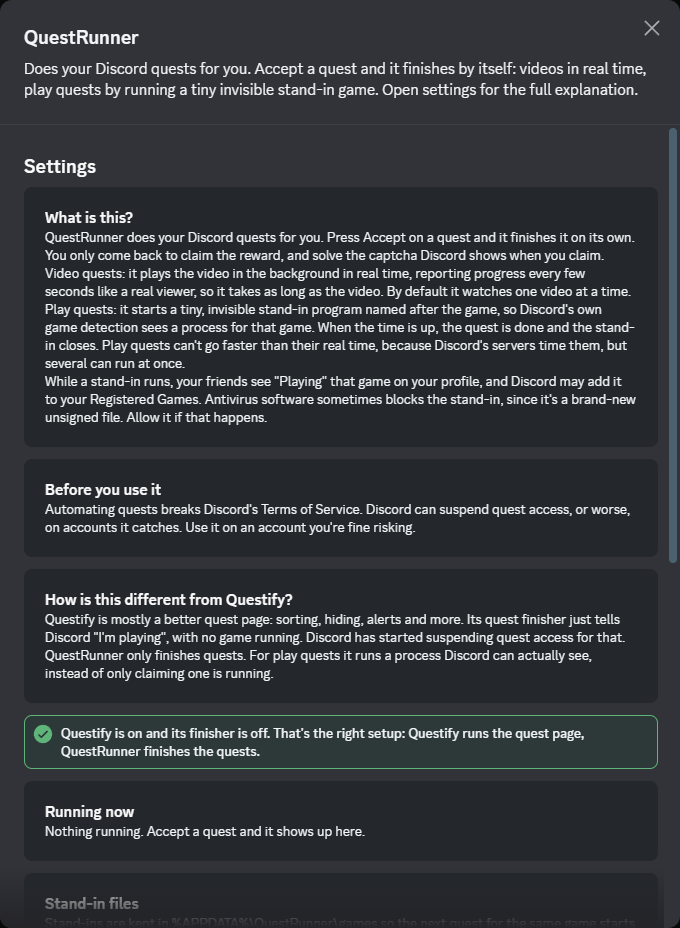

**What it does**
- Video quests play in the background in real time, reporting progress every few seconds like a real viewer. One video at a time by default.
- Play quests run a tiny, invisible stand-in program named after the game, so Discord's own game detection sees a process for it. Several can run at once. Each takes its real time, because Discord's servers time play quests.
- Optional (off by default): auto-accept new quests; finish activity and console-only quests by reporting them straight to Discord (riskier, the method Questify uses); finish activity achievement quests.
- The settings page shows what's running, what's waiting and why, and has a button to delete the stand-in files.

> [!CAUTION]
> Automating quests breaks Discord's Terms of Service. Discord can suspend quest access, or worse, on accounts it catches. Use it on an account you're fine risking.

<details>
<summary><b>How it compares to Questify</b></summary>

Questify is mostly a better quest page (sorting, hiding, alerts). Its finisher just tells Discord a game is running when none is, and Discord has started suspending quest access for that. Keep Questify for its quest page if you like it, but turn its finisher off; QuestRunner offers a button for that. Quests you hid in Questify are skipped.

</details>

<details>
<summary><b>Things to know</b></summary>

- While a stand-in runs, your friends see you "Playing" that game, and Discord may add it to your Registered Games.
- Game detection has to be on in Discord (User Settings, then Activity Privacy).
- Antivirus software sometimes blocks the stand-in, since it's a brand-new unsigned file. Allow it if that happens. Its source is in `questRunner/stub/stub.c`, and `stub/build.cmd` rebuilds it.
- Stand-ins close when Discord closes, and only work on Windows.

</details>

<details>
<summary><b>Privacy, connections and files</b></summary>

**What it talks to:** only discord.com (Discord's own quest API). Activity achievement quests, if you turn them on, also talk to that activity's `discordsays.com` page.

**Where files go:** stand-ins are kept in `%APPDATA%\QuestRunner\games`, each under 300 KB.

</details>

---

### PlatformSpoofer+

`platformSpooferPlus` · Off by default

**Connects to:** nothing. It only changes what your Discord already sends to Discord.

Choose which platform others see you on: phone, console, VR headset, web or desktop. It replaces the PlatformSpoofer Equicord removed (2026-11-03), rebuilt from scratch without the random logouts.


**What it does**
- Adds a button next to mute and deafen. Click it to flip between your real platform and the last one you picked. Right-click it to pick any of them.
- Switches live: Discord reconnects for a second, no restart.
- Spoofs from the very first connect, so you never flash up as desktop first.
- Sends it the way the real apps do (Android app, Xbox app, a real browser name).
- Turning the plugin off puts your real platform back right away.

> [!CAUTION]
> **Use at your own risk.** Changing what platform you report is against Discord's rules. Discord also turns some features on per platform, so things like Quests or Orbs may hide while you show as something else. Switch back if something you need disappears.

<details>
<summary><b>How to use it</b></summary>

- The button's icon shows what you look like right now. You can hide it in the settings.

  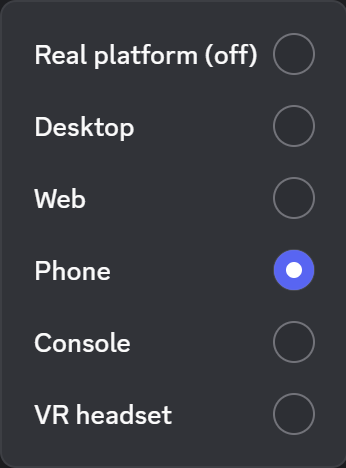

- **Right-click yourself → Show me as**, the **Platform** setting, or **`/platform`** (run it empty to see what Discord shows you as right now) do the same as the button.
- Only turning the plugin on the first time needs one restart, like any plugin that changes Discord's code.
- After each switch a message says what Discord now shows you as. The settings page has a **What Discord sees right now** panel listing every session on your account and how Discord sees it.

  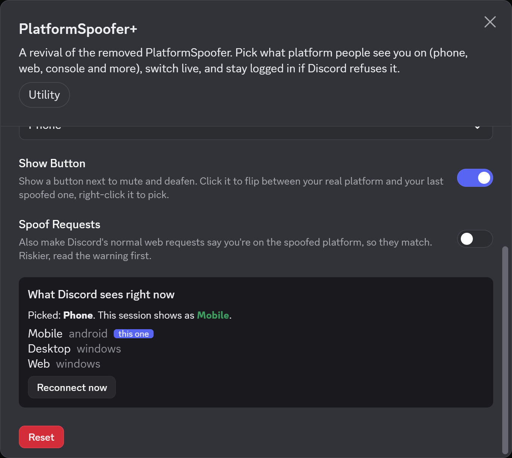

</details>

<details>
<summary><b>What people see</b></summary>

| You pick | Others see |
|---|---|
| Phone | The phone icon next to your status |
| VR headset | The VR icon |
| Console | Console (shown by plugins like PlatformIndicators) |
| Web / Desktop | No special icon |

The phone icon only shows while you're Online; that's how Discord works. Your other devices still show up as themselves.

</details>

<details>
<summary><b>What's different from the old PlatformSpoofer</b></summary>

- The old plugin logged people out because Discord sometimes refuses a spoofed connection with an "authentication failed" code, and Discord's app treats that code as "log out now". PlatformSpoofer+ catches that one case: you stay logged in, get put back on your real platform, and the button says Discord refused it (click it to try again). If your login really did expire or got revoked, Discord still logs you out like normal.
- Discord's desktop app opens its connection before plugins load. The plugin skips that early connection while a spoof is on.
- Phone is sent like the Android app, Console like the Xbox app, and Web uses a real browser name instead of the made-up "Discord Web".
- When you turn the plugin off, its button, menu and command go away with it.
- If you used the old PlatformSpoofer, your pick carries over by itself.

</details>

<details>
<summary><b>Spoof web requests too (off by default, riskier)</b></summary>

Normally only the live connection is changed, and Discord's normal web requests still say what you really are. This option makes them match the platform you picked, from the very first request after Discord starts.

Turning it on shows a warning first, and nothing changes until you click **Turn it on**. It's riskier: Discord picks some features and tests by platform from those requests, so parts of Discord can change or break, and Discord sees more of the spoof. Turn it off if anything acts weird. The sign-in page always stays real.

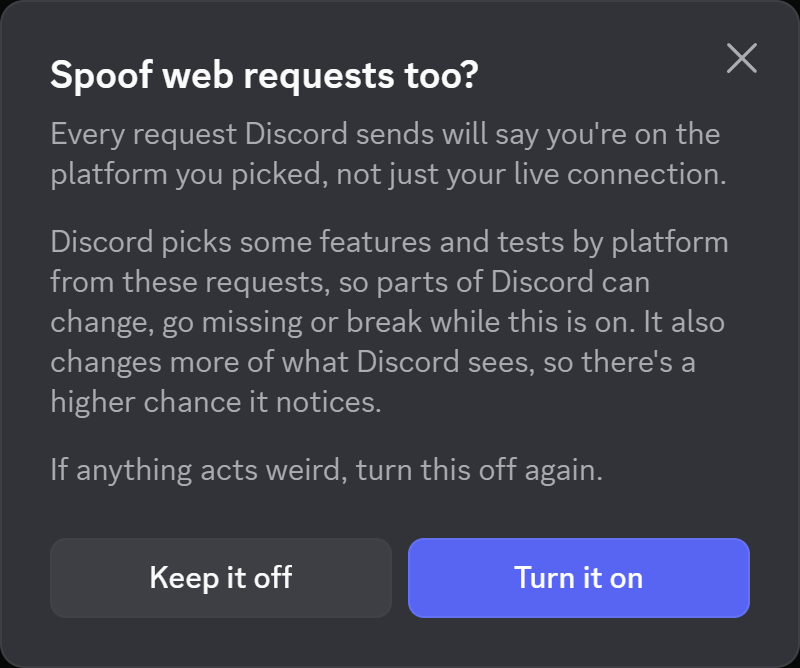

</details>

---

### Ransom

`ransom` · Off by default · Desktop app

**Connects to:** static.wikitide.net (the DOORS wiki's files) while **Doors Assets** is on. Details below.

A harmless jump-scare game: Ransom from DOORS wanders your Discord window, and if you move while it holds up its sign, it fake-"encrypts" your screen until you pay it in gold you find around Discord. Everything is visual and only on your screen.

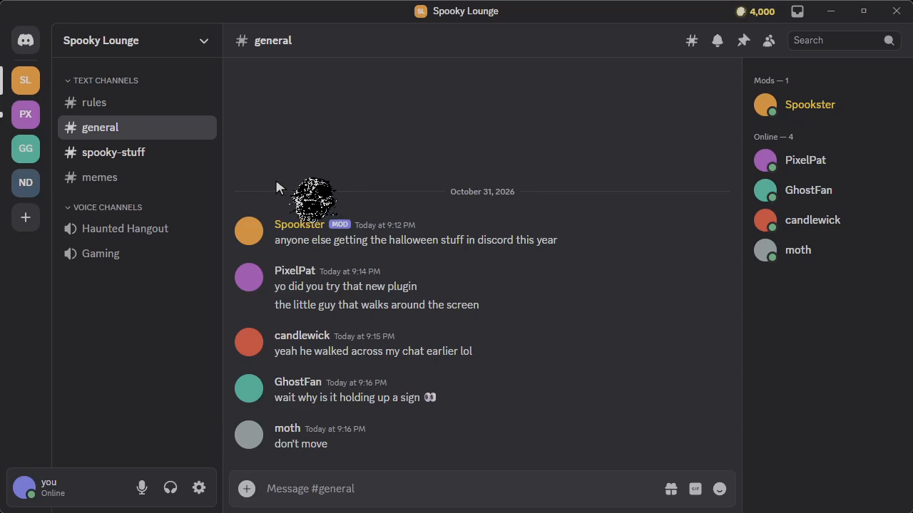

**What it does**
- Its little face wanders around the window like Oneko, and every now and then it stops and holds up its stop sign: a split second of freeze, like in the game. Hold still and Ransom leaves. Move your mouse or press a key and it catches you.
- Then names, channels and messages turn into scrambled text, the message box locks and pop-ups fill the screen. Click the gold piles around Discord to pay it off before the 90-second timer runs out.
- Run out of time and Discord falls apart. Revive with your gold, or give up and get the DOORS death screen.
- Loose gold and hidden items turn up around Discord for you to collect.
- The Ransom panel shows your gold, items and scores.
- Nothing is really encrypted or deleted, and nobody else sees any of it.

<details>
<summary><b>How it plays</b></summary>

- Spam clicking costs you gold. Paying it off always drops a Honey Pot.
- If time runs out, Discord stays broken until you revive with all your gold (at least 1,000). Give up and you get the DOORS death screen with the Guiding Light and its music, then an overview of your run.
- Like the gold in DOORS drawers, a small pile of loose gold turns up somewhere in Discord now and then. Taking it brings Ransom sooner.
- Sometimes a small spooky item hides in a DM or server channel when you open it. Click it to collect it. Losing a ransom can take up to 3 hidden items.
- The Ransom panel is in the Equicord toolbox (**Open Ransom**), and you can revive from there. The toolbox also has **Try a challenge** and **Drop some gold**.

| 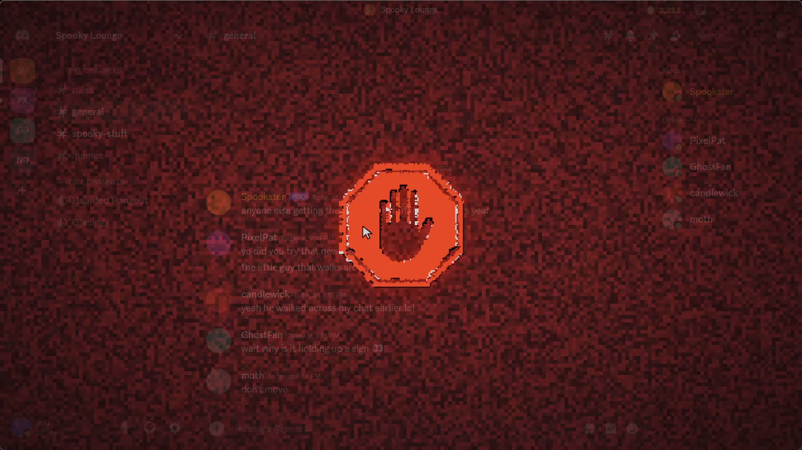<br>The stop sign | 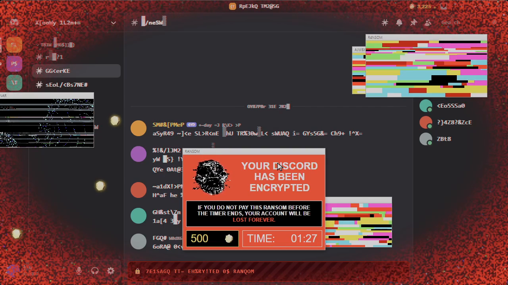<br>Discord encrypted, with the ransom window and its timer |
|---|---|
| 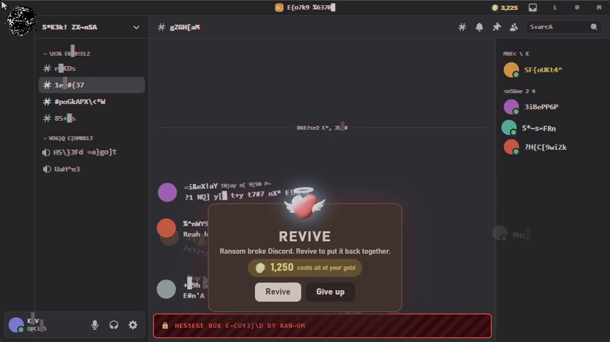<br>The revive card | 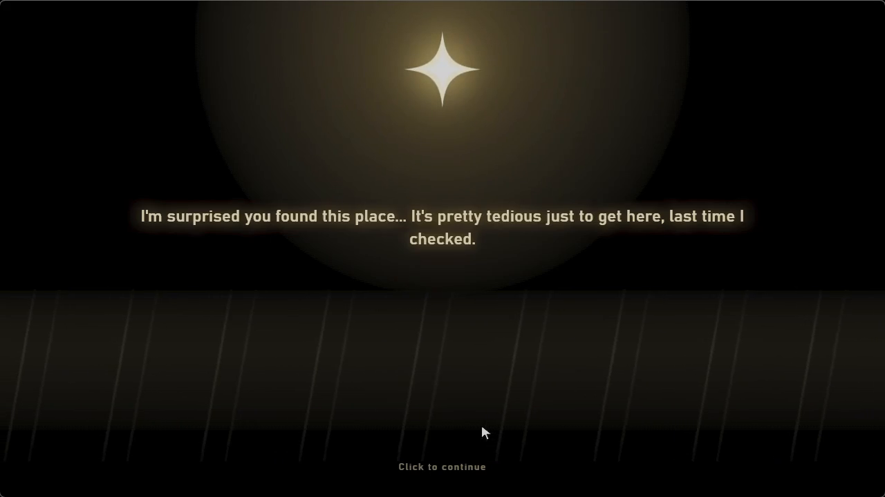<br>The death screen |

<p align="center">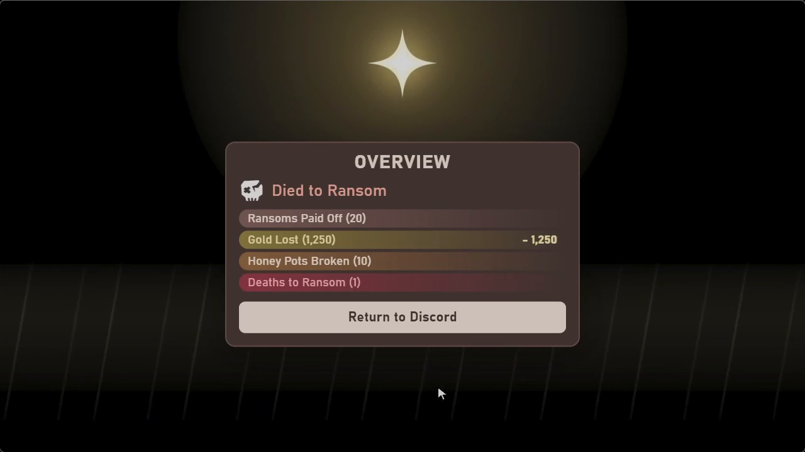<br>The overview after dying</p>

</details>

<details>
<summary><b>Settings</b></summary>

- Turn the wandering, the challenges, loose gold and hidden items on or off one by one.
- How often challenges can happen, how much gold Ransom asks for, and how fast and big it is.
- **Break UI** (Discord falls apart) and **Encrypt UI** (scrambled text) can be turned off. Both are only visual and everything comes back when it ends.
- **See Through** tints the sign and download screens red instead of solid, so you can still read your chat.
- **Jumpscare** with its own volume, or a plain "TIME'S UP" screen instead.
- **Calm Effects:** no flashing, softer static and shaking.
- Challenges can be kept away while you're typing or in a voice call or stream.

</details>

<details>
<summary><b>Things to know</b></summary>

- The wait between challenges only counts down while you're actually using Discord, never while it's in the background, idle or you're in a call.
- Works in the Discord desktop app with Equicord, not in Discord on the web.

</details>

<details>
<summary><b>Privacy, connections and files</b></summary>

**What it talks to:** static.wikitide.net, the DOORS wiki's files (Ransom's sprites, pop-ups, sounds and music), only while **Doors Assets** is on (it's on by default). With it off, or if a download fails, plain stand-ins are used.

**Where files go:** `%APPDATA%\discord\RansomPlugin` (the downloaded DOORS files). Your gold, items and scores stay inside Discord.

</details>

> [!NOTE]
> Ransom, its art, sounds and music belong to LSPLASH, the makers of DOORS. They aren't in this repo: the plugin downloads them from the DOORS wiki. This plugin is unofficial and not made or supported by them.

---

## Building it yourself

**Repo layout**
- `custom-creations/`: one folder per plugin
- `equicord-installer/`: the Go installer
- `docs/`: screenshots used in this README
- `tools/patchtest/`: checks whether a plugin's patches still fit the Discord you have open

**The installer** needs [Go](https://go.dev) 1.27 or newer (see `equicord-installer/go.mod`).

```bash
cd equicord-installer
go build -trimpath -ldflags "-s -w" -o "Cordmuffin Equicord Installer.exe" .
```

**Using the plugins without the installer:** copy any folder from `custom-creations` into your Equicord checkout's `src/userplugins`, then run `pnpm build && pnpm inject`.

**Making the release zip:**
- Run `equicord-installer/build-release.ps1 -Version 1.2.3` in PowerShell, with the version you'll tag the release as (`v1.2.3`). The background updater compares the two to find a newer installer.
- It only packs the installer and the empty **Plugins Go Here** and **Themes Go Here** folders, and stops if anything else would end up in the zip.
- Upload both files it makes, the zip and `Cordmuffin Equicord Installer.zip.sha256`. The background updater checks a new installer against the checksum before using it.

## Issues

[Open an issue](../../issues) for bugs or questions. Please include which plugin, what you did and what happened. For install or update problems, attach `install.log` or `update.log` from `%LOCALAPPDATA%\Cordmuffin`.

## License

GPL-3.0. See [LICENSE](LICENSE).
