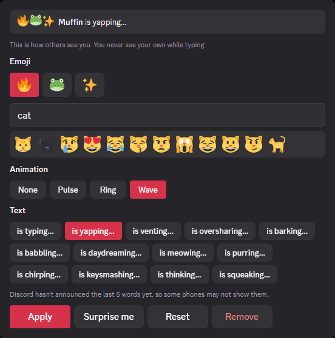

# OfficialCustomTypingIndicator

Set your typing indicator from desktop: 3 emoji, an animation, and a word like "is yapping…" in place of "is typing…".

**This is Discord's own feature, not something the plugin made up.** Discord calls it [Custom Typing Indicator](https://support.discord.com/hc/en-us/articles/42962943077271-Custom-Typing-Indicator-FAQ). It's a Nitro perk that so far you can only set up in the phone app. This plugin lets you set it from desktop too. What you pick is saved on your Discord account, the same as setting it on your phone.

## Who sees it

- **People on an up-to-date Discord phone app see your style without any plugin.** Discord shows it to them itself. It's still rolling out, so a few people may see the normal dots for a little while.
- **Desktop and web Discord don't show it yet.** They get your style from Discord but still draw the plain dots. Desktop users with this plugin see it too.
- **You never see your own while you type.** Discord doesn't show you your own typing. The preview in the plugin settings shows how it looks to others.
- It only shows when you're the only one typing. Once two or more people are typing, everyone goes back to "is typing…". That's Discord's rule.
- In a server with **Use External Emoji** turned off, people there see the normal dots instead of emoji from other servers. They still see your word.

## What you need

- **Nitro.** Nitro Basic isn't enough. Discord won't save it without Nitro. That's Discord's rule too.
- **Your account in Discord's rollout.** Discord says every Nitro user gets it within the next few weeks. If you have Nitro and your phone app shows **Settings → App Settings → Typing Indicator**, you're in.

## How to use it

Open the plugin's settings:

1. **Pick 3 emoji.** Your first pick fills all 3 slots, like on the phone. Then click a slot and pick another emoji to swap it in. You can search by name (`thumbs_up`, `+1`) or type an emoji in. Your default skin tone is used.
2. **Pick an animation:** None, Pulse, Ring or Wave.
3. **Pick a word.** These are the ones Discord's FAQ lists: yapping, venting, oversharing, barking, babbling, daydreaming, meowing. Discord's code also has purring, chirping, keysmashing, thinking and squeaking, but hasn't announced them yet, so some phones may not show those. "typing" is the normal word.
4. **Click Apply.**

**Surprise me** picks a random combo (only from the announced words). **Reset** undoes changes you haven't applied. **Remove** puts you back on the normal dots.

## Good to know

- **How saving works:** Discord only accepts this setting from its phone app. On that one save, the plugin tells Discord the request comes from the Android app. Nothing else you do in Discord is changed.
- **Captcha:** Discord sometimes asks for a captcha when you save. Solve it and the save goes through. Saving a lot in a short time makes it ask more often.
- If it says **"Discord didn't save it"** and you have full Nitro: your account may not have the feature yet, or Discord now needs a newer app version than the plugin sends. Report it so the version can be bumped.
- **Show other people's** is on by default. Turn it off to see plain dots everywhere.
- Animated emoji play only if Discord's **Play animated emoji** setting is on. They stop when Discord's window isn't focused. **Reduced Motion** (Accessibility) stops all the motion.

## What this plugin loads and calls out to

**Nothing new.** It talks only to Discord, through Discord's own connection. Emoji images come from Discord's own image server.
